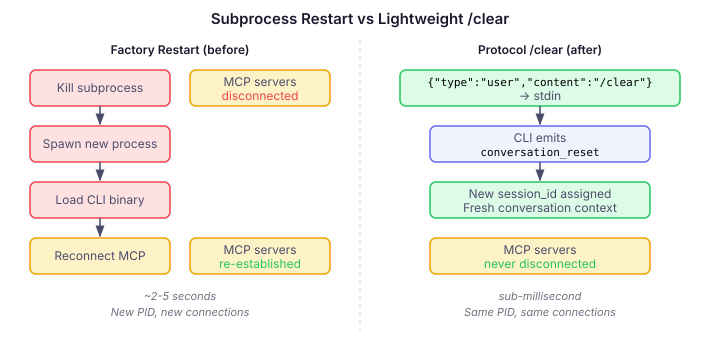
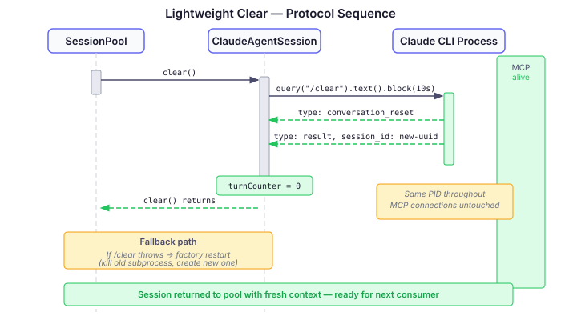

# The Clear That Doesn't Kill

*Continues from [The Reset That Never Was](2026-11-02-mdp03-the-reset-that-never-was.md), where we discovered that `clear()` was a no-op and fixed it with a subprocess-restart factory. This entry is about what happens when you look at that fix and ask: does it have to be this expensive?*

The factory-based `clear()` works. It kills the old subprocess, creates a fresh one, and the session goes back in the pool with a clean slate. The architecture is correct. But killing a subprocess is not free.

Every `ClaudeAsyncClient` wraps a Claude CLI process. That process loads the binary, parses configuration, and — this is the expensive part — establishes connections to every configured MCP server. In a system with multiple MCP tools wired in, the reconnection cost dominates. A clear that takes two to five seconds isn't a clear at all in a real-time multi-agent scenario. It's a stall.

## What If /clear Works In Stream-JSON Mode?

The Claude CLI in interactive mode supports `/clear` as a slash command. Type it, the conversation resets, the process keeps running. I'd assumed this was an interactive-only feature — the stream-json protocol uses structured JSON messages, not raw text commands.

Claude and I tested it. We spawned a CLI subprocess with `--input-format stream-json --output-format stream-json`, sent a normal user message, then sent `/clear` as the content of a second user message:

```json
{"type":"user","message":{"role":"user","content":"/clear"},"session_id":"default"}
```

Three things came back:

1. A `conversation_reset` message — a type I'd never seen in the protocol
2. A `result` message with a **new** `session_id`
3. Silence — the process was still alive, waiting for the next message

The subprocess survived. Same PID. Same MCP connections. We sent a follow-up query and it responded normally, with no memory of the first conversation.

## The Protocol Nobody Documented

The stream-json protocol is largely undocumented beyond the CLI flag itself. The community SDK handles `user`, `control_request`, `control_response`, and `rate_limit_event` message types — those are the four that appear in the SDK's source. `conversation_reset` is not among them. The SDK's message parser silently skips any type it doesn't recognise, which is why nobody noticed the CLI could do this.

The practical consequence: slash commands embedded in user message content are processed by the CLI before being sent to the model. This isn't just `/clear` — it's the entire slash command vocabulary, available to any process that controls the stdin stream. Since the platform spawns every subprocess itself through `ClaudeAgentClient.openSession()`, we control the input stream completely. There's no shared interactive user to collide with.



## The Implementation

The change is in `ClaudeAgentSession.clear()` — the same method that was an empty body two days ago and a factory restart yesterday. The new version tries the lightweight path first:

```java
if (sdkClient != null && sessionStarted.get()) {
    try {
        sdkClient.query("/clear").text().block(Duration.ofSeconds(10));
        turnCounter.set(0);
        LOG.infof("Agent session cleared (lightweight) [correlationId=%s]",
            correlationId);
        return;
    } catch (final Exception e) {
        LOG.warnf("lightweight failed, falling back to restart [correlationId=%s]",
            correlationId, e.getMessage());
    }
}
// ... factory restart as before
```

The `sdkClient.query("/clear")` call uses the SDK's own query mechanism — no special transport handling needed. The response goes through the normal turn lifecycle. The `conversation_reset` message is silently skipped by `MessageEventMapper` (it only processes `AssistantMessage`, `ResultMessage`, and `UserMessage`). The `result` message completes the turn and the `block()` returns.

If anything goes wrong — the CLI doesn't support `/clear`, the call times out, the process has died — the catch block falls through to the factory restart. Same behaviour as before. The lightweight path is an optimisation, not a requirement.



## What the Session Pool Sees

Nothing changes above `ClaudeAgentSession`. The `AgentSession.clear()` contract is `void` — no return value, no change in semantics. `ManagedSession` calls `clear()` through its clearing policies (`EVERY_CALL`, `AFTER_N_TURNS`, `SIZE_AWARE`) and gets the same result: a session with fresh context, ready for the next consumer.

The difference is invisible at the API boundary and measurable at the system level. A session pool running `SIZE_AWARE` with a 80,000-token threshold now clears in under a millisecond instead of two to five seconds. In a seventeen-character simulation where each character has its own session and clears happen at tick boundaries, that's the difference between a barely-noticeable pause and a multi-second stall across the entire system.

## The Provider Abstraction

One thing I checked after the implementation: does this tie us to Claude? It doesn't. `AgentSession` is the provider-agnostic interface in `agent-api`. The `/clear` message is a `ClaudeAgentSession` implementation detail, no different from how an OpenAI backend might reset its `ChatMemory` or a Gemini backend might drop its message history.

What I did find is that every non-Claude backend — OpenAI, Gemini, Gemini CLI, Codex — throws `UnsupportedOperationException` from `openSession()`. They're single-shot only. No sessions means no conversation state, which means `clear()` is irrelevant for all of them right now. The abstraction is correct and ready — it's waiting for backends to catch up.

## The Pattern

Three days, three versions of `clear()`:

1. **Empty method body** — the clearing policies fire, the counter resets, the session is unchanged
2. **Factory restart** — kills the subprocess, creates a new one, MCP servers reconnect
3. **Protocol clear** — sends `/clear` through the existing connection, subprocess and MCP survive

Each version is a correct fix for the problem it addresses. The empty body was a placeholder waiting for the SDK to support clearing. The factory restart made clearing work at all. The protocol clear makes clearing fast enough to use in production without thinking about it.

The progression matters because it maps to how platform capabilities actually evolve. You don't jump from broken to optimal. You go from broken to correct, then from correct to fast. Trying to skip the middle step — going straight to the protocol-level optimisation without first proving that subprocess restart works — would have meant debugging two things at once: whether clearing works at all, and whether this specific mechanism is reliable. The factory restart separated those concerns.

The fallback structure preserves this separation permanently. If the lightweight path fails on a future CLI version, the factory restart is still there. The system degrades to slow-but-correct rather than broken.
