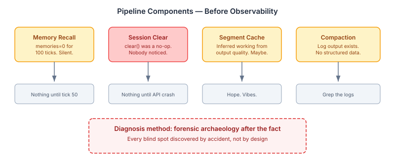
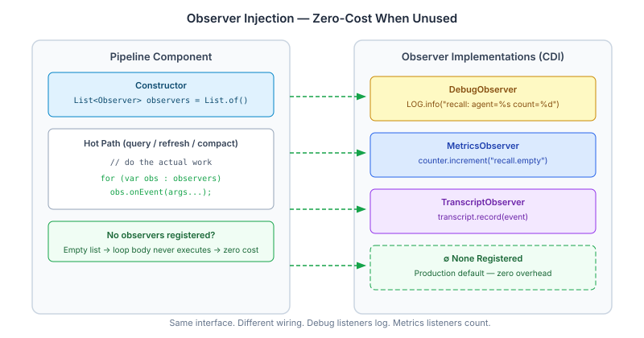

# The Pipelines That Couldn't Speak

*Continues from [The Clear That Doesn't Kill](2026-11-02-mdp04-the-clear-that-doesnt-kill.md), where we fixed session clearing with a lightweight protocol reset. This entry is about the reason we didn't catch that bug — or any of the others — until it was too late.*

The ERA6 validation run was 100 ticks, 17 characters, GENERIC profile. By all observable measures, it worked. Characters talked, moved, reacted. Drives adapted. Consolidation ran. The output read like a functioning cognitive system.

It was lying by omission.

## Four Blind Spots

Memory recall returned zero results for all 100 ticks. Not because memory was empty — because the domain label on the query didn't match the domain label on the stored memories. A string mismatch. The kind of bug you'd catch in five minutes with a log line that prints the recall count. We didn't have that log line. We found it at tick 50, by accident, because someone noticed a `memories=0` field buried in an `[observation-assembly]` debug dump.

Session clearing was a no-op. `ManagedSession` tracked token usage, decided the context was too large, called `clear()` on the delegate, reset its own counter, and moved on. The delegate's `clear()` was an empty method body. The conversation grew unbounded. We found this because at 80,000 tokens the API started returning errors. Not because anything in the system told us clearing wasn't working.

The segment cache — the component that injects condensed history into prompts so characters remember what happened — we *inferred* it was working from the quality of character output. The characters seemed to know who Clara was after a context reset. Seemed to. We had no direct evidence: no count of how many condensed nodes were read, how many recent nodes were included, what the token budget was versus what was actually injected. It could have been serving empty strings and the LLM filling in plausible continuity from context. We'd have had no way to tell.

Observation compaction had basic log lines — `"peter: compacted 12 observation nodes"`. Better than nothing. But no structured data: no input/output ratios, no timing, no per-character breakdown. If compaction was silently producing garbage output, the log wouldn't tell you.



Every one of these failures was discovered by forensic archaeology. Grepping logs. Staring at output. Noticing something felt wrong and then spending an hour proving it. This is the diagnostic method of a system without observability: you wait for something to break, then you figure out what was already broken.

## The Problem With Silent Pipelines

Traditional software has a standard observability stack: metrics, logs, traces. You instrument your HTTP endpoints, your database queries, your message queues. The tooling exists. The patterns are well-understood. You don't ship a web service without knowing its request latency and error rate.

Cognitive agent pipelines don't have this yet. Memory retrieval, personality synthesis, context management, sleep-cycle consolidation — these are internal cognitive operations, not request/response pairs. They don't have natural metric boundaries. They're not "requests" in any conventional sense. And because they happen inside the agent's reasoning loop rather than at system boundaries, the instinct to instrument them is weak.

But the consequence of not instrumenting them is the same: you find out your system is broken when the symptoms become visible to end users. In a web service, that's a 500 error. In a cognitive agent, it's a character who doesn't remember what happened five minutes ago, and you can't tell whether that's a memory bug, a retrieval bug, a cache bug, or the LLM just making things up.

## The Design: @FunctionalInterface Observers

The fix is four `@FunctionalInterface` observers — one per pipeline blind spot:

```java
@FunctionalInterface
public interface MemoryRecallObserver {
    void onRecall(String agentId, String domain, int resultCount);
}
```

```java
@FunctionalInterface
public interface SessionClearObserver {
    void onClearAttempt(String sessionId, int estimatedTokens,
                        boolean actuallyCleared);
}
```

```java
@FunctionalInterface
public interface ObservationCacheObserver {
    void onRefresh(String agentId, int condensedNodes, int recentNodes,
                   int tokenBudget, int actualTokens);
}
```

```java
@FunctionalInterface
public interface CompactionObserver {
    void onCompaction(String agentId, int inputNodes, int outputNodes,
                      long elapsedMs);
}
```

These are observation-only — they don't affect pipeline behaviour. They fire after the work is done, reporting what happened. The method signatures carry exactly the information that would have caught each of the ERA6 blind spots:

`MemoryRecallObserver` with `resultCount=0` at tick 1 would have caught the domain mismatch immediately. Not at tick 50.

`SessionClearObserver` with `actuallyCleared=false` would have shown that clearing was a no-op on the first attempt. Not when the API crashed.

`ObservationCacheObserver` with `condensedNodes=0, recentNodes=0` would have told us the cache was empty — no guessing from output quality.

`CompactionObserver` with `elapsedMs` and `inputNodes/outputNodes` gives compaction ratios and timing as structured data, not grep-the-logs.

## Why @FunctionalInterface and Not Events

CDI events (`@Observes`) would work. So would Vert.x event bus messages. The reason I went with `@FunctionalInterface` and constructor injection is zero-cost default.



A `List<Observer>` defaults to `List.of()`. The for-each loop over an empty list compiles to nothing. No CDI proxy. No event bus lookup. No annotation processing. The pipeline code looks identical whether zero observers or five observers are registered — the only difference is what gets passed into the constructor.

```java
public CognitiveMemoryRetriever(CaseMemoryStore store,
                                 List<ModulationFactor<Memory>> staticFactors,
                                 List<ContextualModulationFactory<Memory>> contextualFactories,
                                 List<MemoryRecallObserver> observers) {
    // ...
    this.observers = observers.isEmpty() ? List.of() : List.copyOf(observers);
}
```

The CDI container that creates these pipeline components can inject `Instance<MemoryRecallObserver>`, collect all registered implementations, and pass them in. In production with no observers registered, the list is empty. In a diagnostic scenario, a `@Singleton` debug observer logs every recall event. In a metrics scenario, a Micrometer observer counts empty recalls. Same interface, different wiring.

The backwards-compatible constructor overloads mean every existing caller — every test, every factory, every CDI producer — continues to work without change. The observer parameter is additive.

## Where They Live

Three of the four observers live in neocortex's `cognitive-observability-api` — the existing module for cognitive pipeline observability. `SessionClearObserver` lives in platform's `agent-api`, because session management is a platform concern and platform should not depend on neocortex.

The wiring crosses three repositories:

| Observer | Interface module | Wired into |
|----------|-----------------|------------|
| `MemoryRecallObserver` | neocortex | `CognitiveMemoryRetriever.query()` |
| `SessionClearObserver` | platform | `ManagedSession` — all clearing paths |
| `ObservationCacheObserver` | neocortex | `ObservationSegmentCache.refresh()` |
| `CompactionObserver` | neocortex | `ObservationCompactionPhase.compactSubgraph()` |

The module boundary decision matters. `SessionClearObserver` could have gone into neocortex alongside the others for package consistency. But that would have made platform's `agent-session-core` depend on neocortex — a coupling that doesn't exist today and shouldn't exist tomorrow. Session clearing is provider-agnostic; the observer that watches it should live where sessions are defined.

## The Pattern for Cognitive Agent Builders

If you're building LLM agents with pipelines that run between the user and the model — memory retrieval, context assembly, persona injection, summarisation, anything — you have the same problem we had. Your pipelines are silent. You'll find out they're broken when the output looks wrong, and you'll spend hours proving what a single observer call would have shown you in milliseconds.

The pattern is simple:

1. **Identify the pipeline seam.** Where does data enter a component and results leave? That's where the observer fires.
2. **Capture the diagnostic minimum.** Not a full trace — the three to five values that distinguish "working correctly" from "broken silently." For memory recall, that's agent ID, domain, and result count. Nothing more.
3. **Default to zero cost.** Empty list, empty loop. The observer interface exists in the API module. Implementations are optional and live wherever makes sense — a test helper, a CDI bean, a metrics adapter.
4. **Keep observation separate from behaviour.** The observer fires after the pipeline work is done. It never changes the result. It never throws. It's a read-only tap on the pipeline's output.

The hardest part isn't the implementation — it's four interfaces and four for-each loops. The hardest part is admitting you need it. The instinct is to add observability after something breaks. The ERA6 validation run proved — expensively — that by the time something breaks in a cognitive pipeline, you've already lost the evidence of when it started.

Instrument before you need to diagnose. The cost is nothing. The cost of not doing it is hours of forensic archaeology per bug.
