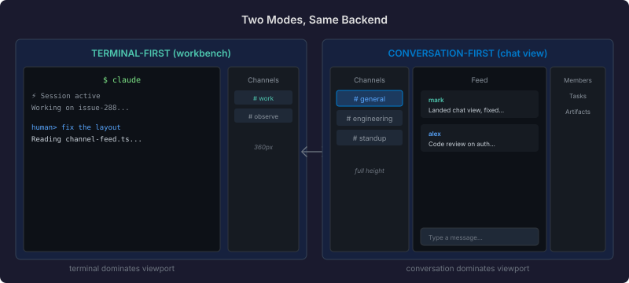

# The Conversation That Wasn't a Sidebar

Claudony started terminal-first. A Claude Code session fills the screen, and if you need channel context — what the agents are saying, what commitments are outstanding — you toggle a 360px sidebar. That design is right for watching agents work. It is not right for participating in a conversation.

The chat-app demonstrated the alternative: a full-viewport conversation workbench with channel navigation, threaded messages, reactions, member presence. But it ran its own embedded Qhorus with separate storage. Same team, same channels, different database. That gap had to close.

## Same backend, different layout

The fix was simpler than expected. Claudony already embeds Qhorus. The `agency-conversation-workbench` component from casehub-mosaic already handles channel rendering, message threading, reactions, and member panels. The chat view is a composition root — a new LitElement that wires the workbench to the same Qhorus REST API the workbench was always designed for.

A "Chat" tab alongside Sessions, Cases, Inbox, Pools, Fleet, and Mesh. Click it, and the workbench fills the viewport. Same auth, same channels, same messages. No proxy, no bridge, no separate deployment.

## The data path nobody documents

The interesting part was not the layout. It was discovering how the workbench actually receives data.

I assumed the workbench fetched channels from REST — `GET /api/channels`, render the list. It doesn't. The `ChannelStateController` receives all channel data through push dataset operations. No push connection, no channels. The workbench sat there with an empty nav and "No messages yet" in the feed, making zero API calls, waiting for data that would never arrive.

The workbench's `config.restBase` is only used for *writes* — sending messages, adding reactions. For *reads*, everything flows through a push controller that accepts dataset operations: `{ dataset: 'channels', op: 'snapshot', rows: [...] }`. Each row is a positional array — `[channelId, name, null, description, null, spaceId, spaceName, ...]` — not a JSON object. You wouldn't know this without reading the source.

The interim fix: a REST-polling shim in `connectPush` that fetches channels and messages on mount and feeds them as snapshot ops. Not real-time, but enough to render the view. The real fix is wiring `casehub-qhorus-push` — a WebSocket endpoint that pushes dataset ops as channels and messages change. That's the next session.

## A CSS spec trap three shadow DOMs deep

Once channels rendered, I clicked the emoji reaction button. The picker appeared — 344 by 400 pixels of emojis — but 957 pixels off the right edge of the screen. Invisible.

The cause: the channel-feed component wraps each message's action toolbar in a `.hover-toolbar-anchor` div. That div uses `transform: translateY(-50%)` to centre the toolbar on the message boundary. Clean CSS — until you put a `position: fixed` element inside it.

The CSS spec is unambiguous: an element with a `transform` value other than `none` establishes a new containing block for `position: fixed` descendants. The emoji picker popover, positioned at `left: 920px` with `position: fixed`, was resolving that 920px relative to the anchor instead of the viewport. Add the anchor's own viewport offset (957px) and the picker lands at 1877px — nearly 600px past the right edge of a 1280px screen.

The fix was one line: replace `transform: translateY(-50%)` with `top: -15px`. Same visual offset, no containing block. A second fix added a 200ms delay to the toolbar's `mouseleave` handler — without it, moving the mouse from the toolbar to the fixed-positioned picker triggered `mouseleave` on the anchor, dismissing the toolbar (and the picker with it) before the user could reach an emoji.

Both of these are the kind of bug you only find by running the actual UI. No unit test covers "the emoji picker appears 957 pixels off-screen because a parent three shadow DOM levels up has a CSS transform."

## Why a standalone chat view matters

Agent work platforms have a natural bias toward the agent's viewport — the terminal, the code, the execution trace. That's where the work happens. But for humans steering multiple agents, the conversation is often more important than any single terminal.

Case channels accumulate commitments, status updates, handoff notes, oversight decisions. Reading that stream in a 360px sidebar works for spot-checking. It does not work for following a thread across six channels, reviewing commitments from three agents, or composing a response that references artifacts from two different cases.

The chat view is the surface where humans participate as equals in the conversation — not peering through a narrow slit at what agents are saying, but reading and responding in the same full-width layout any team communication tool provides. Same Qhorus, same auth, same data. The only difference is which activity gets the viewport.
