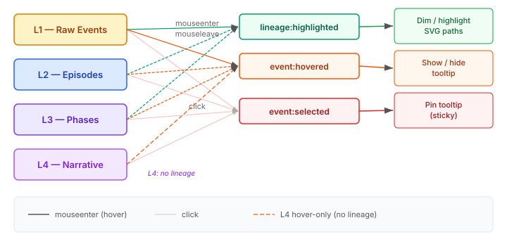

# Three Events, One Tooltip

The summarisation timeline ships with four lanes — raw events as dots, episodes as cards, phases as bars, narrative steps as blocks — connected by SVG bezier paths that trace the lineage between them. Hover an episode and the dots it summarised light up; the unrelated lanes dim to 20% opacity. It works. But the tooltip only appeared on click, which nobody discovers without being told.

The fix sounds trivial: show the tooltip on hover instead. It wasn't.

## The problem with one event doing two jobs

The original design used two custom events. `lineage:highlighted` fired on mouseenter with source and target IDs — the shell used these to dim unrelated elements and draw SVG paths between connected ones. `event:selected` fired on click with the full event data — the shell used this to position and populate a tooltip.

Making the tooltip appear on hover meant one of two things: overload `lineage:highlighted` to carry the full event object (mixing concerns — the lineage system doesn't need event data, just IDs), or overload `event:selected` to fire on both hover and click (losing the distinction between "show me a preview" and "pin this for inspection").

Neither felt right. The tooltip and the lineage highlight serve different purposes. The lineage system answers "what's connected to this?" — it needs IDs. The tooltip answers "what is this?" — it needs the data object and a position. Mixing them creates a coupling that makes both harder to change independently.

## Three events, clean separation

We added a third event: `event:hovered`. Each lane dispatches it on mouseenter with the event data and lane identifier, and on mouseleave with null. The shell handles three concerns with three events:

Each lane dispatches both `lineage:highlighted` and `event:hovered` on mouseenter. They fire synchronously, in order, as part of the same mouseenter handler. The shell processes them independently — one updates the SVG overlay, the other updates the tooltip. Neither knows about the other.

## The pinning problem

Hover-to-show is fine until you want to compare a tooltip's content with something else on screen. You hover away, the tooltip vanishes. The standard solution is click-to-pin: clicking an element locks the tooltip in place until you explicitly dismiss it.

The implementation exposed a subtle ordering question. When you click an episode card, three things happen in the same event propagation:

1. The card's click handler fires, dispatching `event:selected` (a CustomEvent, synchronous).
2. The shell's `event:selected` listener catches it and sets `_tooltipPinned = true`.
3. The native click event continues bubbling up to the lanes container, where a click-elsewhere handler would normally dismiss any pinned tooltip.

Step 3 would immediately undo step 2. We solved it with a synchronisation flag — `_selectHandledClick` — that the select handler sets and the container click handler consumes. It's a one-shot flag, reset on every container click. The ordering is guaranteed by the DOM spec: `dispatchEvent` is synchronous, so the CustomEvent listener completes before the native click continues bubbling.

Dismiss is the inverse: click on empty space in the lanes container, or press Escape. Both clear the pinned state and the tooltip data.

## L4 had no hover at all

The narrative lane (L4) was click-only — no mouseenter, no mouseleave, no dimming. This was a gap from the original implementation. L4 doesn't participate in lineage highlighting because narrative steps don't have sourceRefs linking to lower lanes. But it still needs a tooltip on hover so users can see the step name and time range without clicking.

Adding hover to L4 meant adding `_onHover` and `_onLeave` methods that dispatch `event:hovered` only — no `lineage:highlighted`, because there's no lineage to highlight. The asymmetry is intentional: L4 gets tooltips but not lineage paths, which matches its data model.

## The accessibility bug hiding in plain sight

The code review caught something the implementation missed. The tooltip uses a CSS `@keyframes` animation for a fade-in effect. The shell's `prefers-reduced-motion` media query suppressed transitions with `* { transition: none !important; }` but not animations. The tooltip would still slide and fade for users who've requested reduced motion.

The lane-level styles had the right pattern — `* { transition: none !important; animation: none !important; }` — but the shell-level styles only copied half of it. A one-word fix: adding `animation: none !important` to the shell's media query. The kind of bug that's invisible in testing because the people writing the tests don't have reduced motion enabled.

## What this is really about

The tooltip itself is a small feature. The interesting part is the event architecture that makes it work without creating a mess.

Web components communicate through CustomEvents. When multiple interaction behaviours need to coexist — highlighting, previewing, pinning — you can stuff them all into one event and let the handler sort it out, or you can give each concern its own event and let them compose. The second approach means each lane only needs to know "dispatch these events with this data." The shell can add, remove, or modify tooltip behaviour without touching any lane code.

The three-event model — `lineage:highlighted` for graph connections, `event:hovered` for previews, `event:selected` for committed selection — is a pattern that generalises beyond this timeline. Any multi-element visualization where hover and selection serve different purposes benefits from the separation. Merging them saves one event name and costs you the ability to change either independently.
