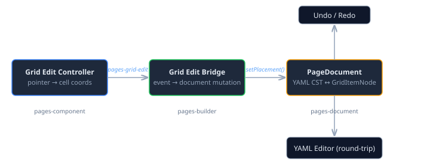
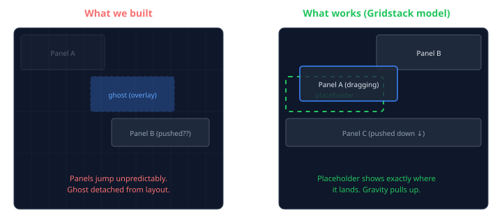

# When Custom Stops Being an Advantage

*Continues from [Grid Editing Without a Framework](/docs/blog/2026-11-05-mdp01-grid-editing-without-a-framework.md).*

The previous entry ended with a promise: "The next layer wires this into the PageDocument model. Every drag becomes a YAML CST mutation." I shipped that layer. Then I used it. And I learned something more useful than the code itself.

## The Bridge Pattern

The architecture is clean. Three packages, two boundaries, one event.

The grid edit controller in `pages-component` knows nothing about YAML. It tracks pointer events, snaps to cells, resolves collisions, and dispatches a `pages-grid-edit` event carrying the updated placements. The `GridEditBridge` in `pages-builder` catches that event and translates it into `PageDocument` mutations — `GridItemNode.setPlacement()` calls that update the YAML CST per-property, preserving comments and formatting. The YAML editor diff-patches to show the change. Undo records a snapshot before mutation.

The bridge also handles format conversion. A page using the old `components:` or `rows:` layout gets silently converted to `items:` on the first grid edit. The original component definitions are extracted from the YAML tree, paired with placements from the event, and the old layout key is replaced. One drag converts the format.

This is the part I'm satisfied with. The document model — `GridItemNode` wrapping `{ placement, component }` YAML entries, `PageNode.getItems()` / `addItem()` / `removeItem()`, the `grid-items` container descriptor slot — is solid infrastructure that will outlast whatever interaction model sits on top of it.

## The Rendering Bug

Shipping the gallery demo surfaced something embarrassing: page-level `items:` rendering was broken. The renderer set `grid-column` and `grid-row` on each child element, but never set `display: grid` or `grid-template-columns: repeat(12, 1fr)` on the parent container. Every item had correct grid coordinates pointing at a grid that didn't exist. The Grid Spanning sample — which predated this work — had been rendering as a vertical stack the entire time.

The fix was two lines. But it had been invisible because the sample data used full-width items that look identical whether they're in a 12-column grid or a flex column.

## The UX Problem

The document model works. The bridge works. The rendering works. I put it in the gallery, clicked "Edit layout," and tried to drag a panel.

I couldn't figure out what the drag was doing.

The grid overlay showed a 12-column grid with 60px rows — but the actual layout uses content-sized rows, so the grid lines had no relationship to the panel boundaries visible on screen. The ghost preview appeared on the overlay, not at the drop position. Other panels jumped around from collision resolution, but the direction of displacement was unpredictable — sometimes up, sometimes down, sometimes sideways. I couldn't tell where a panel would land before I dropped it.

I removed the grid overlay for content-sized layouts, added dashed outlines to panels in edit mode, added hover highlighting, added solid outlines during drag. Each fix made it slightly better and still fundamentally confusing. The problem wasn't the visual feedback. The problem was the interaction model.

## What the Libraries Know

Gridstack.js and React-Grid-Layout both solve grid editing. Between them they have 30,000 GitHub stars and years of accumulated edge-case fixes. I'd read their code during the design phase. I'd studied their collision algorithms. I'd decided to build custom anyway, because CaseHub Pages already has its own CSS Grid rendering pipeline, and running two layout systems side by side creates impedance mismatch.

That reasoning was technically correct and practically wrong.

The thing the libraries get right isn't the collision algorithm — ours is fine. It's the interaction contract. Three rules:

**Placeholder at the drop target.** Not a ghost on an overlay. A visible rectangle at the exact grid position where the panel will land, rendered as an actual CSS Grid child so other panels move to accommodate it. The user sees the final state before they commit.

**Vertical compaction.** One rule: everything falls to the top. Drag a panel out of a row and the panels below float up. Drop into a gap and panels below push down. This is predictable because there's only one direction. Our collision resolver pushed in arbitrary directions — technically correct resolutions that felt random.

**Drag handle on the title bar.** Only the top strip of a panel triggers drag. The rest is content. This prevents accidental drags and lets users interact with charts, tables, and text inside panels while in edit mode.

None of these are algorithmically difficult. Each one is a design decision backed by thousands of hours of user testing across multiple products — Grafana, Kibana, Home Assistant, and dozens of dashboard builders that all converged on the same interaction model. Building the collision algorithm from scratch was educational. Ignoring the interaction model that sits on top of it was a mistake.

## The Pivot

I've filed a detailed issue to replace the edit controller's internals with placeholder-based drag and vertical compaction. The document model, the bridge, the event contract, the tree view integration, the format conversion — all of that stays. The change is in `grid-edit-controller.ts` and `grid-collision.ts`: how the pointer events translate to visual feedback and how displaced items find their new positions.

The question is whether to integrate Gridstack.js directly or reimplement the interaction model natively. Gridstack's layout engine is battle-tested, but it uses absolute positioning internally — entering edit mode would switch from CSS Grid to absolute layout and back, which might cause visual jumps. The alternative is to port the compaction algorithm (it's essentially a sort-then-pack) and build the placeholder rendering against our existing CSS Grid. Either way, the interaction contract is the same.

## The Actual Lesson

There's a version of this story where I say "we should have used a library from the start." That's too simple. The custom grid edit controller is 370 lines. It handles pointer capture, snap-to-cell, resize from eight handles, mutual exclusion between grids, and emits a clean event that the rest of the system consumes without modification. The infrastructure it produced — `GridItemNode`, the bridge pattern, the format converter — would have been needed regardless of which drag library sits on top.

The real lesson is narrower: the *mechanism* (pointer tracking, cell snapping, collision resolution) was worth building custom because it integrates directly with our CSS Grid model. The *interaction design* (placeholder vs. ghost, compaction direction, drag handle placement) was not worth discovering from first principles. The libraries converged on those patterns because users told them what works. Rebuilding that feedback loop from scratch is not engineering — it's repeating someone else's user research.

I'll know the pivot is right when I can drag a panel and predict where it will land before I release the mouse.
