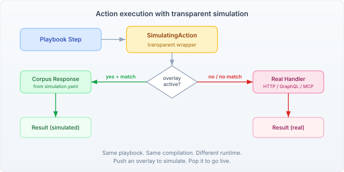

# When Less YAML Means More Testing

A YAML playbook step should read like a sentence.

```yaml
- agent-session-close: classifier
```

Not like a form:

```yaml
- agent-session-close:
    session: classifier
```

Both say the same thing. The first says it in one line. The second wraps one value in two lines of structure that exists only because the parser expected a map. When a step has one required parameter, the step name is the verb and the value is the object. The map form adds ceremony without information.

This applies to five step types across the playbook language — `agent-session-close`, `agent-session-clear`, `rest-request`, `graphql-exec`, `mcp-call`. Each has a single primary parameter. Each was requiring the map form. Across the playbook catalog, that added up to sixteen unnecessary lines of indentation.

## The scalar subject pattern

The fix is a pattern already used by other steps. `signal: my-signal` and `await: my-signal` have always been scalar. `assertThat: ${response}` and `run-playbook: examples/02.yaml` both accept a string value and map it internally to a primary parameter. The mechanism — Walker converts scalar values to `{_subject: value}` — was there from the start.

What was missing: the step compilers and binding parsers for session, REST, GraphQL, and MCP steps didn't accept strings. They required maps. Adding scalar support meant three changes per step type: the `DeclarationParser` accepts a string and creates the binding directly, the `StepCompiler` accepts a string and builds a single-entry config map, and the JSON Schema uses `oneOf: [string, object]` to validate both forms.

For `rest-request`, the scalar form defaults to GET with no headers or body:

```yaml
- rest-request: https://api.example.com/users
```

For `mcp-call`, it's the tool name with no params:

```yaml
- mcp-call: file_search
```

The map form is still valid and necessary when you need the additional parameters — `method`, `headers`, `body` for REST, or `params` for MCP. The scalar form is a convenience for the common case where you don't.

## From verbosity to testability

Making steps shorter was the stated goal. But halfway through, the conversation shifted to something more interesting: why can't these steps run under simulation?

When a playbook calls a REST endpoint, it makes a real HTTP request. When it executes a GraphQL query, it hits a real server. When it invokes an MCP tool, it expects a running tool provider. In dry-run mode — where you want to validate the playbook's flow without real infrastructure — these steps fail or need manual mocking.

The simulation framework already handles this for SPIs like `AgentProvider` and `CaseMemoryStore`. A `@Decorator` wraps the real implementation, checks whether a simulation overlay is active, and returns corpus-backed responses when it is. But playbook invoke handlers aren't CDI beans. They're wired manually through `YamlDefinitionSource`, outside the decorator machinery.

The first attempt was obvious: inject `SimulationRuntime` into each handler. REST handler checks simulation state before making the HTTP call. GraphQL handler does the same. Each handler grows a constructor parameter and a runtime check.

The problem: that couples every handler to simulation. A playbook compiled with a simulation-aware handler behaves differently from one compiled without it. You'd need to "recompile" — rebuild the action graph — to switch between real and simulated execution.

## The wrapper that doesn't know it's there

The solution is a transparent wrapper. `SimulatingAction` implements `Action`, holds a reference to the real action, and checks simulation state at execution time:

```java
public Result execute(Map<String, Object> params, ServiceRegistry services) {
    if (runtime.hasActiveOverlay() && lookupKey != null) {
        Optional<SimulationStrategy<Object, Object>> strategy =
                runtime.strategyFor(qualifiedName);
        if (strategy.isPresent() && strategy.get().canResolve(lookupKey)) {
            Object simulated = strategy.get().resolve(lookupKey);
            // ...
            return Result.of(output, Map.of("simulated", true));
        }
    }
    return delegate.execute(params, services);
}
```

The handler doesn't know the wrapper exists. The compiler doesn't know about simulation. The playbook YAML doesn't change. Push an overlay with corpus entries and the steps return simulated responses. Pop the overlay and they make real calls. Same binary, same compilation, different runtime.



The corpus is pure YAML in `simulation.yaml`:

```yaml
rest-request:
  strategy: key-lookup
  corpus:
    - key: { url: "/api/users" }
      response: { users: [{ id: 1, name: "Alice" }] }
```

No code to change a response. No handler to modify. No recompilation. Edit the YAML, push the overlay, run the playbook.

## Why this matters for adoption

A playbook language lives or dies on two things: whether people can read it, and whether people can test it. The scalar form addresses the first — a step that reads as `agent-session-close: classifier` communicates intent faster than the map form, and the playbook as a whole becomes denser without becoming less clear.

The simulation wrapper addresses the second. A playbook that requires live REST endpoints, real GraphQL servers, and running MCP providers to validate isn't a playbook you iterate on quickly. A playbook where you can define expected responses in a YAML file and run the whole thing offline — that's one you write tests for.

The two changes are connected. The scalar form defines the natural corpus key: the URL, the query string, the tool name. The simulation framework uses that key for corpus lookup. Concise syntax and testability aren't separate concerns — they share the same vocabulary.
