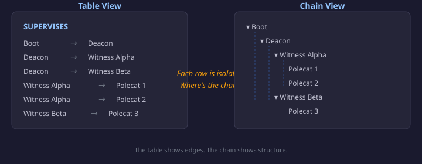
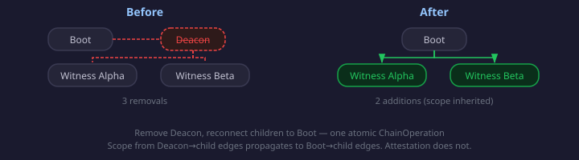

# Chains, Not Rows

A table of agent relationships tells you the edges. It doesn't tell you the chain.

Boot supervises Deacon. Deacon supervises Witness Alpha. Witness Alpha supervises Polecat 1 and Polecat 2. In the table, those are four isolated rows. You can see that Boot supervises Deacon, but you can't see that Boot is three hops above Polecat 1 — or that removing Deacon would orphan two entire sub-chains unless you reconnect them.

That gap matters when your org structure has fifty agents and six relationship kinds. SUPERVISES forms trees. ESCALATES_TO forms linear chains. DELEGATES_TO can go either way. The table gives you the raw material; the chain gives you the shape.

## Walking the hierarchy

The chain navigator is a new tab in the relationship editor — alongside Table and Diagram — that renders relationships as an indented tree. Pick a kind, and it walks the chain from root to leaf. If your focal agent is mid-chain, it walks upward first to find the root, then renders the full tree with the focal agent highlighted.

The traversal itself is a pure function in `graph-stencil-org`: give it a relationship array, a root agent, and a kind, and it hands back a `ChainNode` tree. Cycle detection uses ancestor-path tracking rather than a flat visited set — the distinction matters for org structures with matrix management, where the same agent can report to two managers (DAG convergence) without forming a cycle.

I had this wrong in the first design pass. A flat visited set conflates "I've seen this node before" with "this node is its own ancestor." The first is convergence — legitimate in any real org chart. The second is a cycle — an error. Claude caught this during the spec review, and the fix shaped the entire traversal API: `isCycle` and `isConvergent` are separate booleans on every node.

## Editing in context

The chain view isn't read-only. Every node has inline controls: add a child, insert between parent and child, remove with reconnection or disconnection. The point is that you see the structural impact before you commit.

Removing a mid-chain agent is a compound operation. Take Deacon out of the supervision chain: that's three removals (Boot→Deacon, Deacon→Witness Alpha, Deacon→Witness Beta) and two additions (Boot→Witness Alpha, Boot→Witness Beta). In the old model, those would appear in the changeset as five independent entries — the table would show two red rows and two green rows with no indication they're semantically linked.

The new model groups them as a single `ChainOperation`. The description says "Remove Deacon, reconnect children to Boot." Undo is atomic — dismiss the operation and all five changes revert together. The chain view renders the what-if state inline: Deacon struck through in red, Witness Alpha and Witness Beta appearing in green under Boot. You see the structural consequence before you confirm.

## Metadata propagation

Compound operations have a subtle problem: what happens to the metadata on the removed edges?

When Deacon supervised Witness Alpha with `scope: { capabilityName: 'rig-monitoring' }`, and you reconnect Witness Alpha to Boot, should the new Boot→Witness Alpha edge inherit that scope? It should — the scope describes what Witness Alpha was being supervised *about*, and that doesn't change just because the supervisor changed.

Attestation grants are different. Deacon's attestation for Witness Alpha is a trust relationship between those two specific agents. Boot doesn't automatically inherit Deacon's trust assessments. So scope propagates; attestation doesn't.

This came out of the spec review. It's the kind of thing that feels obvious once stated but would have been a data-loss bug if nobody had thought about it until a user removed a mid-chain agent and their scope metadata vanished.

## The changeset migration

The original relationship editor tracked pending removals by array index: `_pendingRemovals: Set<number>`. Index 3 means "the fourth relationship in the array." That works for the table, where each row maps to an index. It falls apart for the chain view, where you're thinking in terms of "the edge between Deacon and Witness Alpha" — a content identity, not a position.

I replaced the index-based model with identity-based tracking. A `RelationshipIdentity` matches on source, target, kind, extendedKind, and scope. Pending operations are `ChainOperation` objects that carry both removals (by identity) and additions (full relationship objects). The editor derives its pending state from a flat `flattenOperations()` function that handles deduplication, cancellation (add-then-remove = net zero), and suppression of additions that duplicate confirmed edges.

The migration was the riskiest part — the existing table view, add form, confirm/reset, and all existing tests had to keep working with the new model underneath. They did. The refactoring was mechanical because the external contract didn't change: the editor still emits `relationship:changed` with a flat `RelationshipChangeset` on confirm. The compound operations are internal.

## Dark mode and the fallback problem

After wiring everything up, the chain view rendered with jarring light backgrounds in the dark demo theme. The focal agent highlight used `var(--pages-accent-2, #eff6ff)` — and the demo didn't define `--pages-accent-2`, so the light-blue fallback showed through.

Every mosaic component has this problem. The CSS custom property fallbacks all assume light mode: `#fafafa` for neutral backgrounds, `#e5e5e5` for borders, `#fff` for inputs. If the host page defines the tokens, everything works. If it misses one, that element renders as a bright white rectangle on a dark surface.

I fixed chain-view with `rgba()` fallbacks — `rgba(59, 130, 246, 0.15)` instead of `#eff6ff` — which look reasonable on any background. But it's a per-component fix. The systemic pass across all mosaic components is a separate issue now.

## What this opens up

The chain traversal utility is a building block. Right now it serves the relationship editor, but the same `buildChainTree` / `findChainRoots` functions can drive chain visualization anywhere — escalation path display in the trust workbench, delegation chain views in the worker task pane, reporting line overlays on the org diagram.

The identity-based changeset model is also reusable. Any component that stages compound edits and needs atomic undo can use `ChainOperation` and `flattenOperations` — it's not specific to relationships.
