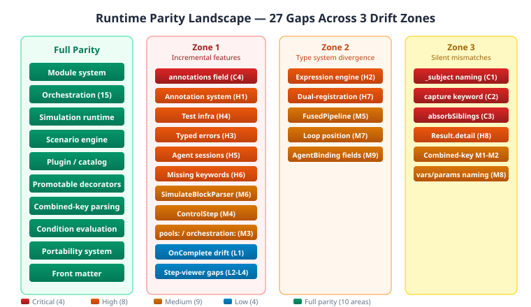
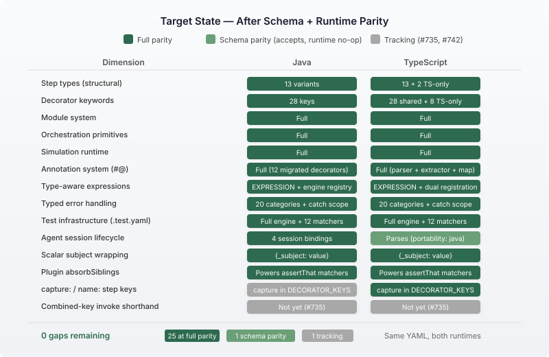

# When "Same Language" Isn't Same Runtime

CaseHub playbooks are defined in YAML. The same YAML document should produce the same behaviour whether it runs on the Java server or renders in the TypeScript browser runtime. That's the contract.

I hadn't tested the contract in months. The Java side has been through a sustained push on the YAML runtime — the Walker, the type system, annotation infrastructure, error handling, the test framework, the simulation engine. Dozens of features. Hundreds of commits.

The TypeScript yaml-core kept pace on the foundations: module system, orchestration primitives, the scenario engine. But the type system, annotations, and test infrastructure drifted without anyone noticing. A full parity audit found 27 gaps across 5 severity tiers.

## The Shape of the Drift

The interesting thing isn't the number of gaps — it's where they cluster. The architectural foundations are at complete parity: module expansion, orchestration primitives (all 15 types), simulation runtime, scenario compilation, plugin registration, portability. These are the systems I ported deliberately, with explicit issues tracking each one.

The drift happened in three zones.

**Zone 1: features that grew incrementally on Java without corresponding TS issues.** The annotation system — `#@timeout(10s)`, `#@retry(3)`, `@Inject` — was added and then extended through hierarchical dotted-key step annotations and annotation threading through match/select branches. Nobody filed a pages issue.

The TypeScript Walker has no annotation parser, no annotation extractor, no annotation map, and no injection resolver. The `annotations` field is absent from every TS step type.

**Zone 2: the type system divergence.** Java added `ParameterType.EXPRESSION` as a seventh parameter type, backed by a pluggable expression engine registry. The `TypeAwareParamResolver` delegates EXPRESSION-typed params to the engine; non-expression params go through string interpolation.

The TS side has six parameter types and resolves everything as string interpolation. This isn't a missing feature — it's a missing layer. The expression context, the scope dual-registration, the typed catch scope (`${error.type}`, `${error.message}`, `${error.step}`) — they all depend on infrastructure that doesn't exist yet.

**Zone 3: naming mismatches that break cross-runtime compatibility silently.** The worst kind of drift. When a playbook step takes a non-Map scalar value — `agent-session-close: my-session` — Java wraps it as `{_subject: "my-session"}`. TypeScript wraps it as `{value: "my-session"}`.

Any plugin that reads its params by key gets a different value depending on which runtime executed the step. One key name, zero test coverage across runtimes. Silently wrong since the scalar subject feature landed.

## Why It Matters Practically

A playbook author writes YAML once. If that YAML uses `capture:` to store a step's output — `capture: result` followed by `assertThat: ${result.text}` — it works on Java and fails on TypeScript. The TS Walker rejects `capture` as an unknown key. Not a graceful degradation. A hard parse error.

The `assertThat` pattern is worse. Java's Walker has `absorbSiblings` on its plugin definition — unknown sibling keys on a step get absorbed into the action's params map instead of throwing. This powers the natural assertion syntax: `assertThat: ${result.text}` with `contains: 'expected'` as a sibling key.

TypeScript has no `absorbSiblings` concept. Every test playbook that uses assertThat — and they all do — is unparseable in the browser runtime.

The test infrastructure gap is the broadest. Java has a full test engine: discovery, execution with setup/teardown lifecycle, JUnit Platform integration, five test-specific plugins including 12 assertion matchers. TypeScript has none of this. Playbook tests are a Java-only capability.

## The Principle That Fell Out

Schema parity is non-negotiable. Both Walkers must accept the same YAML vocabulary. The portability system already handles whether a step *executes* — `aria` is Java-only, `mcp` is TS-only, but both Walkers accept both. Schema acceptance and runtime execution are separate concerns.

Every gap in the audit must follow that pattern: accept first, implement runtime behaviour second. The Walker can return a not-implemented result at runtime; it must never reject valid YAML.

## The Fix Shape

Phase 1 is schema parity — 17 items, mostly XS/S. Rename `value` to `_subject`. Add the five missing decorator keys. Add `barrier`/`quorum` to combined-key prefixes. Parse `pause`/`resume` as `ControlStep`. Accept `pools:`, `orchestration:`, `concurrent:`. Parse agent session binding types. Add `name:` as a structural key alongside `step:`. Add the combined-key invoke shorthand that just landed on platform.

Phase 2 is runtime behaviour behind the schema: typed error catch scope, test infrastructure, the annotation system. Phase 3 is the expression engine — the largest single piece. Phase 4 is agent session handlers and streaming pipeline.

The gap pattern tells a story about how dual-runtime systems drift. The large, visible features — the ones with their own issues and dedicated porting sessions — stay in sync. The incremental additions — a new keyword here, a decorator there, a field renamed during a refactor — accumulate quietly until someone audits the contract.

A cross-runtime keyword diff that runs in CI would have caught the `capture` gap the day it was added to Java's `DECORATOR_KEYS`. A shared scalar-subject test would have caught the `_subject` vs `value` mismatch the day it landed. The audit is done. The harder discipline is making drift structurally impossible rather than periodically detected.
