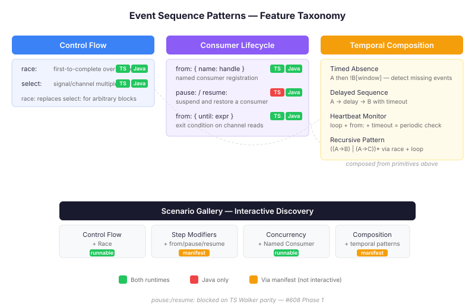

# Patterns Nobody Can Find

CaseHub's YAML playbook runtime has had event sequence patterns — race conditions, channel consumers with lifecycle control, temporal absence detection — for months. The platform runtime supports them. The Java tests exercise them. The YAML compiles and runs.

Nobody uses them.

The scenario gallery — the interactive page where a developer picks a pattern from a dropdown, sees the YAML, and clicks Run — had no entries for any of them. Forty-eight playbook examples in the catalog. Zero covering the features that shipped with the event sequence epic.

## What Event Sequence Patterns Actually Do

The YAML playbook vocabulary for concurrent workflows was already expressive: `parallel:` runs branches, `select:` multiplexes signals, channels move data between branches, barriers synchronise. Event sequence patterns add the temporal dimension — reacting to what happens *when*, and more importantly, what *doesn't* happen when expected.

**`race:`** is the simplest to explain. Two or more blocks execute concurrently. The first to complete wins. The losers are cancelled. Unlike `select:`, which waits on named signals, `race:` works with any step sequence — a block with a delay, a channel read with a timeout, an invoke call. The first thing to finish determines the outcome.

```yaml
- race:
  - block:
    - delay: 200ms
    - log: { message: "Slow branch finished" }
  - log: { message: "Fast branch finished" }
```

`select:` still exists, but its role narrowed. It's signal multiplexing — wait on named signals, first signal wins. `race:` took over the "first-to-complete over arbitrary blocks" role that `select:` was overloaded with. The gallery now labels them distinctly: Select (signal multiplexing) vs Race (first-to-complete).

**Named consumers** add lifecycle control to channel readers. A `from:` decorator with a `name` property registers a handle. Other branches can pause, resume, or stop that consumer by name. The producer keeps sending; items buffer during the pause; the consumer drains the buffer when resumed.

```yaml
- concurrent:
    enricher:
      - name: enrich
        log: { message: "Enriching ${from.type}" }
        from: { channel: raw-events, name: enricher }
        loop: continuous

    supervisor:
      - delay: 500ms
      - stop: enricher
```

This is the producer-consumer pattern with a control plane. The supervisor doesn't need to know what the enricher is doing — it just tells it to stop. The decoupling matters when the consumer is processing a stream that might never end on its own.

**Temporal composition** is where the primitives combine into patterns that wouldn't be obvious from reading the keyword reference. Timed absence — A then !B[window] — detects when an expected event *doesn't* arrive within a time window. A `from:` read with a `timeout:` decorator inside a `block:`. The timeout firing *is* the detection.

Heartbeat monitoring loops this: `loop: continuous` around a `from:` with `timeout:`. Every iteration reads from the heartbeat channel. Timeout means the heartbeat was missed. Delayed sequence adds causality: read event A, wait, then read event B with a timeout — modelling "A causes B after a processing delay."

The recursive pattern nests everything: `race:` over two `block:` sequences, each reading from the same channel, wrapped in `loop: continuous`. Each iteration races two possible event sequences. The winner feeds the next iteration. This is `((A→B) | (A→C))*` expressed as five lines of YAML.



## The Discovery Problem

Features that exist but aren't visible don't get used. The scenario gallery is how a playbook author discovers what's possible. Each category — Control Flow, Step Modifiers, Concurrency Patterns, Composition — has a dropdown picker, a YAML viewer, and a Run button. Pick a pattern, see the YAML, run it, watch the trace. The feedback loop from "what does race: do?" to "oh, the fast branch won" is about three seconds.

Without gallery entries, the only way to discover `race:` was to read the Walker source code or find the platform test suite. Both are terrible discovery mechanisms for someone trying to write a playbook.

The fix splits across two delivery paths. The static scenario pages — Control Flow and Concurrency Patterns — got new entries added directly: Race as a runnable example with the step runner, Named Consumer as a channel-based lifecycle simulation. The dynamic pages — Step Modifiers and Composition — load from a shared manifest served by the platform playbook-catalog JAR. The nine new playbook YAML files that landed in the platform already appear in these pages automatically.

## The Parity Wall

Not everything runs in the browser. The TS yaml-core Walker recognises `race:` as a structural step type — full dispatch, combined-key form (`"race winner": [...]`), the works. `from:` with `until` and `name` sub-properties works. These patterns run in both runtimes.

`pause:` and `resume:` don't. Java has them as `ControlStep` — the Walker parses them, the runtime evaluates them. The TS Walker doesn't recognise them at all. They're not in `RESERVED_KEYS`. A playbook that uses `pause: reader-name` compiles on Java and throws a parse error in the browser. This is one of the 27 gaps from the parity audit — item M4, flagged for Phase 1 schema acceptance.

The manifest handles this cleanly. Each playbook entry has a `runnable` flag. The entries that depend on `pause:`/`resume:` are marked `false`. The gallery shows the YAML and description but doesn't offer a Run button. The author can see the pattern and understand it; they just can't execute it in the browser yet.

The honest version of the parity story: six of the nine new playbooks can't run interactively in the TS runtime. They're visible, they're documented, but they're reference material until the Walker gaps close. `race:` and the `from:` variants work today. The temporal compositions work today (they're built from `block:`, `from:`, `timeout:`, and `loop:` — all supported). The consumer lifecycle patterns — pause, resume, stop — wait on the TS Walker catching up.

## What This Opens Up

The gallery now covers the full event sequence vocabulary. A playbook author looking at the Composition dropdown sees Timed Absence alongside Data Trigger and Orchestration Block. The pattern exists in the same namespace as the patterns they already know. That proximity is how adoption happens — not through documentation that lives in a separate repo, but through examples that sit next to the things they already use.

The temporal patterns in particular change what playbooks can express. Heartbeat monitoring, absence detection, delayed causality — these are operational patterns that traditionally require custom code. Expressing them as YAML compositions of five or six primitives means they're declarative, portable, and visible in the step viewer as swim lane diagrams. The YAML is the diagram.

The parity gaps are a reminder that portability is a contract, not a feature. Having nine new playbook patterns is worth less if three of them only work on one runtime. The audit from last session flagged the gaps. This session made the working patterns visible. The gap between the two is where the next work lives.
