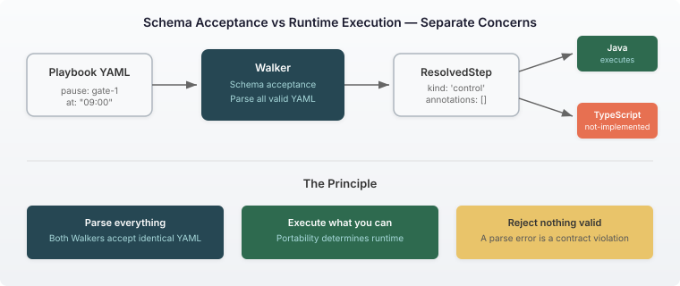
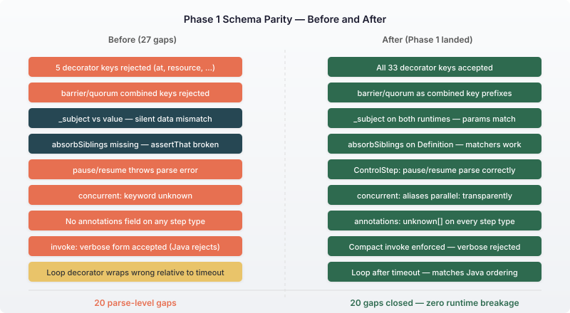

# Twenty Keys to One Language

*Continues from [When "Same Language" Isn't Same Runtime](2026-11-07-mdp01-when-same-language-isnt-same-runtime.md).*

Yesterday's audit found 27 gaps between the Java and TypeScript YAML Walkers. Today the first 20 are closed. The TS Walker now accepts the same vocabulary as Java — every keyword, every step type, every decorator. A playbook that parses on one runtime parses on both.

The interesting part isn't the count. It's what the work revealed about how cross-runtime contracts actually break, and what "schema parity" means in practice.

## Parse Errors Are Contract Violations

The governing principle that fell out of the audit: schema acceptance and runtime execution are separate concerns. The Walker's job is to parse valid YAML into a step tree. Whether the runtime *does anything* with that tree is a different question entirely.



The `pause:` keyword is a good example. Java has a full `ControlStep` implementation — pause suspends a workflow gate, resume reopens it. The TypeScript runtime has no workflow gate infrastructure. Before today, `pause: gate-1` in a playbook would throw a parse error in the browser. Not a graceful "not supported" — a hard crash during Walker resolution.

The fix adds a `ControlStep` type to the TS Walker. It parses cleanly. At runtime, the step can return a not-implemented result. But the document is valid. The contract holds.

This pattern — accept everything, execute what you can — already existed in the portability system. `aria` bindings are Java-only. `mcp` bindings are TS-only. Both Walkers accept both. The portability check at runtime decides whether execution proceeds. The new work extends this same principle to keywords, step types, and structural forms.

## The Silent Mismatch Was the Worst

Most of the 20 gaps were hard rejections — the Walker throws, the playbook doesn't load, someone files a bug. Noisy failures are annoying but discoverable.

The `_subject` mismatch was silent. When a playbook step uses a scalar value — `navigate: '/dashboard'` — the Walker wraps it into a params map. Java wraps it as `{_subject: '/dashboard'}`. TypeScript was wrapping it as `{value: '/dashboard'}`.

Every plugin action that reads its params by key name gets different behaviour depending on which runtime executes the step. No error. No warning. Just a different key name, and a plugin that quietly does nothing because the key it expected isn't there.

I renamed `value` to `_subject` across the Walker, updated the aria playbook handler to accept both keys for backward compatibility, and searched the codebase for any remaining references. The scenario samples in `examples/` needed no changes — they use object params with explicit key names, which bypass the scalar wrapping entirely.

## absorbSiblings: The Feature That Unlocks Testing

The `assertThat` pattern in Java test playbooks looks natural:

```yaml
- assertThat: ${result.text}
  contains: 'expected value'
```

Two keys on one step: `assertThat` is the action, `contains` is a matcher sibling. Java's Definition has an `absorbSiblings` flag — when true, unknown sibling keys get folded into the action's params map instead of throwing. Without it, every matcher keyword is an "unknown step key" error.

Claude and I added `absorbSiblings` to the TS Definition type and changed the Walker's unknown-key handling. Instead of throwing immediately on unrecognised keys, the Walker now defers them. After the action is identified, if the action's definition has `absorbSiblings: true`, the deferred keys merge into params. If not, the original error fires.

This one flag is what makes playbook testing portable. Without it, every `.test.yaml` file that uses assertion matchers is unparseable on the browser runtime.

## primaryInput: Smarter Scalar Resolution

The `_subject` rename was necessary but incomplete. Java goes further with `primaryInput()` — when an action receives a scalar value, the Walker looks up the action's Definition and maps the scalar to the first required input parameter.

`rest-request: '/api/users'` doesn't produce `{_subject: '/api/users'}` on Java. It produces `{url: '/api/users'}` because `url` is the first required input of the `rest-request` definition. The plugin gets a semantically named parameter rather than a generic `_subject` key.

The TS Walker now does the same. When there are no required inputs defined, it falls back to `_subject`. When there are, the first required input name becomes the key. Same definition, same params map, same plugin behaviour on both runtimes.

## Enforcing the New Vocabulary

Two enforcement items went in alongside the acceptance work. Java recently rejected the verbose `step:` and `invoke:` syntax in favour of compact forms, and we matched that.

`step: myName` is now an error — use `name: myName` instead. The `name:` key was already added as part of platform #742, and the combined-key form (`block myBlock: [...]`) has always been available. The old `step:` key was grandfathered syntax that accumulated in examples and tests without anyone questioning it.

`invoke: { binding: 'rest', url: '/api' }` is also rejected. The compact combined-key syntax — `rest-request GET /api:` — is both more readable and structurally consistent with how the Walker resolves action keys. The verbose form was a different code path that bypassed the catalog entirely.

A codebase search after the enforcement confirmed zero runtime breakage. All remaining `step:` references are in documentation and Java backend tests. All `invoke:` uses in TypeScript are Definition bindings (parsed by the definition parser, not the Walker). The migration was already complete before the enforcement landed.

## What the Diagram Looks Like Now



Twenty gaps closed. The keyword sets are identical. The structural types match. The scalar wrapping is consistent. The decorator ordering is aligned.

## What Remains

Phase 1 was parse-level acceptance — the Walker never rejects valid YAML. The remaining phases are about runtime behaviour behind the unified schema:

**Phase 2** — typed error handling in catch scope (`${error.type}`, `${error.message}`), test infrastructure (`.test.yaml` engine with assertion matchers), annotation system (`#@timeout(10s)` syntax parsing).

**Phase 3** — expression engine infrastructure. Java has `ParameterType.EXPRESSION` backed by a pluggable engine registry. TypeScript resolves everything as string interpolation. This is the largest single piece.

**Phase 4** — agent session handlers and streaming pipeline. The binding types parse now (that was Phase 1). The handlers that execute open/query/clear/close sessions against an agent backend are Phase 4.

The schema is unified. The runtimes can diverge on capability while agreeing on vocabulary. A playbook that uses `pause:` loads on both runtimes — Java pauses, TypeScript returns not-implemented. That's the contract working as designed.
