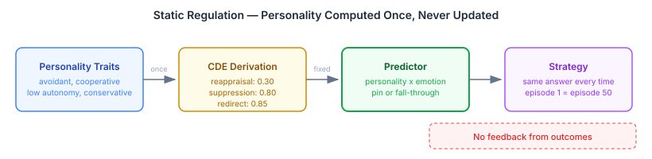
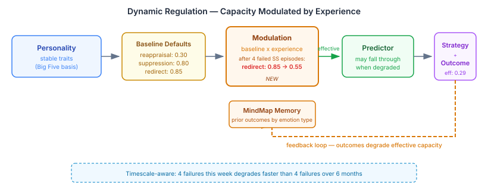

# Why Personality Isn't Enough

*Continued from [Ask the Judge First](2026-11-07-mdp04-asking-the-judge-first.md)*

An avoidant personality facing shame will withdraw. Nathanson's compass of shame maps this clearly — withdrawal is the avoidant's instinctive response. Our emotion regulation predictor had the literature. It had the personality profile. It still got the strategy wrong, and fixing that revealed something more interesting than the bug.

## The Mechanical Fix

The predictor had two gaps. For self-conscious emotions like shame, it only knew one path: strong reappraisal capacity pins cognitive change. For an avoidant personality with weak reappraisal — which is the common case — it fell through to the LLM with guidance text saying "choose SITUATION_SELECTION." The LLM read that guidance and ignored it. It picked attentional deployment instead, because that's easier to generate a narrative for.

The fix was straightforward: if the strategy is deterministic from personality, the predictor should own it. We added avoidant conflict mode as a pin to situation selection. The LLM can't override a pin.

Second gap: for a personality with strong reappraisal (0.90) and moderate suppression (0.50), the predictor treated 0.50 as a "viable alternative" and fell through. But a 0.40 gap is not regulatory flexibility in the Ford & Troy sense. That's an overwhelming reappraiser with moderate backup capacity, not someone who might go either way. We added a dominance gap threshold — fall through only when strategies genuinely compete.

These fixes moved mixed-anger from a judge score of 3 to 5. suppressor-shame got the correct strategy for the first time.

But compounding-shame — an avoidant personality facing shame for the fourth time — dropped from 4 to 3.

## The Measurement That Lies

The eval judge scores strategy selection on a single 1-5 scale. For single episodes, this works fine. For compounding cases, the judge contradicts itself.

In isolation, testing strategy labels directly: "SITUATION_SELECTION is the best strategy for this avoidant personality. Score: 5." In the full pipeline after four episodes: "Even an avoidant personality should be shifting toward cognitive change. Score: 3."

But the same judge scored cognitive change at 2 for this personality — "contradicts the personality dynamics entirely." It wants a strategy the personality can't execute.

The single score conflates two independent dimensions. *Personality congruence* asks whether this is what the personality would naturally do. *Regulatory effectiveness* asks whether it will actually work after repeated failure. For single episodes these align and the conflation is invisible. For compounding cases they diverge, and the number becomes meaningless.

## The Assumption That's Wrong

I initially defended the model. The personality's regulatory capacity is genuinely exhausted. No single strategy scores 5 for this case. Trying to engineer a higher score would make the model psychologically inaccurate.

Claude asked the question I should have asked first: is the problem that we have a "fixed" personality?

It is.

The architecture computes regulatory defaults once from personality traits and never updates them:

Personality *traits* are relatively stable — Big Five research supports this across decades. But regulatory *capacity* is not a trait. It's a learned behaviour that adapts with experience. An avoidant person who has tried withdrawal four times and watched it fail is not the same as an avoidant person encountering shame for the first time. The traits haven't changed. The effective repertoire has.

After four failed avoidance attempts, the predictor still sees suppressionCapacity=0.80 and redirectTendency=0.85, as if nothing happened.

## The Loop That's Missing

I dismissed this initially as aspirational — personality evolution happens over months of therapy, not within a simulation run. But simulations span whatever timescale the scenario requires. Four shame episodes might be an afternoon in one scenario and six months in another. The memory system already stores regulation outcomes. The consolidation system already models temporal decay. The regulation system just doesn't read any of it.

The CAPS architecture — Mischel and Shoda's cognitive-affective processing system that underpins the whole pipeline — requires exactly this loop. Dispositions produce behaviour. Behaviour produces outcomes. Outcomes modulate future disposition-behaviour mapping. We had the first two steps. The third was missing.

After four episodes of low-effectiveness avoidance for shame, the effective redirect capacity degrades below the pin threshold. The predictor falls through — not because the personality changed, but because those strategies have been tried and found wanting in this context. The LLM, seeing depleted capacities alongside the compounding history, has room to generate something that acknowledges the regulatory bind rather than mechanically selecting a strategy that can't work.

## Why This Matters Beyond Our Pipeline

If you're building cognitive agents — for games, training simulations, social AI, anything with characters that feel — and you model emotion regulation, there are three traps.

**Guidance where you need a pin.** If personality determines the strategy, don't ask the LLM to choose. It will choose whatever generates the easiest narrative, not the psychologically correct one. Pin the strategy. Give the LLM creative freedom in *how* to embody it, not in *what* to choose.

**One score for two dimensions.** Personality congruence and regulatory effectiveness are independent. They align most of the time, which makes the conflation invisible until it matters. When they diverge — compounding failure, contextual pressure, regulatory exhaustion — a single score produces contradictions. Measure them separately from the start.

**Static personality.** Personality traits can be stable while regulatory capacity varies with experience. A character who responds to shame identically on episode one and episode fifty is not psychologically consistent — it's psychologically frozen. The memory is already there. The outcomes are already stored. The regulation system just needs to read them.

The fix for the third trap closes the loop. After each regulation episode, the outcome feeds back into effective regulatory capacity. Repeated failure at a strategy degrades it for that emotional context. The personality hasn't changed. The agent has learned what doesn't work.

Which is how regulation learning works in humans too.
