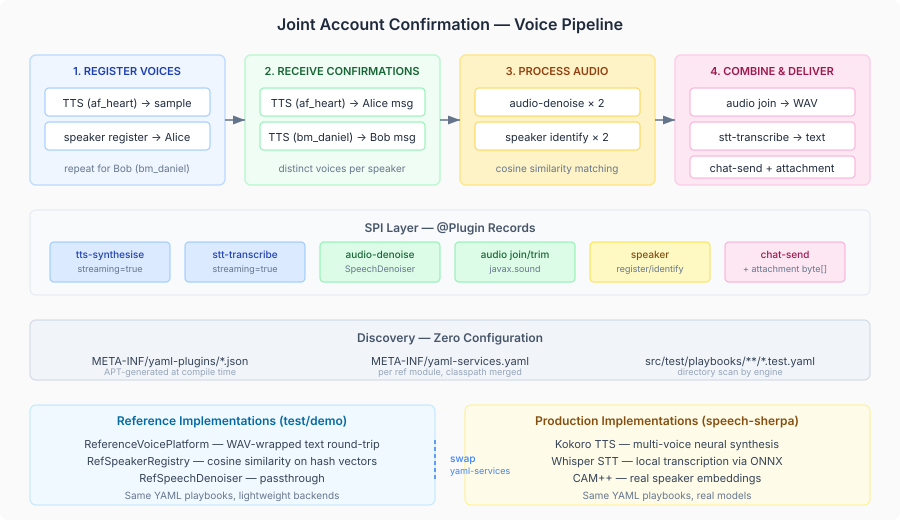

# YAML All the Way Down

A connector playbook that registers voiceprints, transcribes speech, denoises audio, identifies speakers by voice, joins two recordings into a single compliance file, and sends it to an admin channel — with the full transcript — should be testable without writing Java. The playbook is YAML. The test assertions are YAML. The service configuration is YAML. The only Java is the `@Plugin` record that defines each step, and that lives in the SPI module next to the interface it wraps.

The entire test suite is three lines:

```java
@Suite
@IncludeEngines("casehub-yaml")
@SelectDirectories("src/test/playbooks")
class ConnectorPlaybookSuiteTest {}
```

No test wiring. No service construction. No plugin registration. The casehub-yaml engine discovers everything from the classpath — plugins via APT-generated manifests, services via `yaml-services.yaml`, test files via directory scan.

## The compliance playbook

The joint account confirmation scenario exercises the full voice processing stack. Two account holders must verbally confirm a transaction. The system registers their voiceprints, receives their confirmations, cleans the audio, verifies who spoke, joins the recordings, transcribes the result, and sends it all to a compliance channel.

```yaml
steps:
  - tts-synthesise:
      text: Hello, I am Alice
      voice: af_heart
    capture: aliceSample

  - speaker register:
      name: Alice Smith
      audio: ${aliceSample.audio-data}

  - tts-synthesise:
      text: I, Alice Smith, confirm this transaction of 500 pounds
      voice: af_heart
    capture: aliceMessage

  - audio-denoise:
      audio: ${aliceMessage.audio-data}
    capture: aliceClean

  - speaker identify:
      audio: ${aliceClean.audio-data}
    capture: aliceId

  - audio join:
      first: ${aliceClean.audio-data}
      second: ${bobClean.audio-data}
    capture: combinedRecording

  - stt-transcribe: ${combinedRecording.audio-data}
    capture: fullTranscript

  - chat-send:
      channel: compliance
      message: "We have identified ${aliceId.name} and ${bobId.name} by voice, and they have both authorised the payment. Transcript: ${fullTranscript.text}"
      attachment: ${combinedRecording.audio-data}
      attachment-type: audio/wav
      attachment-name: joint-authorisation.wav
    capture: auditRecord
```

Seven domain plugins. Four SPI boundaries (voice, audio, speaker, chat). Binary data flowing through expressions — `${aliceClean.audio-data}` is a `byte[]` at runtime, not a string. The expression engine preserves Java types end-to-end, so the `audio join` step receives actual WAV bytes, not a serialised representation.

The `voice: af_heart` parameter selects a Kokoro TTS voice model. `bm_daniel` voices the second speaker. In the reference implementation, each voice embeds a tag the speaker identification system can match. In production, these are real neural voice models with distinct acoustic fingerprints — the playbook is the same either way.

## Audio processing is a plugin

The `audio` plugin handles WAV manipulation via `javax.sound.sampled` — pure JDK, zero dependencies. Four operations through the compact form:

```yaml
- audio join:
    first: ${alice.audio-data}
    second: ${bob.audio-data}

- audio trim:
    audio: ${recording.audio-data}
    start: 1.5
    end: 10.0

- audio splice:
    target: ${base.audio-data}
    insert: ${clip.audio-data}
    at: 3.0

- audio mix:
    first: ${music.audio-data}
    second: ${voice.audio-data}
    balance: 0.3
```

The `absorbSiblings = true` pattern gives the compact form — `audio join` means plugin name `audio`, operation `join`. The remaining keys are the parameters. One `@Plugin` record handles all four operations.

## Attachments flow through too

`chat-send` now carries binary attachments. The compliance playbook sends the combined WAV file alongside the transcript:

```yaml
- chat-send:
    channel: compliance
    message: Joint confirmation complete
    attachment: ${combinedRecording.audio-data}
    attachment-type: audio/wav
    attachment-name: joint-authorisation.wav
```

The `attachment` field is `@Optional byte[]` on the `ChatSendPlugin` record. The expression resolves to `byte[]` at runtime. The APT-generated action casts it correctly. The JSON Schema declares it as `type: object` — a reasonable mapping since JSON Schema has no native binary type. The type safety lives in the Java record and the expression engine, not in the schema.

## Services register themselves

Each reference implementation ships its own `META-INF/yaml-services.yaml`:

```yaml
# voice-ref/src/main/resources/META-INF/yaml-services.yaml
io.casehub.connectors.voice.spi.VoicePlatform: io.casehub.connectors.voice.ref.ReferenceVoicePlatform
io.casehub.connectors.voice.spi.SpeechDenoiser: io.casehub.connectors.voice.ref.RefSpeechDenoiser
io.casehub.connectors.voice.spi.SpeakerEmbeddingExtractor: io.casehub.connectors.voice.ref.RefSpeakerEmbeddingExtractor
io.casehub.connectors.voice.spi.SpeakerRegistry: io.casehub.connectors.voice.ref.RefSpeakerRegistry
```

The engine discovers all `yaml-services.yaml` files from the classpath via `cl.getResources()` and merges them. Depend on `voice-ref` and you get VoicePlatform, the denoiser, the speaker embedding extractor, and the speaker registry — all registered automatically. No centralised configuration file. No wiring class. The dependency is the declaration.

## The test verifies everything

The test asserts on speaker identification, audio format, transcript content, and compliance delivery — all from named captures:

```yaml
tests:
  - name: full pipeline — register, confirm, denoise, identify, join, send
    steps:
      - run-playbook: ../../../main/playbooks/voice-interaction-patterns/06-joint-account-confirmation.playbook.yaml
        capture: result
      - assertThat: result.captures.aliceId.identified
        equals: true
      - assertThat: result.captures.aliceId.name
        equals: Alice Smith
      - assertThat: result.captures.fullTranscript.text
        contains: confirm this transaction
      - assertThat: result.captures.auditRecord.ok
        equals: true
```

No mocks. No stubs. No test fixtures. Reference implementations execute real logic with real data. The speaker registry does cosine similarity matching on the embeddings. The audio join produces a valid WAV file via `javax.sound.sampled`. The STT extracts text from the WAV data section. Every step does real work — just with lightweight local implementations instead of neural models.



The voice processing stack in `speech-sherpa` — Whisper for STT, Kokoro for TTS, CAM++ for speaker embeddings, sherpa-onnx for denoising and VAD — implements the same SPIs. Swap the `yaml-services.yaml` in each module, and the same playbooks run against real models. The playbook is the contract. The service configuration is the deployment concern.
