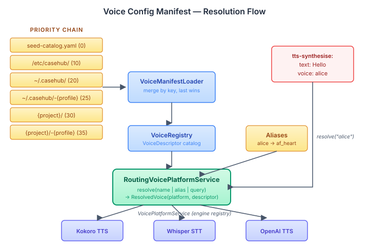

# Voice Needs a Manifest

A playbook step that says `voice: af_heart` should not need to know that Heart is a Kokoro voice, that Kokoro needs a model directory at `/models/kokoro-multi-lang-v1_0`, or that the voice-id Kokoro understands is `0`. The step names a voice. Something else resolves it.

The agent side of the platform already solved this problem. `agent-config.yaml` declares LLM providers and models in a priority chain — classpath seed, system config, user config, project override. `ModelRegistry` catalogs descriptors. `RoutingAgentProvider` resolves a model reference (by name, alias, tier, or criteria query) to the right backend, transparently. The caller says `model: fast` and the router picks Claude Haiku on the configured Anthropic backend.

Voice needs the same thing.

## The problem with hardcoded vendor knowledge

The voice pipeline steps built earlier in this branch take a `voice` string and pass it straight through to the underlying `VoicePlatform`:

```java
var options = new SynthesisOptions(voice, language, "wav", false);
return voicePlatform.textToSpeech().synthesise(text, options);
```

This works when there's exactly one TTS vendor. The moment you have two — say Kokoro for local inference and OpenAI for cloud fallback — the caller needs to know which vendor owns which voice name. The playbook step becomes vendor-aware, which violates the entire point of having a platform abstraction.

The agent config pattern already showed that the fix is a manifest: declare the voices, declare the vendors, let a registry and a router handle the mapping.

## The pattern mirror

I built the voice config as a direct structural mirror of the agent config. Every type has an exact analogue:

| Agent Config | Voice Config |
|---|---|
| `ModelDescriptor` | `VoiceDescriptor` |
| `ModelRegistry` | `VoiceRegistry` |
| `ModelQuery` | `VoiceQuery` |
| `ManifestLoader` | `VoiceManifestLoader` |
| `RoutingAgentProvider` | `RoutingVoicePlatformService` |

The voice manifest loader reads `voice-config.yaml` from the same six-level priority chain — classpath seed catalog at priority 0, `/etc/casehub/` at 10, `~/.casehub/` at 20, profile variants at 25, project directory at 30/35. Higher priority overrides lower, keyed by voice name for voices, vendor for providers, alias name for aliases. The merge is a `LinkedHashMap` sorted by priority — identical to what the agent loader does.



## What a voice-config.yaml looks like

```yaml
providers:
  - vendor: kokoro
    model-dir: ${KOKORO_MODEL_DIR:/models/kokoro-multi-lang-v1_0}
  - vendor: whisper
    model-dir: ${WHISPER_MODEL_DIR:/models/whisper-large-v3}

voices:
  af_heart:
    vendor: kokoro
    voice-id: "0"
    name: Heart
    gender: female
    accent: american
    quality: 4.5
    languages: [en-US]
    capability: tts

aliases:
  alice:
    voice: af_heart
  high-quality:
    min-quality: 4.0
    prefer-vendor: kokoro
    capability: tts

defaults:
  tts-vendor: kokoro
  stt-vendor: whisper
```

Three resolution modes. By name: `voice: af_heart` looks up the descriptor directly. By alias: `voice: alice` follows the alias to `af_heart`. By criteria: the alias `high-quality` queries the registry and picks the best match. But this last one is where the real power is.

## Selecting a voice by criteria

Every `VoiceDescriptor` carries metadata beyond just its name — vendor, gender, accent, quality rating, supported languages, style, and capability (TTS, STT, or both). A `VoiceQuery` can filter on any combination of these fields. The registry returns all voices that match, and the router picks the best one.

A criteria alias in the manifest declares a query:

```yaml
aliases:
  narrator:
    gender: male
    accent: british
    min-quality: 4.0
    capability: tts
  customer-service:
    gender: female
    style: cheerful
    language: en-US
    capability: tts
  best-available:
    min-quality: 4.0
    prefer-vendor: kokoro
    capability: tts
```

When a playbook says `voice: narrator`, the router doesn't look up a voice called "narrator" — it builds a `VoiceQuery` from the alias fields and queries the registry. Every voice whose gender is male, accent is british, quality is 4.0 or above, and capability includes TTS is a candidate. If `prefer-vendor` is set, voices from that vendor rank first. Otherwise the router picks the highest quality match.

This means a playbook can express intent without naming a specific voice:

```yaml
steps:
  - tts-synthesise:
      text: Welcome to your account summary.
      voice: narrator
  - tts-synthesise:
      text: How can I help you today?
      voice: customer-service
```

The voice that reads the account summary depends on what's in the registry — which depends on the manifest files in the priority chain. A deployment with Kokoro voices configured might resolve `narrator` to `bm_daniel` (male, british, quality 4.3). A deployment with OpenAI voices might resolve it to something else entirely. The playbook doesn't change.

`VoiceQuery` also works programmatically. Java callers who don't want to go through an alias can build a query directly:

```java
var query = VoiceQuery.builder()
    .gender("female")
    .language("es")
    .minQuality(4.0)
    .capability(VoiceCapability.TTS)
    .build();
var resolved = routing.resolveQuery(query);
```

The same filtering and selection logic applies — the registry matches, the router picks the best candidate, and the caller gets back a `ResolvedVoice` with the platform and descriptor.

The criteria fields are all optional. A query with only `capability: stt` returns every STT voice in the registry. A query with `gender: female` and `accent: american` narrows to that intersection. The `all()` query matches everything. The principle is the same as `ModelQuery` on the agent side — declare what you need, let the registry find what matches.

The seed catalog that ships with the SPI maps the Kokoro voice names to the `ref` vendor — the in-memory reference platform. A deployment that wants real Kokoro inference drops a `voice-config.yaml` in the project directory that maps the same voice names to the `kokoro` vendor. The playbook YAML doesn't change. The voice name is an abstraction that the manifest resolves.

## What this changes for the plugin

The TTS plugin used to take a `VoicePlatform` directly. Now it takes a `RoutingVoicePlatformService`:

```java
@Execute
public SynthesisResult apply(String text, RoutingVoicePlatformService routing) {
    if (voice != null) {
        var resolved = routing.resolve(voice);
        var options = new SynthesisOptions(
            resolved.descriptor().voiceId(), language, "wav", false);
        return resolved.platform().textToSpeech().synthesise(text, options);
    }
    return routing.defaultTts().textToSpeech().synthesise(text, ...);
}
```

`resolve("alice")` returns a `ResolvedVoice` — the correct `VoicePlatform` engine for that voice's vendor, plus the `VoiceDescriptor` with the vendor-specific voice-id. The plugin doesn't need to know that Alice is a Kokoro voice. It doesn't need to know what Kokoro is.

The same applies to STT. `routing.defaultStt()` returns the platform for the configured default STT vendor. A playbook that transcribes audio doesn't pick an engine — the manifest picks it.

## Why not extend the agent manifest?

Voice config lives in connector infrastructure, not agent infrastructure. The agent manifest (`agent-config.yaml`) belongs to `agent-config-core` in the platform. Adding voice sections to it would couple `voice-spi` to `agent-config-core` — a dependency that doesn't exist and shouldn't. The priority-chain pattern is simple enough (six `addFileIfExists` calls and a `LinkedHashMap` merge) that duplicating it costs less than the coupling.

A shared utility in `platform-api` was the other option. But a 20-line pattern doesn't justify a new platform abstraction. If a third config type needs the same chain, that's the time to extract.

## The alias cycle guard

One difference from the agent pattern: voice aliases can reference other aliases, which means cycles are possible. `alice → bob → alice` would stack-overflow without protection. The resolver tracks a visited set and throws on a cycle — something the agent router doesn't need because model chains are flat lists, not recursive references.

The code review caught this. A cycle in a config file is a deployment error — the right response is a clear error message at startup, not a silent stack overflow at the first TTS call.
