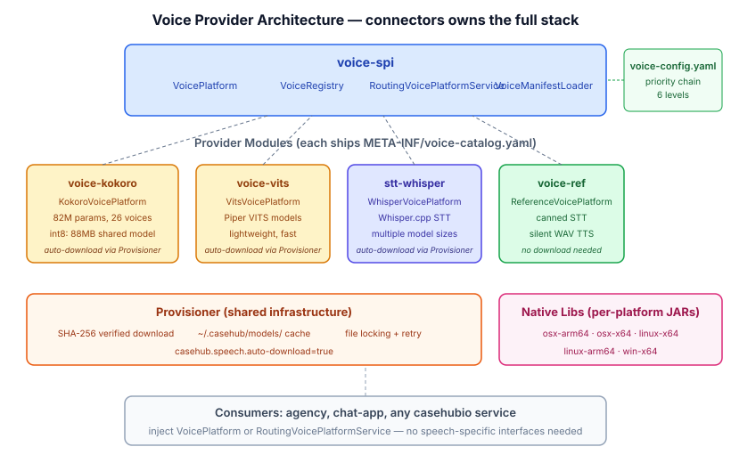

# Voice Implementations Come Home

*Continues from [Voice Needs a Manifest](2026-11-09-mdp02-voice-needs-a-manifest.md).*

The manifest and routing landed. A playbook step says `voice: af_heart`, the `RoutingVoicePlatformService` resolves it to the right `VoicePlatform` engine, and nobody in between needs to know that Heart is a Kokoro voice or that Kokoro needs a model directory. The abstraction works.

But there's a gap in the architecture that the manifest made visible. The voice SPI — `VoicePlatform`, `SpeechToText`, `TextToSpeech`, all 21 types — lives in connectors. The real implementations — `KokoroTextToSpeech`, `SherpaOnnxSpeechToText`, `WhisperSpeechToText`, the provisioner that downloads models — live in agency's `speech-sherpa` module. The abstraction is here; the work happens over there.

## Every other SPI has its providers alongside

Look at how the rest of connectors is structured:

| SPI | Providers |
|-----|----------|
| `chat-spi` | `chat-slack`, `chat-discord`, `chat-signal`, `chat-irc` |
| `email-spi` | `email-ref`, `email-google` |
| `calendar-spi` | `calendar-ref`, `calendar-google` |
| `commerce-spi` | `commerce-ref`, `commerce-amazon`, `commerce-shopify` |
| `voice-spi` | `voice-ref` ... and then? |

For voice, the row just stops. The reference implementation is here, but the production providers that actually produce audio and transcribe speech live in a different repository. That's an anomaly. No other platform SPI works this way.

The consequence is practical. If you're building a casehubio service that needs real voice — say a customer support app that transcribes calls — you depend on connectors for the SPI and on agency for the implementation. Agency is an agent orchestration framework. Your customer support app shouldn't need an agent framework to produce speech.

## The adapter that shouldn't exist

Agency has its own `SpeechToTextService` and `TextToSpeechService` interfaces. These predate `VoicePlatform` — they were the original speech abstractions, tightly coupled to agency's service wiring. When I built `voice-spi` in connectors, the plan was to bridge: an adapter in agency that wraps `VoicePlatform` and exposes it through agency's existing interfaces.

I'd already filed the issue. Then I looked at the interfaces side by side.

`TextToSpeechService.synthesise(String text, SynthesisOptions options)` returns `SynthesisResult`. `TextToSpeech.synthesise(String text, SynthesisOptions options)` returns `SynthesisResult`. Same signature. Same types. The agency interface adds nothing — no extra methods, no extra context, no agency-specific concerns.

The adapter would be a class that implements one interface by calling through to an identical interface. That's not an adapter. That's a symptom.

## What actually needs to move

The real implementations in `speech-sherpa` are:

- `KokoroTextToSpeech` — Kokoro v1.0/v1.1 TTS via sherpa-onnx
- `VitsTextToSpeech` — Piper VITS models
- `SherpaOnnxSpeechToText` — sherpa-onnx STT
- `WhisperSpeechToText` — Whisper.cpp STT
- `SherpaOnnxSpeechDenoiser` — noise reduction

These should become connectors modules: `voice-kokoro`, `voice-vits`, `stt-whisper`. Each implements `VoicePlatform` and ships a `META-INF/voice-catalog.yaml` that declares its voices. Add the module to your pom, the voices appear in the registry.

```java
// voice-kokoro/src/main/resources/META-INF/voice-catalog.yaml
providers:
  - vendor: kokoro
voices:
  af_heart:
    vendor: kokoro
    voice-id: "0"
    name: Heart
    gender: female
    accent: american
    capability: tts
  bm_daniel:
    vendor: kokoro
    voice-id: "1"
    name: Daniel
    gender: male
    accent: british
    capability: tts
defaults:
  tts-vendor: kokoro
```

The `VoiceManifestLoader` needs one change: scan `ClassLoader.getResources("META-INF/voice-catalog.yaml")` (plural) instead of loading a single hardcoded classpath resource. Every provider module contributes its catalog. The loader merges them all at priority 0, same as `yaml-services.yaml` works for plugin discovery.

## 88 megabytes that Maven shouldn't carry

I'd initially assumed voice models would be Maven artifacts — publish the ONNX files to GitHub Packages, declare a dependency, Maven downloads them like any JAR.

Then I looked at what agency actually does. Kokoro isn't 80MB per voice. It's one shared ONNX model across all 26 voices — 88MB for the int8 quantisation, 310MB for fp32 — plus a small binary of style vectors that selects which voice to use. The model is a neural network; the voices are just steering vectors into it.

Agency uses auto-download provisioning. A `Provisioner` class downloads models from GitHub releases and HuggingFace on first use, caches them at `~/.casehub/models/`, verifies SHA-256 checksums, handles file locking and retry. No Maven artifacts. The models version independently from the code, download once, and stay cached across builds.

This is the right approach. An 88MB binary in a JAR inflates every build, can't be memory-mapped by the ONNX runtime, and versions lockstep with the code when it shouldn't. The provisioner downloads once and the model sits on disk where the runtime wants it.

The provisioner moves to connectors alongside the provider modules. It's shared infrastructure — any voice provider that needs external models uses it.

## After the migration

Agency's `SpeechToTextService` and `TextToSpeechService` get deleted. Not deprecated, not bridged — deleted. Any agency code that needs voice injects `VoicePlatform` or `RoutingVoicePlatformService` directly, the same way it would inject `ChatPlatform` or `EmailPlatform`. One SPI, one set of types, no wrapper interfaces pretending to add value.



The pattern is the same one that makes `chat-slack` and `email-google` work: the SPI defines the contract, provider modules implement it with real backends, and consumers depend on whichever providers they need. Adding Kokoro voice to your app becomes the same gesture as adding Slack chat — a Maven dependency and a config file.

That's the architecture I wanted when I started building voice-spi. It just took the manifest work to make the gap obvious enough to act on.
