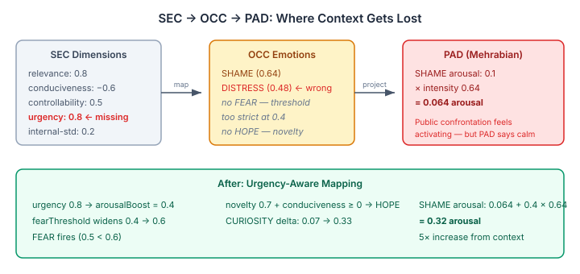

# The Emotion That Forgot to Panic

Mehrabian's PAD model assigns SHAME an arousal value of 0.1. That's the canonical number, published in 1980, replicated since. It's not wrong — quiet private shame is low-arousal. Head down, stomach sinking, energy draining. The literature captures that.

But put an agent in a public confrontation — caught in a lie, called out in front of friends, everyone going silent — and the canonical 0.1 produces an agent that feels calm about it. The coherence judge looked at the pipeline output and scored it 2.7 out of 5. The appraisal narrative described wanting to disappear. The PAD said the agent was barely activated.

The number is correct. The context is missing.

## The gap between taxonomy and pipeline

Scherer's SEC (Stimulus Evaluation Checks) framework gives you eight dimensions: relevance, novelty, urgency, conduciveness, controllability, adjustability, and two standards checks. The OCC emotion taxonomy gives you 22 emotion types organised by appraisal pattern. Mehrabian's PAD gives you the emotional space — pleasure, arousal, dominance — to project each emotion into.

The theory is clean. SEC dimensions map to OCC types. OCC types project into PAD space. Each layer has its own literature, its own validation, its own canonical values.

The problem is that each layer was validated independently. Nobody ran a coherence evaluation across the full chain — from a natural-language observation through SEC appraisal through emotion type selection through PAD projection through drive modulation through prompt rendering — and asked "does this agent's response make sense?"

We did. Three scenarios failed.

## Three gaps, one class

The `EmotionMapper` was a clean 100-line utility. Six OCC emotions mapped from SEC dimensions. Three action tendencies. It passed every unit test. Here's what the eval surfaced:

**SHAME can't panic.** The public confrontation scenario produced SHAME at intensity 0.64. `AlmaPadTable.project()` multiplied the canonical arousal (0.1) by intensity, giving 0.064. The coherence judge expected high arousal for a situation described as wanting to "shrink" and "disappear." The PAD said the agent was tranquil. The canonical value encoded a theoretical average, not a contextual response.

**Curiosity can't activate.** A novel research discovery — "strange pattern in the data that nobody has documented before" — mapped to JOY because conduciveness was positive. JOY maps to CURIOSITY drive at `SECONDARY_BOOST` (0.25), producing a delta of 0.07. The curiosity drive barely registered. The mapper never checked novelty for emotion selection, only for action tendencies. HOPE — which maps to CURIOSITY at `BOOST` (0.5) — was never produced because novelty wasn't part of the emotion rules.

**FEAR can't fire under moderate control.** A security breach — data being exfiltrated, no one else notified — produced DISTRESS instead of FEAR. The mapper required `controllability < 0.4` for FEAR. The agent had moderate controllability (could take action) but extreme urgency. The `else if` chain meant controllability in the 0.4–0.5 range fell through to DISTRESS, regardless of how urgent the situation was.

## The fixes

Three changes, all in `EmotionMapper`:

**Urgency-based arousal boost.** After the canonical PAD projection, add `urgency × 0.5 × intensity` to the arousal component. When urgency is zero, canonical values survive unchanged. When urgency is 0.8, SHAME's arousal jumps from 0.064 to 0.32 — a 5× increase. The literature value stays as the baseline; urgency provides contextual activation.

**Novelty-based HOPE.** When `novelty > 0.4` and `conduciveness ≥ 0`, produce HOPE in addition to whatever else fires. HOPE maps to CURIOSITY at full `BOOST` (0.5). The combined curiosity delta jumps from 0.07 to 0.33 — enough to actually activate the drive. This is OCC-grounded: HOPE is prospect-based, triggered by positive evaluation of uncertain outcomes.

**Urgency-widened FEAR threshold.** When urgency exceeds 0.7, the controllability threshold for FEAR widens from 0.4 to 0.6. The `else if` chain becomes independent `if` statements, allowing FEAR and ANGER to co-occur in crises — fear of the situation, anger at the cause. This is Frijda: mixed action tendencies are the norm in high-activation states, not the exception.

The fourth change was to the LLM appraisal prompt itself. The `LlmAppraisalStrategy` system prompt requested six SEC dimensions — urgency wasn't one of them. The mapper consumed urgency; the LLM never produced it.

## What the eval showed

| Scenario | Before | After |
|----------|--------|-------|
| Security breach (FEAR) | 3.50 | **4.23** |
| Curiosity (HOPE) | 2.50 | **3.65** |
| Shame (arousal) | **4.28** | 3.70 |

The security breach scenario passed. FEAR fires at 0.90 intensity with arousal 0.99 — the urgency-widened threshold and arousal boost working together.

The curiosity scenario improved by 46%. HOPE now fires, curiosity drives activate, and three of four pipeline stages score above 4.0. The remaining drag is the channel weighter — a separate subsystem that doesn't prioritise attentional channels for curiosity-dominant states.

The shame scenario regressed from its previous passing score. The LLM now produces urgency for social confrontations (reasonable — a public callout feels urgent), which causes FEAR to fire alongside SHAME. Both map to AUTONOMY in the drive modulator, saturating it at 1.0. The coherence judge correctly flags this: a relational scenario about losing a friendship shouldn't maximise the autonomy drive.

That last point is the finding I didn't expect. The emotion mapping is doing the right thing — a public confrontation does involve fear. But the drive modulator maps SHAME → AUTONOMY + AFFILIATION(−0.2), actively suppressing the drive the scenario most needs. The problem moved downstream. Fixing the mapper exposed a drive modulation gap that was previously hidden by the wrong emotions being produced.

## Unit tests can't see this

Every `EmotionMapper` unit test passes. They verify that specific SEC inputs produce specific OCC outputs — and they're correct. FEAR fires when controllability is low. JOY fires when conduciveness is positive. SHAME fires when internal standards are violated.

What unit tests can't verify is whether the pipeline output — the final prompt sections that an LLM agent reads — makes psychological sense. That requires a coherence judge: an LLM that reads the observation, the appraisal result, the drive state, and the prompt output, then scores whether the chain holds together. A human would call this "does this feel right?" We formalised that as a transition coherence score across pipeline stages.

The security breach unit test says FEAR fires at the right intensity. The eval test says the prompt output makes an agent that sounds scared, acts urgently, and focuses on the right channels. Those are different claims, and only the second one tells you whether the system works.

Four follow-up issues filed: SHAME→AFFILIATION suppression (#983), drive saturation clamping (#984), curiosity channel prioritisation (#985), ATTENDING→attentional channel (#986). The mapper exposed them. The mapper didn't cause them.
