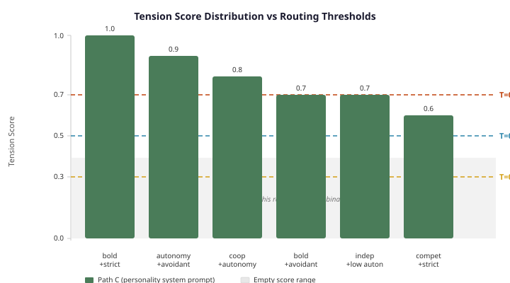

# The Threshold That Didn't Matter

The personality-aware situation classifier routes profiles through one of two prompt paths. Path A appends a personality suffix to the user prompt — lightweight, informational. Path C rebuilds the entire system prompt around the character's internal tension — the LLM inhabits the interpretive frame rather than applying it from outside.

The routing boundary was hardcoded at 0.5. A tension score above 0.5 triggers path C. Below it, path A. The design spec flagged this: "Test at 0.3, 0.5, 0.7 to validate the routing boundary."

I expected this to be a meaningful calibration exercise — find the sweet spot where enough profiles benefit from path C without over-applying it. The actual finding was simpler and more interesting.

## The score distribution makes the threshold irrelevant

The tension table has six entries. Each represents a genuine psychological conflict between two disposition axis values — bold risk appetite paired with strict rule-following, high autonomy paired with avoidant conflict style, and four others. Each was hand-curated with a narrative that describes how the conflict shapes perception.

Every entry scores between 0.6 and 1.0. Profiles without a matching conflict pair score exactly 0.0. There is nothing in between.

This means any threshold in the range (0.0, 0.6) produces identical routing. Threshold 0.3 and threshold 0.5 send exactly the same profiles to path C. The "sensitivity analysis" turned out to be a proof that the parameter has no sensitivity in the current operating range.

## Why 0.7 is wrong and 0.5 is arbitrary but correct

Threshold 0.7 does change something. It excludes three tension entries: competitive+strict (0.6), bold+avoidant (0.7), and independent+low-autonomy (0.7). The strict-greater-than comparison means 0.7 tension doesn't clear a 0.7 threshold.

These aren't weak tensions. The bold+avoidant narrative reads: "impulsive toward action but shrinks from interpersonal friction — sees opportunities but worries about the social cost of seizing them." That's a genuine perceptual conflict. At threshold 0.7, the classifier falls back to path A's generic suffix — "classify as this character would perceive it" — which can't capture the push-pull dynamic that defines these profiles.

Threshold 0.5 captures all six curated tensions. It provides headroom for hypothetical future entries at 0.4 or 0.5 tension, though adding such weak tensions would need its own justification. In practice, 0.5 is the right value not because sensitivity analysis found it optimal, but because the score distribution makes every value below 0.6 equivalent.

## What actually matters: the table is binary

The deeper observation is that the tension table is binary by construction. A pair of axis values either creates a named psychological conflict or it doesn't. There's no concept of "slightly conflicted." The scores — 0.6 through 1.0 — represent the severity of fully-formed conflicts, not a continuum from no-conflict to full-conflict.

This has a practical implication for extending the system. If someone adds a new tension entry, they need to decide: does this pair create a genuine interpretive conflict that warrants a dedicated system prompt narrative? If yes, score it ≥ 0.6 and the threshold captures it automatically. If the conflict is too weak to justify a narrative, it shouldn't be in the table at all.

The threshold isn't a tuning knob. It's a safety margin between the lowest legitimate score and zero.

## Making it configurable anyway

The threshold is now a config property: `casehub.caps.classification.tension-threshold`, defaulting to 0.5. The constructor validates it falls within [0, 1]. The CDI producer wires the property through to the classifier instance.

Why make something configurable when the analysis shows one value is equivalent to many others? Because the analysis is about the current table. A future extension could introduce tensions in the 0.3–0.5 range. A production deployment might want to experiment with routing fewer profiles to path C to reduce LLM cost. Configurability costs nothing and avoids a future code change for what should be a runtime decision.

The eval test exercises all six tension table entries across thresholds 0.3, 0.5, and 0.7 — seven profiles total including a zero-tension baseline. It measures inter-profile activation variance, dual-activation rates for approach vs. inhibition nodes, and classification stability for profiles that route to the same path regardless of threshold. The LLM data collection is blocked by a model deployment issue, but the test structure is in place to validate findings when the deployment catches up.

## The pattern worth naming

Sensitivity analysis that reveals insensitivity is still a finding. The question "what's the right threshold?" had a boring answer — any value below 0.6 works. But the meta-question — "why doesn't it matter?" — revealed something about the design: the tension table's binary score distribution means the threshold is a formality, not a control surface.

This is worth knowing before someone spends time tuning it. It also means the real control surface is the table itself — which axis-value pairs get entries, what narratives they carry, and how high they score. That's where future calibration effort should go, not the threshold.
