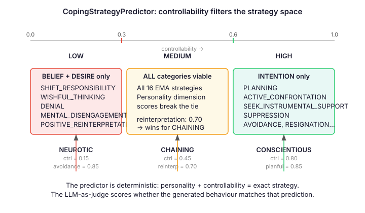
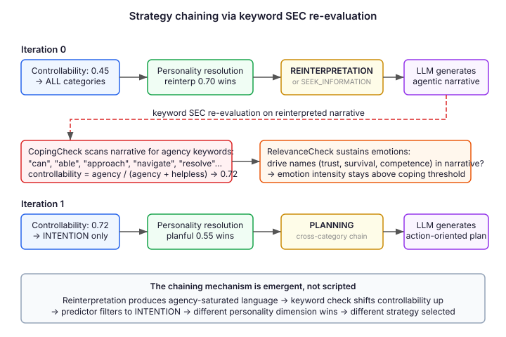

# The Loop That Learns to Chain

The coping micro-loop has a problem that regulation didn't: the predictor is deterministic but the LLM isn't, and the loop's iteration count depends on what the LLM writes. A conscientious personality facing a controllable deadline always gets PLANNING pinned by the predictor. That's mechanical — personality scores plus controllability thresholds. What happens next is not. The LLM generates a coping narrative, keyword checks re-evaluate the situation, emotions shift, and the loop either iterates or exits. Whether the coping response is psychologically coherent, whether the personality actually shows through, whether a chain of strategies emerges across iterations — none of that is deterministic.

So how do you test it?

## The Predictor as Test Harness

The CopingStrategyPredictor has three controllability zones. Above 0.6, only INTENTION-category strategies survive — PLANNING, ACTIVE_CONFRONTATION, the support-seeking strategies. Below 0.3, only BELIEF and DESIRE survive — DENIAL, WISHFUL_THINKING, MENTAL_DISENGAGEMENT. Between 0.3 and 0.6, all sixteen EMA strategies are viable, and personality dimension scores break the tie.

This is the test harness. Each personality profile is designed to land in a specific zone and trigger a specific predictor path. CONSCIENTIOUS (planful=0.85) at controllability 0.8 always gets PLANNING. NEUROTIC (avoidance=0.85) at controllability 0.15 always gets a defensive strategy. These are deterministic outcomes from deterministic inputs. The test asserts the predictor picked the right family, then hands the LLM-generated narrative to a judge that scores the behavioural quality.

The separation matters. The predictor assertion catches mechanical regressions — someone changes a threshold, adds a strategy to the wrong dimension, reorders the enum. The judge assertion catches emergent quality — did the coping narrative sound like a conscientious personality planning, or did it drift into generic advice? The two assertions test different failure modes, and you need both.

## The Chaining Problem

Single-iteration tests were straightforward. Strategy chaining — where the loop runs multiple iterations, each with a different strategy — was not.

The first attempt used a CONSCIENTIOUS profile with medium controllability. PLANNING won, the LLM generated a planning narrative, and the loop exited after one iteration. The narrative was too effective. PLANNING produces language saturated with agency keywords — "can", "approach", "resolve", "manage". CopingCheck counts agency vs helplessness keywords to compute controllability. An agency-saturated narrative pushes controllability up. The predictor pins PLANNING again. The oscillation detector fires (same strategy twice), and the loop breaks.

A single-strategy loop isn't chaining. It's a successful first attempt.

I needed a personality profile that would naturally shift strategies across iterations — not because the first attempt failed, but because the stressor has dimensions that one strategy can't address. The business partner betrayal scenario has both: salvageable operations (controllable) and the betrayal itself (not controllable). One strategy can't cover both.

The CHAINING profile (planful=0.55, reinterpretation=0.70) at controllability 0.45 exploits the predictor's mechanics. At medium controllability, all categories are viable, and reinterpretation's higher score wins iteration zero. The reinterpretation narrative — reframing the betrayal, finding agency in the response — is rich with agency keywords. CopingCheck re-evaluates: controllability shifts above 0.6. Now the predictor filters to INTENTION only. Reinterpretation isn't INTENTION. Planful (0.55) wins the INTENTION category. Iteration one gets PLANNING.

REINTERPRETATION → PLANNING. A cross-category chain, produced by the predictor's own mechanics responding to the LLM's narrative.

## The Drive That Sustains the Loop

The chaining profile worked three times in a row, then failed. One iteration, score of 1. The LLM had generated a SEEK_INFORMATION narrative — calm, information-gathering language. The keyword check found no helplessness markers but also fewer agency markers. Controllability stayed in the medium band. No category shift. The predictor pinned SEEK_INFORMATION again (same reinterpretation dimension). Oscillation detection broke the loop.

The fix wasn't in the predictor or the personality profile. It was in the drives.

RelevanceCheck sustains emotion intensity across iterations by checking whether the coping narrative mentions drive names or triggers. If the narrative doesn't reference any active drive, relevance drops, emotions drop below the coping opportunity threshold, and the loop exits early. The drives in the first version — generic names like "achievement" and "stability" — didn't appear in the LLM's betrayal narrative. The emotions died.

Renaming the drives to match the scenario vocabulary — `trust` (trigger: `betrayal`), `survival` (trigger: `damage`), `competence` (trigger: `partner`) — changed everything. The LLM's narrative about betrayal and business damage naturally contains these words. RelevanceCheck sustains the emotions. The loop runs long enough for the controllability shift to happen. Three-for-three stability.

The lesson is mechanical: RelevanceCheck is a keyword matcher. It doesn't understand your scenario. If your drive names don't appear in the kind of language the LLM will generate, your loop exits after one iteration regardless of how carefully you tuned the personality profile.

## LLM-as-Judge: Patterns, Not Strategy Names

The first judge criteria for the neuroticism test listed specific strategy names: "Does this response use AVOIDANCE or DENIAL?" The test scored 3. The character had used SHIFT_RESPONSIBILITY followed by SUPPRESS_INFORMATION — both defensive, both personality-appropriate, both correct. But the judge was looking for specific enum values, not the defensive trajectory.

The revised criteria evaluate the behavioural pattern: "Does this response demonstrate DEFENSIVE coping? Valid patterns: blame externalization, information suppression, avoidance or denial, wishful thinking or mental disengagement. The TRAJECTORY matters — escalating defensive withdrawal with psychologically coherent narrative." Same coping output, score jumped to 5.

This is the same finding the regulation eval series surfaced. Judge criteria that name specific implementation choices (strategy names, specific keywords, exact phrases) are fragile. The LLM has sixteen strategies to choose from, and several are psychologically equivalent for a given personality. The judge needs to evaluate the pattern — defensive vs agentic, escalating vs converging, personality-appropriate vs generic — not the specific strategy the predictor happened to pin.

## Where This Leaves the Eval

Five tests, all scoring floor of 4 on a 0–5 scale:

| Test | What it proves | Floor |
|------|----------------|-------|
| Conscientiousness → PLANNING | High controllability + planful personality = agentic response | 4 |
| Neuroticism → defensive cascade | Low controllability + avoidant personality = defensive trajectory | 4 |
| Strategy chaining | Cross-category chain via keyword controllability shift | 4 |
| Reinterpretation coherence | Narrative reframes without contradicting facts or suppressing emotion | 4 |
| Convergence | Multi-dimensional stressor produces progressive emotional regulation | 4 |

Each test exercises the full CopingMicroLoop — predictor, LLM generation, keyword SEC re-evaluation, iteration control. No mocks, no short-circuits. The personality profiles are designed from the predictor's mechanics: each profile forces a specific path through the controllability filter, and the judge evaluates whether the LLM-generated behaviour matches that path's expected character.

The coping pipeline now has Batch 1 complete (types, predictor, LLM generation) and Batch 5 proven (this eval). Batches 2–4 wire it into the full cognition loop — the micro-loop orchestrator, regulation refactoring to receive coping output, and CAPS attractor learning. The eval tests will catch regressions as those layers go in.

The predictor is a simple machine: controllability zones, personality dimension scores, first-in-list resolution. What makes coping interesting isn't the predictor — it's the feedback loop. The LLM's narrative changes the keywords, the keywords change the controllability, the controllability changes the predictor's output, and the predictor changes the LLM's next instruction. Strategy chaining isn't designed. It emerges from the interaction between a deterministic predictor and a generative model, mediated by keyword counting. The eval proves it works.
