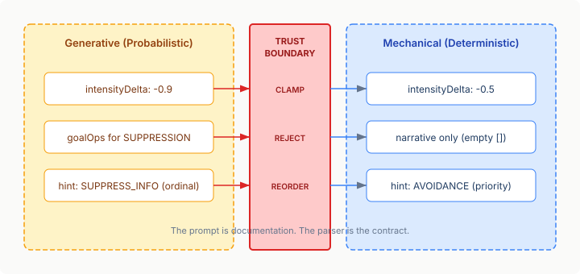

# Every Field Is a Boundary

The coping micro-loop generates JSON. The CopingGenerationPhase prompts the LLM with a schema — strategy name, narrative, goal operations, drive modulations, attention directives — and parses the response into typed records. The LLM fills fields. The pipeline trusts the values. That trust is the problem.

Three issues surfaced from a single code review pass, all variations on the same design flaw: the pipeline assumed the LLM would respect the prompt's constraints.

## The Delta That Wasn't Bounded

`parseDriveModulations()` reads an `intensityDelta` from the JSON — a number that represents how much a coping strategy shifts a drive. The prompt says "typically -0.1 to -0.3". The parser called `asDouble(0.0)` and passed the raw value through.

An LLM can return -0.9. Or +0.5. The prompt says "typically" — that's guidance, not enforcement. And even if the prompt said "must be between -0.3 and 0", the LLM has no obligation to comply. It generates text. The parser converts text to a double. The pipeline feeds that double into drive modulation arithmetic. An unclamped -0.9 delta on a drive with intensity 0.6 produces a negative drive intensity. The drive system wasn't designed for that.

The fix: `Math.clamp(delta, -0.5, 0.5)`. One line. The range is wider than "typical" because there are legitimate strong modulations — ACCEPTANCE reducing a drive substantially, or a coping response amplifying a drive. But ±0.5 caps the damage from hallucinated extremes.

The interesting part isn't the fix. It's that the prompt says one thing and the code enforced nothing. Every LLM-to-pipeline boundary has this gap. The prompt is a suggestion. The clamp is the contract.

## The Strategy Without a Rule

SEEK_EMOTIONAL_SUPPORT and SUPPRESSION are regulation-routed strategies. When the coping micro-loop selects one, it doesn't produce goal operations or drive modulations — it produces a narrative reinterpretation, then hands off to the regulation pipeline for the actual social dispatch or expression modulation.

The prompt listed both strategies with their descriptions but didn't say what effects to generate. The rules section said "empty array otherwise" for goalOperations, driveModulations, and attentionDirectives — but "otherwise" is implicit. The LLM might generate a goal operation for SEEK_EMOTIONAL_SUPPORT ("find someone to talk to") because that's what support-seeking means in plain language.

The fix was explicit per-strategy guidance: "Narrative transformation only — regulation handles the social dispatch." Two lines in the system prompt. The LLM now has an unambiguous instruction per strategy, not an implicit default it has to infer from a general rule.

The pattern: when a strategy has a specific contract with another pipeline stage, the prompt must name that contract. "Empty array otherwise" is a catch-all that relies on the LLM understanding which strategies fall through. It won't, reliably. Name the boundary explicitly.

## The Order That Wasn't Intentional

`CopingStrategyPredictor` maps personality dimensions to strategy families. The "avoidance" family has nine strategies. When the predictor selects avoidance as the best-fit dimension but can't narrow to a single strategy, it returns `strategies.getFirst()` as the hint, lowers confidence, and sets a family label for the LLM to resolve.

The strategies were computed from an `EnumMap`, which iterates in enum declaration order. `CopingStrategy` declares SEEK_INFORMATION at ordinal 0 and SUPPRESS_INFORMATION at ordinal 1. Both map to dimensions that include them in the avoidance family. The avoidance family's first element was SUPPRESS_INFORMATION — not AVOIDANCE — because the enum happened to declare it earlier.

The hint strategy shapes the LLM's generation. SUPPRESS_INFORMATION as a hint for avoidance is misleading — it's a narrow attention strategy, not the prototypical avoidance response. The LLM picks up the hint even at lowered confidence.

The fix: replace the computed map with explicit priority-ordered lists. AVOIDANCE leads the avoidance family. POSITIVE_REINTERPRETATION leads the reinterpretation family. The ordering is a design decision, not an accident of enum declaration.

## The Principle

Every field the LLM fills is a trust boundary between a generative system and a mechanical one. The generative system is probabilistic. The mechanical system is deterministic. Where they meet, the mechanical side must enforce its own invariants:

- **Numeric fields** need range clamping. The LLM doesn't know your arithmetic.
- **Strategy-to-effect mappings** need explicit per-case rules. Implicit defaults rely on inference the LLM may not make.
- **Ordering** must be intentional. Any computed order that feeds into LLM prompting is a latent bug — the LLM will treat position as signal.

The prompt is documentation. The parser is the contract. Trust the contract.
