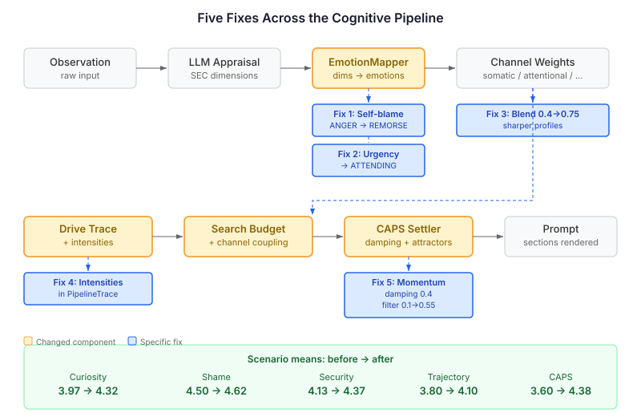

# The Filter That Let Everything Through

The coherence eval told us eight transitions were below 4.0 across five scenarios. The obvious fix — channel weight polarization — was item #1020 on the list: blend factors too low, action tendency profiles too similar to their base categories. Increase blend factors from 0.4 to 0.75, sharpen the profiles, done. That fixed the channel weight transitions from 3.8 to 4.3.

But the eval still failed three scenarios.

## Self-blame produces anger

The shame scenario has the agent lying to their closest friend and being confronted publicly. The appraisal should produce guilt, remorse, avoidance. Instead it produced ANGER at 0.87 intensity with ANTAGONISM at 0.90.

The root cause was in `EmotionMapper`. The mapper routes negative conduciveness + high controllability to ANGER and ANTAGONISM. That mapping is correct when someone else caused the problem — you're angry because something bad happened and you have the power to do something about it. But in a self-blame scenario, high controllability means something different. It means *you had a choice and you chose wrong*. That's guilt, not anger.

The SEC dimensions from the LLM appraisal were correct: internal-standards at 0.2 (moral failure), controllability at 0.7 (had agency), conduciveness at -0.8 (terrible outcome). The mapper just didn't distinguish self-caused from other-caused events. A single boolean — `selfBlame = internalStd < 0.5` — gates the ANGER, ANTAGONISM, and DOMINANCE paths. Under self-blame, the same high controllability routes to AVOIDANCE + SUBMISSION instead.

## The network that wouldn't stop oscillating

The CAPS consolidation scenario processes three graduated experiences of social exclusion through the CAPS network. Social rejection activates competing pathways — withdrawal (get away from the threat) and reactive aggression (fight back against the exclusion). The two output clusters feed back through mediating nodes and create interference patterns.

The original settler had two-cycle oscillation detection: check if the state two iterations ago matches the current state. That catches A-B-A patterns. It doesn't catch the slowly-decaying spiral that social-threat topologies produce, where withdrawal and antagonism alternate with diminishing amplitude but never reach the tight convergence epsilon of 0.001.

Momentum damping fixes this. Each iteration blends 40% of the previous activation with 60% of the new computed value. The damped network converges in 20-30 iterations instead of oscillating for 100 and reporting MAX_ITERATIONS. Wider oscillation detection — checking if the variance across the last five states is small — catches the cases where damping has effectively converged the network but individual node deltas haven't quite reached epsilon.

The convergence type changed from MAX_ITERATIONS to CONVERGED, and the judge's score went from 2.8 to 4.5. The activations were right all along — BIS activation, withdrawal, cautious approach, all psychologically appropriate for rejection. The dynamics of *how* they emerged were wrong.

## The filter that scored 0.5

This was the single change with the biggest impact across the entire CAPS consolidation scenario. The attractor strength filter threshold was 0.1 — any output node above 0.1 activation strength gets reported as a behavioral attractor. For bipolar nodes (tanh activation, resting at 0.0), that's sensible. For unipolar nodes (logistic activation, resting at 0.5), it means every output node in the topology passes the filter whether or not it received any input signal.

The BehavioralSynthesisPhase writes every attractor into the MindMap as a CapsGenerated node. The BehavioralPromptSection renders those nodes. So the prompt was showing "depend: noticeable, comply: noticeable, rebel: noticeable, self-direct: noticeable" alongside "co_regulation: deeply ingrained" — four autonomy nodes at their unstimulated baseline drowning the actual behavioral signal from the settling.

Changing the filter from 0.1 to 0.55 — just above the unstimulated logistic resting level — eliminated the noise floor. The genuinely activated attractors (0.6+) survived. The baseline nodes disappeared. The prompt now showed the real attractor landscape: co-regulation, cautious approach, social support seeking. The CAPS scenario mean jumped from 3.75 to 4.38.

## Urgency demands attention

One transition kept flickering between 3.8 and 4.3 across runs: security's appraisal-to-channel-weights. The issue was that ATTENDING — the action tendency that drives attentional channel weight emphasis — only fired when novelty exceeded 0.5. For a security breach, novelty is a coin flip. Some LLM runs gave the specific breach high novelty ("this particular database exposure is new"), others didn't ("security breaches are a known category").

But urgency should capture attention regardless of novelty. Ohman's 1986 work on pre-attentive threat processing established that threat-relevant stimuli capture attention before conscious appraisal of novelty. A building on fire demands your attention even if you've seen fires before. The fix: ATTENDING now fires on `max(novelty > 0.5 ? novelty : 0, urgency > 0.6 ? urgency * 0.9 : 0)`. The 0.9 multiplier on urgency means urgency-driven attention is slightly weaker than novelty-driven — you're focused but not curious.

## What this opens up

The coherence eval now passes all five scenarios. But passing isn't the same as good. The CAPS scenario still has transitions at 4.1 — the BehavioralPromptSection renders the top attractors but drops mid-tier ones that carry important psychological signal (the tension between withdrawal and proximity-seeking under threat). The drive trace enrichment (#1021) exposed another gap: the eval serialized drive data as bare category names for months before anyone noticed the judge couldn't see the mapping from appraisal to drives.

The attractor filter fix is worth generalising. Any threshold that works for one activation function but not another is a latent bug. Bipolar and unipolar nodes have fundamentally different resting levels, and a single threshold that handles both correctly is unusual. The 0.55 value works because the topology's output nodes are all unipolar. If the topology ever adds bipolar output nodes, the filter will need to be activation-function-aware.inge
