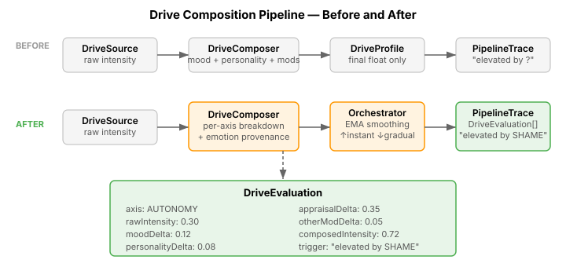

# The Black Box That Shrugged

Continuing from [yesterday's filter work](2026-11-16-mdp03-the-filter-that-let-everything-through.md). The channel weight transitions crossed the 4.0 gate, but three scores still wobbled: `appraisal-to-drives` at 3.3 in its worst run, `full-trace-consistency` at 4.2, and `cross-tick-trajectory` at 3.8. Each one pointed at the drive layer.

The drive system was a black box. Emotions went in, four floating-point intensities came out, and nothing in between was visible. When the eval judge saw COMPETENCE elevated during a shame scenario, it couldn't tell whether the system had evaluated the competence signal and found it above threshold, or whether the signal had been lost entirely. The trigger string said "elevated by emotional response" for every axis. That's the entire explanation.

## The provenance gap

Consider a shame scenario: the agent lies to a close friend and gets confronted publicly. The appraisal produces SHAME at high intensity. SHAME maps to AUTONOMY (primary, the urge to escape) and AFFILIATION (secondary, the relational wound). Both make psychological sense. But COMPETENCE also rises — not because shame directly maps there, but because high arousal from the shame triggers a general competence mobilisation. The mood pathway amplifies it.

The old system reported all three as "elevated by emotional response." The eval judge couldn't distinguish the direct SHAME→AUTONOMY pathway from the indirect arousal→COMPETENCE pathway. It scored this as incoherent: competence elevation during shame looks wrong unless you can see the arousal mechanism.

The fix was structural. `DriveComposer` now tracks each modulation delta separately — mood, personality, appraisal, and other (narrative, sub-thought). When the appraisal delta is the dominant contributor, the trigger names the specific emotion: "elevated by SHAME" instead of the generic shrug.

This required threading provenance through the pipeline. `AppraisalDriveModulator.dominantContributions()` identifies which emotion had the strongest effect on each axis. That information travels through `ModulationLayer` as per-axis descriptions, and `DriveComposer` uses it to generate human-readable triggers.

## DriveEvaluation: the full trace

The trigger string was one problem. The bigger one was that sub-threshold evaluations vanished entirely. `PipelineTrace.activatedDriveCategories()` returned only the drives above threshold. If AFFILIATION was evaluated at 0.25 against a 0.3 threshold, it disappeared. The judge saw zero affiliation signal and penalised for it — even when the narrative explicitly mentioned wanting to share a discovery with someone.

`DriveEvaluation` captures the full per-axis breakdown: raw source intensity, mood delta, personality delta, appraisal delta, other modulation delta, the final composed value, and whether it crossed the activation threshold. Every evaluation is visible, including the sub-threshold ones. The judge can now verify that AFFILIATION was evaluated, found sub-threshold at 0.25, and dismissed for a reason — not silently dropped.

One subtlety: the `composedIntensity` field records the pre-smoothing value. The orchestrator applies temporal smoothing afterward (see below), so the actual profile intensity may differ on downward transitions. This is architecturally correct — the evaluation traces what the composer computed, the smoothing is an orchestrator-level concern — but it needed documenting to avoid confusion.

## Temporal smoothing

The trajectory eval scored 3.8 because drives had no momentum. Each tick evaluated from scratch. A drive at 0.8 in tick N could be 0.0 in tick N+1 if the source signal changed. Psychologically, that's wrong — competence built through struggle doesn't evaporate at the moment of success.

The fix is asymmetric exponential smoothing: `smoothed = α * new + (1-α) * previous`, but only on downward transitions. Upward spikes bypass smoothing entirely — threat activation should be instant. With α at 0.3, drives ramp down over roughly three ticks instead of cliff-edging to zero.

One thing the code review caught: the initial implementation passed through the original `compositeMotivation` and `dominantDrive` from the pre-smoothing profile. After blending the intensities, the dominant axis might have flipped — CURIOSITY at 0.8 that gets smoothed to 0.5 while COMPETENCE stays at 0.6 means COMPETENCE is now dominant. The fix was to recompute both after smoothing.

## The tone problem

`SearchBudgetPromptSection` renders the 4D budget (depth, breadth, laterality, convergence) as cognitive-state prose. The prose is drive-shaped: it dispatches on which drive is dominant and renders curiosity language, competence language, etc. The problem is that it has no access to appraisal state. A data breach with FEAR at 0.89 and AVOIDANCE at 0.92 produces the same casual curiosity prose as a mild discovery, if their drive profiles happen to be similar.

The fix passes the current `AppraisalResult` to the prompt section via a supplier. When crisis emotions (FEAR, DISTRESS, FEARS_CONFIRMED) are present above 0.5 intensity, the prose gets a crisis qualifier: "This is not idle — something is wrong and demands your attention." When urgency exceeds 0.7 and action tendency intensity exceeds 0.8, it gets an urgency qualifier. The casual curiosity tone now only appears when the appraisal state actually warrants it.

## Channel weight expansions

Three more Frijda action tendencies got channel weight profiles: APPROACH (attentional + temporal for exploration), SUBMISSION (temporal-dominant for waiting and yielding), and DOMINANCE (action + somatic for assertion). REJECTION, INTERRUPTION, and INDIFFERENCE stayed unmapped — REJECTION overlaps AVOIDANCE too closely, INTERRUPTION lacks a clear secondary channel signature, and INDIFFERENCE maps correctly to equal defaults.

Also filled two gaps in the emotion→drive mappings: INTEREST→CURIOSITY (direct epistemic pathway), and DISTRESS→AFFILIATION as a secondary boost alongside its existing AUTONOMY primary. The Tangney relational argument that justified SHAME→AFFILIATION and REMORSE→AFFILIATION applies to DISTRESS too — empathic distress activates the social bonding drive.

## What opens up

The drive layer is no longer a black box. Every evaluation is traceable from source signal through each modulation to final intensity, with the dominant emotion named. The eval judge can verify not just what activated but what was considered and dismissed.

The temporal smoothing changes the character of multi-tick scenarios. Drives now have momentum that matches psychological intuition — competence doesn't vanish at the moment of success, affiliation doesn't wait for the user model to catch up. Whether the eval scores actually improve depends on how the judge weights trajectory realism against the new information density. I expect `appraisal-to-drives` to stabilise above 4.0 and `cross-tick-trajectory` to clear 4.0 for the first time.

The remaining queue items are the hard ones: CAPS settling convergence (M/High), BehavioralPromptSection attractor filtering, and attractor threshold activation-function dependence. All three operate in the CAPS engine — a different subsystem with different math and different failure modes. Fresh context.
