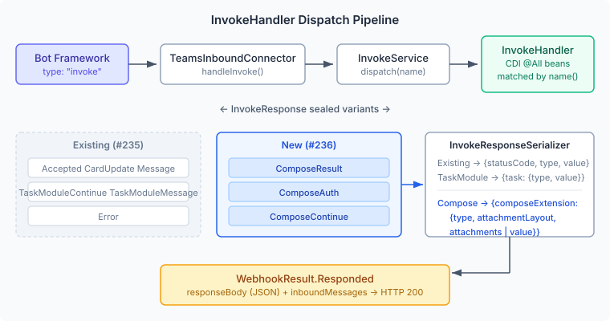

# The Dispatch That Didn't Change

Teams messaging extensions — search in the compose box, link unfurling, action forms — are a distinct interaction model from regular chat messages. Microsoft uses them to let bots surface content right where users are typing. A user searches for a customer in the compose box, picks a result, and a rich card drops into the conversation. No context switch, no slash command, no "please wait while I look that up."

Under the hood, though, they're just invoke activities. Same `type: "invoke"` as adaptive card actions or task module interactions. Different `name` prefix — `composeExtension/query` instead of `adaptiveCard/action` — but structurally identical. The Bot Framework delivers them to the same webhook endpoint, with the same JSON envelope, through the same auth flow.

That's what made this work interesting. Not the implementation — the implementation was trivial. What was interesting was that the invoke pipeline we built for adaptive card actions in the previous issue absorbed messaging extensions without a single line of dispatch code changing.

## The pipeline

When we built `InvokeHandler` for adaptive card support, the design was deliberately open:

```java
public interface InvokeHandler {
    String name();
    InvokeResponse handle(InvokeRequest request);
}
```

`InvokeService` collects all CDI beans implementing this interface and dispatches by name. `TeamsInboundConnector.handleInvoke()` doesn't care what the invoke name is — it passes everything through `InvokeService`, serializes whatever `InvokeResponse` comes back, and returns a `WebhookResult.Responded`.



For messaging extensions, the dispatch path is identical. A `composeExtension/query` activity arrives, `InvokeService` looks up a handler registered under that name, the handler returns an `InvokeResponse`, the serializer turns it into JSON, the connector wraps it in `WebhookResult.Responded`. The whole pipeline already works.

## What actually needed to change

The only gap was the response model. Messaging extension responses use a different JSON envelope from adaptive card responses:

```json
{
  "composeExtension": {
    "type": "result",
    "attachmentLayout": "list",
    "attachments": [{ "contentType": "...", "content": {...} }]
  }
}
```

Adaptive cards return `{statusCode, type, value}`. Task modules return `{task: {type, value}}`. Messaging extensions return `{composeExtension: {type, ...}}`. Three distinct envelopes for three interaction categories — but all flowing through the same sealed interface and serializer.

Three new `InvokeResponse` variants cover the entire messaging extension surface:

- **`ComposeResult`** — search results, link unfurling cards, item selection, and action results. All produce the same `{composeExtension: {type: "result"}}` envelope.
- **`ComposeAuth`** — SSO/OAuth flow initiation for extensions that need authentication.
- **`ComposeContinue`** — task module responses for action-based extensions that present a form.

Seven `composeExtension/*` invoke names, three response shapes. The mapping:

| Invoke name | Response |
|---|---|
| `composeExtension/query` | ComposeResult (list/grid) |
| `composeExtension/queryLink` | ComposeResult (unfurl card) |
| `composeExtension/selectItem` | ComposeResult (single card) |
| `composeExtension/submitAction` | ComposeResult or ComposeContinue |
| `composeExtension/fetchTask` | ComposeContinue (form) |
| `composeExtension/querySettingUrl` | ComposeAuth (config URL) |
| `composeExtension/setting` | Accepted |

The serializer gained three new cases in its switch expression. The sealed interface gained three new records. The dispatch pipeline gained nothing — it was already complete.

## Why sealed interfaces earn their keep

`InvokeResponse` is a sealed interface with pattern-matched exhaustive switches. When we added `ComposeResult`, `ComposeAuth`, and `ComposeContinue`, the compiler enforced that every switch over `InvokeResponse` handled the new variants. In this codebase, only `InvokeResponseSerializer.toJson()` matches on `InvokeResponse`, so there was exactly one place to update.

If this were an enum, we'd need to pack response data into fields that don't apply to every variant. If this were an open class hierarchy, we'd have no compile-time guarantee that all branches handle all types. The sealed interface gives us closed-world exhaustiveness with open-data polymorphism — each variant carries exactly the fields it needs, and the compiler catches any switch that falls behind.

That's the practical payoff. Not the type theory — the fact that adding three variants to a sealed interface surfaced exactly one edit in one file, with the compiler telling us where.

## The delivery-infrastructure principle

Worth noting what we didn't build: typed Adaptive Card models, card builders, attachment record types. The response variants carry raw JSON strings — `List<String>` for attachments, `String` for card JSON. The same pattern as the existing `CardUpdate(String cardJson)`.

This library is delivery infrastructure. It moves messages and responses between the platform and the chat system. It doesn't have opinions about card structure, form layout, or search result formatting. Callers build card JSON however they want; the connector serializes it into the envelope the Bot Framework expects. If a caller passes malformed JSON, `parseJson()` throws, the existing try-catch in `handleInvoke()` catches it, and the connector falls back to `Accepted`. Clean failure, no special handling needed.

## What it enables

A consumer who wants to add, say, a customer lookup in the Teams compose box now implements one bean:

```java
@ApplicationScoped
public class CustomerSearchHandler implements InvokeHandler {
    @Override public String name() { return "composeExtension/query"; }

    @Override public InvokeResponse handle(InvokeRequest request) {
        String queryText = request.value().getString("queryText", "");
        List<Customer> results = customerService.search(queryText);
        List<String> cards = results.stream()
            .map(c -> buildAdaptiveCard(c))
            .toList();
        return new InvokeResponse.ComposeResult("list", cards);
    }
}
```

CDI picks it up. `InvokeService` registers it. The next `composeExtension/query` activity from Teams gets dispatched to it. No registration code, no configuration, no changes to the connector. The same pattern that adaptive card handlers already use — because it's the same dispatch path.

The total change: 3 records, 3 serializer cases, 12 tests. Zero lines of dispatch code. That's the kind of extension point worth getting right the first time.
