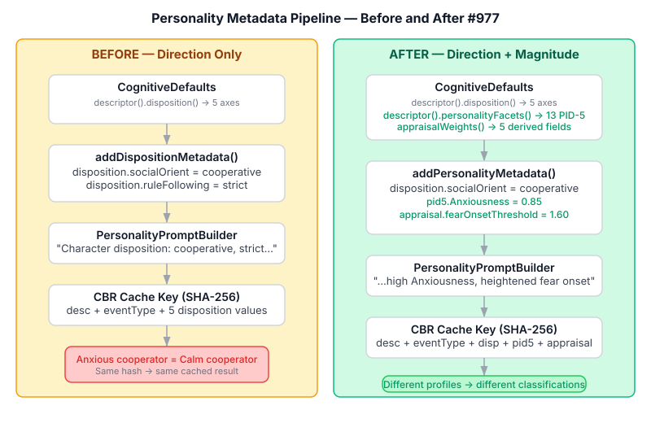

Two cooperative characters walk into the same situation: "your manager announces unexpected organisational changes that may affect your role." One reads it as a threat — social_threat, norm_violation, powerlessness all light up. The other reads it as information — maybe some reward nodes fire for the career opportunity angle. Same disposition axes. Same tension routing. Same cached classification result.

That's the gap we closed in #977. The CAPS situation classifier has been personality-aware since disposition axes landed, but it was direction-aware without being magnitude-aware. It knew a character was cooperative but not *how intensely* they react to perceived threats against cooperation.

## Why PID-5 and not just "more axes"

The [Personality Inventory for DSM-5](https://www.psychiatry.org/psychiatrists/practice/dsm/educational-resources/assessment-measures) defines 25 facets of personality pathology, of which we use 13. These aren't arbitrary traits — they're empirically derived dimensions that capture how intensely a person experiences specific psychological processes. ANXIOUSNESS isn't "worries a lot." It's a measurable tendency to perceive ambiguous stimuli as threatening, grounded in decades of threat-perception research (Bar-Haim et al., 2007 meta-analysis of attentional bias in anxiety).

The key distinction from disposition axes:

- **Disposition axes** are categorical and directional: cooperative vs competitive, strict vs flexible. They tell the classifier *what* a character values.
- **PID-5 facets** are continuous scores [0, 1] measuring trait intensity. They tell the classifier *how strongly* the character reacts when those values are threatened or fulfilled.

Two characters with `socialOrient=cooperative, ruleFollowing=strict` can have completely different inner lives. One with ANXIOUSNESS=0.85 and SUSPICIOUSNESS=0.75 reads social ambiguity as danger. One with ANXIOUSNESS=0.20 and SUSPICIOUSNESS=0.25 reads it as normal workplace noise. The disposition axes alone can't express this.

## The AppraisalWeights bridge

PID-5 facets are raw personality measurements. `AppraisalWeights` are the derived perceptual filters that `CognitiveDerivationEngine` computes from them — urgency sensitivity, fear onset threshold, self-standards strictness. The derivation pathway chains Jungian cognitive functions through Big Five composites to Scherer appraisal dimensions, with PID-5 facets modulating at each stage:

- **ANXIOUSNESS** amplifies the fear onset threshold (Bar-Haim 2007)
- **IMPULSIVITY** amplifies urgency sensitivity
- **RISK_TAKING** dampens fear onset (disinhibition pathway)

Passing both PID-5 scores and AppraisalWeights to the classifier gives the LLM two complementary lenses: the raw personality profile ("this character is highly anxious") and its perceptual consequences ("this character has a heightened fear onset at 1.60x").

## How it works



The implementation threads through three layers, all using the same `Map<String, String>` metadata transport that disposition axes already use:

**Metadata enrichment.** `addPersonalityMetadata()` (renamed from `addDispositionMetadata()`) now populates `pid5.Anxiousness=0.85` and `appraisal.fearOnsetThreshold=1.60` alongside the existing `disposition.socialOrient=cooperative` entries. Both `BehavioralSynthesisPhase` and `DriveProfileDerivationPhase` call this — every situation classification in the CAPS pipeline now carries the full personality profile.

**Prompt construction.** `PersonalityPromptBuilder` formats PID-5 facets as natural-language annotations with interpretive labels:

```
Personality facets: high Anxiousness (0.85), low Risk Taking (0.20), moderate Withdrawal (0.55).
Perception biases: elevated urgency sensitivity (1.45), heightened fear onset (1.60).
```

The labels ("high"/"low"/"moderate" for facets, "elevated"/"dampened"/"strict"/"lenient" for appraisal) give the LLM interpretive guidance without flooding it with raw numbers. Near-neutral appraisal values (within ±0.15 of 1.0) are omitted — if fear onset is 1.05, that's not worth mentioning.

**CBR cache key.** The SHA-256 hash now includes every `pid5.*` and `appraisal.*` metadata key in sorted alphabetical order after the disposition axes. Different PID-5 profiles produce different cache entries. The model version bumps from `haiku` to `haiku-pid5`, invalidating the entire existing cache — every prior entry was classified without personality magnitude and can't be trusted for magnitude-aware queries.

## The cache key design tension

The interesting design question was what belongs in the cache key versus what belongs only in the prompt.

PID-5 facets are stable — derived from the agent's disposition profile, they don't change between conversation turns. They go in the cache key because two agents with different PID-5 profiles should never share a cached classification.

Mood and active drives are transient — they change every tick. Mood shapes perception right now ("I'm already anxious, so this news feels worse"), but caching mood-specific classifications would fragment the cache into per-turn entries that almost never get reused. A character at ANXIOUSNESS=0.85 with current mood pleasure=-0.6 perceives differently than the same character at pleasure=0.2, but those are runtime modulations, not personality traits.

The line: **personality goes in the cache key, emotional state goes in the prompt but not the key.** The cache discriminates personality profiles. Runtime mood is applied on top at classification time, never cached.

## The eval setup

The test adds two profiles — `anxious-cooperative` and `calm-cooperative` — with identical disposition axes (`cooperative/strict/conservative/low/avoidant`) and opposite PID-5 extremes (ANXIOUSNESS 0.85 vs 0.20, SUSPICIOUSNESS 0.75 vs 0.25, EMOTIONAL_LABILITY 0.70 vs 0.30). Both route through Path A (zero tension — no contradictory axis pairs), so any activation difference is purely from PID-5.

Two assertions:

1. **Divergence**: cosine distance between activation vectors exceeds 0.05 (the same baseline the disposition-divergence test uses)
2. **Threat sensitivity**: the anxious profile activates threat nodes (social_threat, punishment, powerlessness, norm_violation) more strongly than the calm profile across the majority of observations

These are LLM-dependent — the thresholds may need tuning when first run against the live API. The structure validates that PID-5 produces measurable perceptual differentiation, not just different words in the prompt.

## What this opens up

The classifier now has the vocabulary to express personality magnitude, not just direction. That's the prerequisite for three things:

**PID-5-aware tension routing.** The current `DispositionTension` table detects contradictory axis pairs (bold + strict → "approach vs inhibition"). An anxious character with that tension feels it differently than a non-anxious one — the inhibition side weighs heavier. The table could incorporate PID-5 to modulate tension scores, but that's a separate eval.

**Cross-agent personality comparison.** Two agents perceiving the same situation now produce genuinely different classifications based on personality magnitude. `SocialComparison` already computes perspectival divergence metrics — personality-enriched classification feeds richer data into that pipeline.

**Config-driven facet tuning.** All 13 facets are included by default behind `casehub.caps.classification.pid5-facets`. The 7 perception-shaping facets (ANXIOUSNESS, EMOTIONAL_LABILITY, WITHDRAWAL, IMPULSIVITY, RISK_TAKING, SUSPICIOUSNESS, INTIMACY_AVOIDANCE) are the obvious candidates, but the remaining 6 (CALLOUSNESS, HOSTILITY, GRANDIOSITY, etc.) may also colour perception in ways we haven't measured yet. The config lets us narrow or expand after running evals, without code changes.
