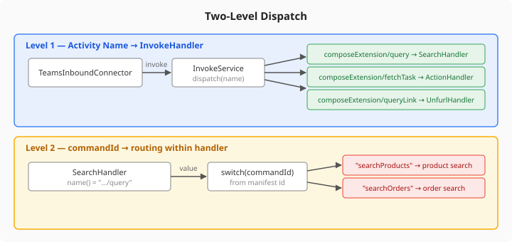

# The Dispatch That Didn't Change

The messaging extensions SPI landed in #236 — three new `InvokeResponse` variants (`ComposeResult`, `ComposeAuth`, `ComposeContinue`), their serialization, and comprehensive round-trip tests. What remained was the gap between "the code handles everything" and "a consumer can actually deploy this to a real Teams tenant."

That gap turned out to be entirely documentation.

The interesting thing about Bot Framework messaging extensions is how little the code side needs to know about the manifest. A Teams app manifest declares `composeExtensions` with `commands` — search commands, action commands, link unfurling handlers — and each one maps to an invoke activity name that the existing `InvokeService` already dispatches by exact match. The manifest is configuration; the SPI is the runtime. We didn't need to touch either `TeamsInboundConnector` or `InvokeService` because they were already general enough.

## The two-level dispatch

What *did* need documenting was the dispatch model that most Bot Framework guides gloss over. There are two levels, and they serve different purposes.



At the first level, the invoke activity name (`composeExtension/query`, `composeExtension/fetchTask`, etc.) determines which `InvokeHandler` bean receives the request. `InvokeService` does a straight map lookup by name — one handler per activity type, no ambiguity.

The second level is where it gets interesting. When a manifest declares two search commands — say, "Search products" and "Search orders" — both arrive as `composeExtension/query`. Same activity name, same handler. The `commandId` field inside `InvokeRequest.value()` distinguishes them, and that field maps directly to the `id` in the manifest's `commands[]` array. The handler switches on `commandId` to route internally:

```java
return switch (request.value().getString("commandId", "")) {
    case "searchProducts" -> searchProducts(request);
    case "searchOrders"   -> searchOrders(request);
    default -> new InvokeResponse.Accepted();
};
```

A consumer deploying their first multi-command extension will hit this wall immediately if the docs don't explain it. Microsoft's own documentation covers each level separately but never shows them working together from the consumer's perspective — which handler receives what, and how to distinguish commands within it.

## What we shipped

Two artifacts. A manifest template at `chat-teams/src/main/resources/manifest-template.json` covering all three extension types in a single copyable file. JSON has no comment syntax, so we used `_comment` fields for inline documentation — each section explains what it configures and how it maps to the SPI.

And a standalone setup guide at `docs/guides/teams-messaging-extensions-setup.md`. The Azure bot registration prerequisites are a checklist with links to Microsoft's docs, not a step-by-step walkthrough that rots when they change their portal. The guide's real value is in the sections Microsoft doesn't cover: the activity name → handler mapping table, the `commandId` routing pattern with a worked multi-command example, and the Quarkus configuration properties that wire the bot's credentials.

The prerequisite checklist is four bullet points. The commandId routing section has a complete worked example. That ratio — minimal ceremony, maximum substance — is deliberate. The guide earns its keep by explaining the one thing a consumer can't figure out from the manifest schema alone.
