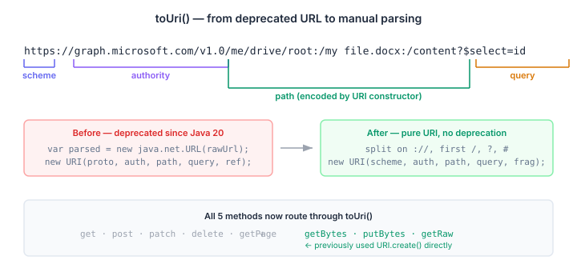
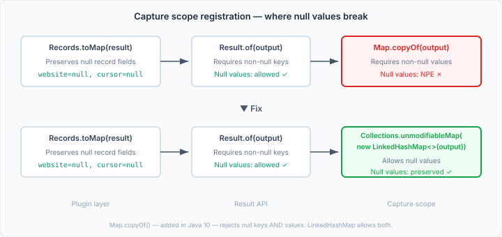

# Deprecation, Encoding, and Cloned Voices

Five fixes across three modules today, each small enough to land in one session but each touching something worth explaining.

## The URL That Wasn't

`MicrosoftGraphClient.toUri()` had a quiet problem: it used `new java.net.URL(rawUrl)` to parse a URL string into components, then fed those components into the multi-arg `URI` constructor for proper encoding. The `URL(String)` constructor has been deprecated since Java 20 and is flagged for removal. On a Java 26 JVM, it still works — until it doesn't.

The replacement is a manual string split. No library, no helper class — just `indexOf("://")`, find the first `/` after the authority, check for `?` and `#`, and hand the five components to `new URI(scheme, authority, path, query, fragment)`. The multi-arg `URI` constructor does the encoding — spaces become `%20`, percent signs get double-encoded — which is exactly why `toUri()` exists in the first place. A file called `my file.docx` in a OneDrive path needs encoding before it hits the wire.



The interesting part was what happened next. With `toUri()` fixed, three other methods turned out to be bypassing it entirely. `getBytes()`, `putBytes()`, and `getRaw()` all used `URI.create(BASE_URL + path)` — which throws `IllegalArgumentException` on unencoded spaces and misinterprets `?` as a query delimiter in filenames. Every other method in the class already routed through `toUri()`. These three were just missed when the method was introduced. One line each.

`getBytesFromUrl()` correctly stays on `URI.create()` — it takes absolute CDN URLs from redirect responses, already well-formed. Same for pagination cursors in `getPage()`. The rule is simple: paths from callers go through `toUri()`; URLs from APIs stay as-is.

## Configurable Sample Rates

`SpeakerPlugin.extractFromWav` had a hardcoded `if (sampleRate != 16000)` check that rejected everything except wideband telephony audio. The underlying `SpeakerEmbeddingExtractor` SPI already accepts a `sampleRate` parameter — the validation layer was more restrictive than the interface it feeds.

Real voice systems span 8 kHz (G.711 telephony) to 48 kHz (studio recording). The fix adds an `@Optional List<Integer> supportedSampleRates` field to the plugin record, defaulting to `Set.of(16000)` when null. Backward compatible: existing playbooks that don't specify rates get the same validation as before. Playbooks that need telephony audio or studio recordings configure it:

```yaml
speaker register:
  name: Alice Smith
  audio: ${aliceSample.audio-data}
  supported-sample-rates: [8000, 16000, 48000]
```

The error message now lists the configured valid rates rather than just saying "expected 16000 Hz."

This matters immediately in practice. The Kokoro TTS engine outputs 24 kHz audio. Every playbook that synthesises speech and then passes it to speaker registration or identification needs `supported-sample-rates: [16000, 24000]` — the default 16 kHz rejects the TTS output at the WAV header check, before the embedding extractor even runs.

## The Cloned Voice Attack

The negative twin playbook `06b-sole-gate-insecure` existed to demonstrate that speaker identification alone is an insecure payment gate. But it only showed Alice registering and confirming as herself — proving single-factor bypass, not the actual attack.

We rewrote it to show the attack the multi-factor rule prevents. Bob registers his voiceprint with the `bm_daniel` TTS voice. An attacker — using the same `bm_daniel` voice, simulating a cloned voiceprint — speaks the payment confirmation. The speaker identification system matches the attacker as Bob. Payment authorised. No second factor to catch the impersonation.

The test asserts that the clone passes: `speakerId.identified = true`, `speakerId.name = Bob Smith`. That passing assertion IS the vulnerability. The corresponding secure playbook (06) requires both voice ID and an SMS reference number — the clone might fool the biometrics, but it can't produce the OTP.

## Three Bugs in a Trenchcoat

The playbook integration tests broke. All eighteen of them. Tracking it down uncovered three independent failures stacked on top of each other, each masking the one beneath.

**Layer 1: capture variable scoping.** The platform runtime stopped resolving `capture:` variable prefixes — `${audio.audio-data}` failed with "Unknown prefix 'audio'." This was a runtime regression, fixed upstream the same day. With that fix applied, the "Unknown prefix" errors vanished. But the tests still failed.

**Layer 2: `Map.copyOf` on null values.** The capture scoping fix introduced a new line in `PlaybookRunnerCore.run()`:

```java
Map<String, Object> captured = Map.copyOf(result.output());
```

`Map.copyOf()` — added in Java 10 — rejects null values. `Records.toMap()` preserves null record fields: a `Place` with `website=null`, a `Page` with `nextCursor=null`. Any step that uses `capture:` and returns a record with nullable fields triggers a bare `NullPointerException` — no message, no stack trace in the playbook result, just `"java.lang.NullPointerException"` as the error string.



The fix is one line: `Collections.unmodifiableMap(new LinkedHashMap<>(result.output()))`. Same immutability guarantee, no null-value restriction. The `Result.Success` constructor already does the same thing — the new code introduced an inconsistency with the existing pattern.

What made this hard to find is that the step itself works fine. Direct execution, inline test assertions, everything passes. The NPE only fires inside `PlaybookRunnerCore.run()`, specifically on the `capture:` code path. Remove the `capture:` decorator from the playbook and the step succeeds. The diagnostic isolation pattern — run the step directly, then via `run-playbook`, then with and without `capture:` — was what narrowed it to the single line.

**Layer 3: TTS sample rate mismatch.** With both runtime bugs fixed, the voice tests still failed. `SpeakerPlugin` defaults to accepting only 16 kHz WAV audio, but Kokoro TTS outputs at 24 kHz. The WAV header check rejects the audio before it reaches the embedding extractor. Adding `supported-sample-rates: [16000, 24000]` to every speaker step fixed it.

There was one more surprise. The multi-factor gate test asserts that a reference number appears in the speech transcript:

```yaml
- assertThat: result.captures.fullTranscript.text
  contains: "7,429"
```

The playbook speaks "TX-7429" but Whisper transcribes it as "TX 7,429" — the STT engine interprets the spoken number as a comma-separated group. The reference number survives the TTS→STT round-trip, just not in the format the test expected. Any system that relies on exact-match transcript comparison against structured identifiers will hit this — spoken language doesn't preserve formatting.

The practical takeaway: a single test failure can hide several independent bugs. Fixing one peels back the layer to reveal the next. Systematic isolation — varying one axis at a time (direct vs. run-playbook, with vs. without capture, specific sample rate) — is the only way to separate them.
