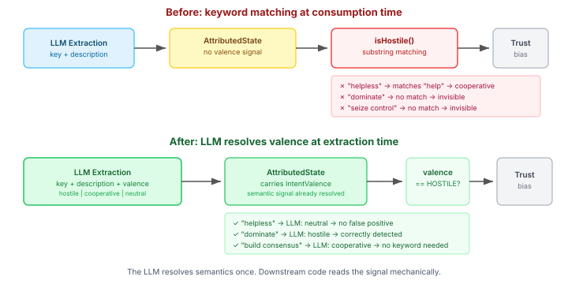
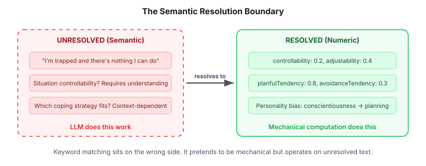
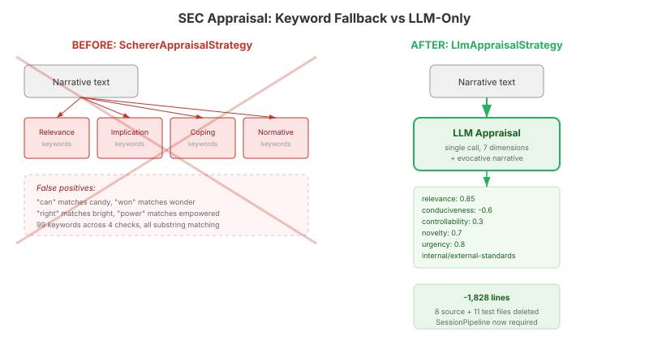

# The Second Time Keywords Lied

The first time was CAPS situation classification. A keyword classifier that mapped "bullied" to `dominance` and missed that the agent's response was gallantry. I wrote about that in October — the vocabulary abstraction gap, the proof that disabling the classifier was less harmful than the wrong activations it produced. The fix was straightforward: let the LLM classify, cache the result, graduate to cheaper tiers when you have the data.

The second time was quieter, and I nearly didn't notice it.

## The Bug That Wasn't a Bug Yet

When we wired Theory of Mind into the cognitive pipeline (#1094–#1096), `RelationalSchemaEvolutionPhase` needed to know whether an observed agent's BDI entries — beliefs, desires, intentions — carried hostile or cooperative intent. That intent signal biases trust formation: if I attribute hostile intentions to you, my trust in you should decrease faster than the valence of our interactions alone would suggest.

The classifier I wrote looked like this:

```java
private static boolean isHostile(String key, String description) {
    return containsAny(key, description,
        "deceiv", "decept", "manipulat", "betray", "harm", "exploit",
        "undermin", "sabot", "revenge", "hostile", "aggress", "attack",
        "destroy", "steal", "cheat", "trick", "threaten", "intimidat");
}
```

Eighteen stems, matched against the key and description of each BDI entry. A parallel `isCooperative()` method with twelve stems and four negative exclusions — "helpless", "distrust", "mistrust", "overshare" — to avoid the most obvious false positives.

It worked. The tests passed. The BDI entries are LLM-normalised output, so the keys tend to be clean — "plans-to-deceive", "wants-to-cooperate". The stems match. But "working" is a low bar when you've already seen the same pattern fail.

## What Keywords Can't See

"Dominate and seize control of the group." Hostile intent. No matching stem. The classifier returns neutral.

"Build consensus and find common ground." Cooperative intent. No matching stem. The classifier returns neutral.

Both invisible. The keyword list would need to grow every time the LLM produced a naturalistic key that didn't happen to contain one of the thirty stems. The exclusion list for false positives — "helpless" matching "help" — would grow at the same rate.



This is the same structural problem as the CAPS situation classifier, applied one layer up. The BDI entries are already LLM-structured output. Their semantic content is richer than substring matching can capture. The difference between "wants to help" and "feels helpless" is obvious to any reader — and invisible to `containsAny`.

## The Semantic Resolution Boundary

The project's CLAUDE.md codifies this as a design principle: mechanical computation works when operating on signals that are already semantically resolved — numeric values where meaning has been extracted. Keyword matching fails because it pretends to be mechanical while operating on unresolved text.



The fix follows the boundary. The LLM already produces the BDI entries. It already understands the interpersonal direction of "dominate" vs "observe" vs "reconcile". Asking it to also classify valence at extraction time is a single additional field in the JSON schema:

```json
{"key": "dominate-group",
 "text": "Intends to dominate and seize control",
 "confidence": 0.8,
 "valence": "hostile"}
```

Three enum values: `HOSTILE`, `COOPERATIVE`, `NEUTRAL`. The LLM resolves the semantics once. Everything downstream reads the enum.

## What Changed

`AttributedState` — the unified BDI record — gained a seventh field: `IntentValence valence`. A backward-compatible six-argument constructor defaults to `NEUTRAL`, so every existing call site compiles without changes. Old serialised snapshots without the field deserialise gracefully.

`classifyIntentBias` went from thirty lines of substring matching to ten lines of enum comparison:

```java
if (intention.valence() == IntentValence.HOSTILE) {
    hostileWeight += intention.confidence();
} else if (intention.valence() == IntentValence.COOPERATIVE) {
    cooperativeWeight += intention.confidence();
}
```

No more `isHostile`. No more `isCooperative`. No more `containsAny`. No more exclusion list that grows with every false positive discovered.

The LLM extraction prompt includes the valence schema, with examples: "hostile (harmful, deceptive, exploitative, aggressive, undermining), cooperative (helpful, supportive, protective, collaborative, reconciling), or neutral (observational, self-directed, ambiguous)." The `formatBdi` method now includes existing entries' valence in the re-inference prompt, so the LLM sees its own previous classifications when evaluating new signals.

## The Bug the Review Caught

`decayMap` creates new `AttributedState` instances when confidence decays over time. It was using the six-argument constructor — which defaults valence to `NEUTRAL`. Every time confidence decayed, the LLM-classified valence was silently reset. A hostile intent with 0.79 confidence would become a neutral intent with 0.78 confidence after one decay tick.

The fix is one argument: `s.valence()` passed through to the new instance. Easy to fix. Easy to miss. The kind of bug that only shows up when the pipeline has been running long enough for decay to fire, and only matters when the decayed entry happens to be hostile or cooperative.

## The Pattern

This is now the second time the same design failure appeared in the cognitive pipeline. The CAPS situation classifier and the BDI intent classifier both started as keyword matching over LLM-normalised text. Both looked correct in testing because the test data happened to contain matching stems. Both were structurally fragile because they operated on the wrong side of the semantic resolution boundary.

The principle: when the LLM is already producing structured output, make it resolve the semantic question at the point of extraction. Don't punt it downstream and hope that substring matching will reconstruct what the LLM already understood.

The next case to watch is the coping micro-loop in emotion regulation, which still uses keyword detection for SEC re-evaluation triggers. Different system, same pattern. That one's not broken yet — but I know where to look.

## Update: The Third Time — And the Last

I didn't have to look long. The same afternoon, we swept the entire SEC appraisal layer (#1113). Four keyword classifiers: `CopingCheck` with 51 keywords splitting agency from helplessness ("can"→candy, "able"→comfortable), `ImplicationCheck` with 20 keywords for goal conduciveness ("won"→wonder, "lost"→gloucester), `NormativeCheck` with 14 keywords for standards compliance ("right"→bright, "just"→adjust), and `RelevanceCheck` matching drive names against narrative text ("power"→empowered, overpowered).

All four shared the same failure mode: substring matching on unresolved narrative text. All four had obvious false positives documented in the issue. All four had an LLM replacement already running in production — `LlmAppraisalStrategy` produces all seven SEC dimensions in a single call with an evocative first-person narrative that feeds the prompt pipeline.

The keyword fallback existed for a defensive reason: what if there's no LLM available? But you cannot run a cognitive neocortex without an LLM. The keyword fallback is more dangerous than no fallback at all — wrong activations actively break downstream appraisal filtering, emotion mapping, and coping strategy selection. A failing-fast `IllegalStateException` when no `SessionPipeline` is available is strictly better than incorrect appraisal dimensions propagating through the entire cognitive pipeline.



The sweep deleted eight source files, one API record, and eleven test files. 1,828 lines removed. The coping micro-loop — the case I flagged above — now delegates re-evaluation to `AppraisalStrategy` instead of iterating over keyword `SecCheck` implementations. The `SecCheck` interface itself became orphaned dead code and was deleted.

Three classifiers, three removals, one principle: the semantic resolution boundary is not a suggestion. If you're doing substring matching on text that an LLM produced, you're reconstructing meaning that was already understood and discarding context that matters. Resolve the semantics at extraction time. Everything downstream reads the resolved signal.
