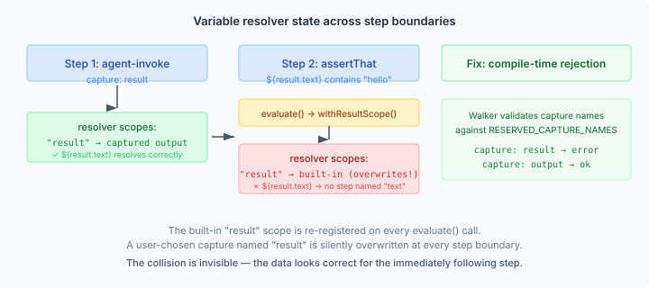

# The Name the Framework Already Owns

Every framework has names it uses internally. Variable scopes, built-in prefixes, reserved keywords. The question is whether those names are enforced or just documented — and what happens when a user picks one without knowing it's taken.

Our playbook runtime has a `capture:` decorator that lets a step save its output under a name for later reference. Write `capture: response`, and downstream steps can resolve `${response.text}`. The built-in `result` scope provides the last step's output via the same `${result.*}` prefix. So `capture: result` looks like it should work — and it does, for exactly one step.

## The collision is invisible at first

After step A runs with `capture: result`, the resolver has `"result"` mapped to the captured output. `${result.text}` resolves correctly for step B, the immediately following step. But there's a catch: `evaluate()` is called for every step, and its first line re-registers the built-in `result` scope via `withResultScope()`. The resolver uses `LinkedHashMap.put()` — last write wins. The user's capture is silently replaced by the built-in scope at every step boundary.

For the step immediately after the capture, the built-in scope happens to provide the same data — both point at the last step's output, which is the captured step. But insert a step between the capture and the reference, and they diverge. The built-in scope moves to the new last step. The capture was supposed to persist. It doesn't.

The worst part: 21 test files used `capture: result` and all passed. The test framework (`YamlTestExecutor`) creates its evaluator without an execution scope, so `resultSource` is null, `withResultScope()` is a no-op, and the capture works fine. The collision only manifests in `PlaybookRunnerCore` — the production runtime. The test infrastructure was structurally incapable of detecting the bug.

## Reject, don't re-prioritise

The tempting fix is to change the resolver priority — have captures override built-in scopes. But `result` as a capture name and `result` as a built-in scope serve fundamentally different purposes. The capture resolves field names within one step's output (`${result.text}`). The built-in resolves step names across the execution history (`${result.stepName}`). Making one shadow the other changes the semantics of `${result.*}` based on whether a capture exists somewhere upstream. That's a different kind of invisible.

The right fix is a reserved-name set. `capture: result` is now rejected at parse time by the Walker, with a clear error message naming the collision. Same for `error`, `each`, `var`, `params`, `module`, and `events` — every built-in scope prefix. The set lives in `StepKeywords.RESERVED_CAPTURE_NAMES`, referenced by both Walker and YamlTestExecutor, so they can't drift independently.

The 21 test files that used `capture: result` all changed to `capture: output`. Not one assertion needed semantic adjustment — confirming that none of them actually relied on the capture persisting past the next step. The name was a habit, not a choice.

## The pattern underneath

Naming collisions between user-chosen identifiers and framework-reserved names are as old as programming languages. SQL reserves `SELECT`. Java reserves `class`. CSS reserves `inherit`. The consistent lesson: enforce the reservation at the boundary where the name is introduced, not at the point where the collision manifests. By the time `withResultScope()` overwrites the user's capture, it's too late to produce a useful error — the user is three steps downstream, wondering why their data disappeared.

A framework that reserves names silently is a framework that lets users write code that works in testing and breaks in production. The enforcement should happen where the name is chosen, not where it collides.
