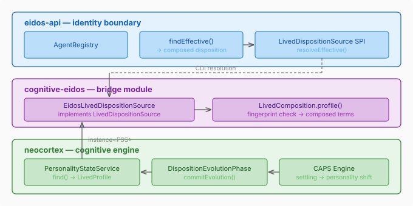

# The Loop That Closed Itself

Eidos owns identity. It knows what an agent was designed to be — the authored disposition, the personality axes, the goals. Neocortex owns experience. It runs the CAPS engine, tracks situational personality evolution, publishes lived profiles that capture how an agent's disposition has shifted through interaction. The question that #1132 answers: when something outside neocortex asks "who is this agent, really?" — does it get the authored blueprint or the lived personality?

Until now, it got the blueprint. `AgentRegistry.findById()` returns authored descriptors only. The eidos team added `findEffective()` and a `LivedDispositionSource` SPI so that the answer can include evolution — but the SPI had only a `NoOpLivedDispositionSource` returning authored values unchanged. The propagation path existed on paper but had no actual source of lived data.

## The propagation path

The chain is:

1. `DispositionEvolutionPhase.commitEvolution()` writes evolved personality state
2. `PersonalityStateService` persists it in MindMap as a `LivedProfile`
3. `EidosLivedDispositionSource` reads the lived profile and composes it with the authored disposition
4. `AgentRegistry.findEffective()` calls the source and returns the composed result

Steps 1 and 2 were already working. Step 4 was wired but calling a no-op. Step 3 is what I built — the bridge that makes the loop real.

## Why not use the existing bridge method

`EidosCognitiveProfileBridge.livedDescriptor()` already does disposition composition, and the issue's spec said to call it. I read the code first. The method takes an `AgentDescriptor`, which meant constructing a fake descriptor just to route a disposition through it and extract `.disposition()` from the result. That's already awkward. But the actual problem is that `livedDescriptor()` rebuilds the disposition via `AgentDisposition.builder()` and only sets ten of the twelve fields — it drops `ampdFacets` and `situationalProfiles`.

For `livedDescriptor()`'s original consumer — `EidosDescriptorViewSource`, which calls it during descriptor-to-view conversion — the dropped fields are harmless. AMPD facets get composed separately at the `DescriptorView` level via `LivedComposition.compose()`. But the `LivedDispositionSource` SPI receives a full `AgentDisposition` from the caller. If I route it through `livedDescriptor()`, the caller gets back a disposition with its facets silently stripped. That's a data-loss bug in a new code path.

The composition logic itself is one function call: `LivedComposition.profile()`. It takes the authored profile terms, checks the fingerprint, and returns either the lived terms (if fingerprint matches) or the authored terms unchanged. I called it directly and built the new disposition with all twelve fields preserved.

## The SPI is the boundary

The interesting design point is where the SPI sits. `LivedDispositionSource` lives in eidos-api — it's an identity-system contract, not a cognitive one. The implementation lives in neocortex's `cognitive-eidos` module, using `PersonalityStateSource` via CDI `Instance<>` for graceful degradation. When neocortex is on the classpath, `findEffective()` returns composed personality reflecting evolution. When it's not, the `NoOpLivedDispositionSource` default bean returns authored values unchanged. The identity system never needs to know that neocortex exists — it just calls whatever implementation CDI provides.

This is the same pattern as `EidosDescriptorViewSource`: the bridge module depends on both sides of the boundary, implements the identity-side SPI, and reads from the cognitive-side data. The identity system stays clean of cognitive dependencies. Cognitive evolution feeds back through a stable contract.

## The pre-existing bug

The `livedDescriptor()` field-dropping issue is worth tracking. It doesn't affect any current consumer because the only caller is `EidosDescriptorViewSource.find()`, which works at the `AgentDescriptor` level where AMPD facets get composed separately. But if anyone else calls `livedDescriptor()` expecting to get a complete `AgentDisposition` back, they'll get a subtly wrong one. The kind of bug that sits quietly until someone writes an integration test that actually checks all fields.
