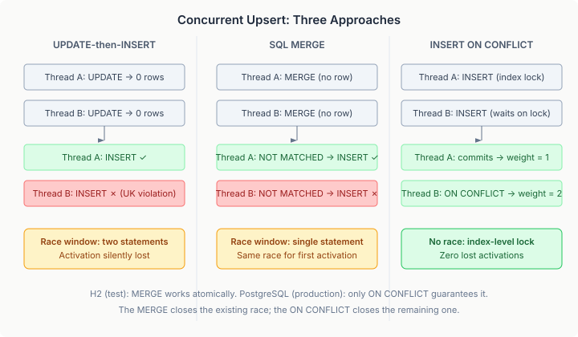

# The Polish Pass

A bug-fix batch is never just the fixes. The fixes change the shape of the code — types widen from `int` to `double`, race conditions get closed, validation tightens — but the names, conventions, and assumptions that surrounded the old code don't update themselves. For a brief window after the batch lands, the codebase is internally inconsistent. Not broken. Not buggy. Just dishonest in small ways that calcify into confusion if nobody goes back.

Issue #244 is the going-back. Three items found during the code review of the disposition fixes (#237, #241, #239) that are each too small to interrupt a batch for, and each too real to leave.

## The Turkish-İ Waiting to Happen

`AmpdFacets.canonicalise()` calls `toLowerCase()` to normalise AMPD facet names before lookup. The 13 facet names are ASCII English. Today, this is fine. On a JVM whose default locale is Turkish, `"IMPULSIVITY".toLowerCase()` produces `"ımpulsivity"` — with a dotless ı instead of a dotted i. The lookup map was built with `toLowerCase()` too, so if both sides run in the same locale they'd match. But if the map is built at class-load time (which it is — a `static final`) and the canonicalise call happens on a request thread whose locale differs, the keys won't match. A latent failure that would surface as "Unknown AMPD facet: Impulsivity" in a stack trace that makes no sense.

The fix is `toLowerCase(Locale.ROOT)` on both sides. It's a one-import, two-site change. The kind of thing that's obviously correct the moment you see it and invisible until someone spends a day debugging a Turkish production server.

## MERGE: Better, But Not Done

The original `recordActivation` did update-then-insert: a JPQL `UPDATE ... SET weight = weight + 1`, check the row count, `em.persist()` on zero rows. Two threads that both see zero rows both insert. One gets a unique constraint violation. The activation is lost silently.

The batch (#241) was about fixing the in-memory store's concurrency. The JPA store's race was noted in the issue as "currently acceptable as a lower bound" because there's no production traffic yet. But "acceptable for now" is how technical debt gets its name.

The replacement is SQL standard `MERGE`:

```sql
MERGE INTO disposition_signal AS ds
USING (VALUES (CAST(:agentId AS VARCHAR), ...)) AS src(...)
ON ds.agent_id = src.agent_id AND ...
WHEN MATCHED THEN UPDATE SET weight = ds.weight + 1
WHEN NOT MATCHED THEN INSERT (...) VALUES (..., 1.0)
```

This is a single statement. When a row exists, the MATCHED path fires atomically — no race. When no row exists and there's no concurrency, the NOT MATCHED path inserts cleanly. The choice of `MERGE` over PostgreSQL's `INSERT ... ON CONFLICT DO UPDATE` is pragmatic: the test suite runs H2 in PostgreSQL compatibility mode, and H2 doesn't support `ON CONFLICT` syntax. `MERGE` is SQL:2003 standard and works in both.

But there's a catch.



On PostgreSQL, `MERGE` doesn't use the index for conflict detection the way `INSERT ... ON CONFLICT` does. Two concurrent first activations of the same function term — both see no row, both execute NOT MATCHED, both attempt INSERT — produce the same constraint violation as the old code. `INSERT ... ON CONFLICT DO UPDATE` has specific concurrency guarantees: it takes a lock on the index entry, serialising the two threads. Zero lost activations, by construction.

For H2 (the test database), `MERGE` is fully atomic. For PostgreSQL (the production target), the MATCHED path is safe and the NOT MATCHED race is narrow — it only triggers on the very first activation of a given function by two threads simultaneously. That's a production deployment concern. The final mile will be a dialect-aware query that uses `INSERT ... ON CONFLICT` on PostgreSQL and `MERGE` on H2.

## Counts That Aren't Counts

`DispositionSignalStore.activationCounts()` returned `Map<String, Double>`. Before #237, it returned `Map<String, Integer>`. The fix to integer truncation on decay was correct — fractional values must survive decay passes — but the method name kept saying "counts". A count is an integer. These values are 2.1, 0.2, 50.5 after a decay pass. They're weights.

A misleading method name on an SPI is worse than a misleading name on a private method. Every implementation — `InMemoryDispositionSignalStore`, `JpaDispositionSignalStore`, `NoOpDispositionSignalStore` — overrides this method. Every caller — `DefaultDispositionHealth.probe()`, the `valenceCounts` default method — reads the return value with expectations shaped by the name. The name said "counts" and the values said "fractions". One of them had to change, and the values were right.

The rename to `activationWeights()` touched 13 files: the interface, three implementations, two callers, four test classes, and four documentation files. IntelliJ's semantic rename handled the mechanical part. The interesting part was the blast radius check — the rename tool also found `activationCounts` in the engine repo's blog posts, where it refers to a completely different concept (agent execution counts in `AbstractExecutionDriver`). Reverting that one file was the kind of judgment call that automated refactoring can't make.

## The Polish Window

Fix batches create a narrow window where the codebase is internally inconsistent. The `int`-to-`double` migration was correct, but `activationCounts` was now a lie. The `canonicalise` method was correct, but `toLowerCase()` was latently locale-dependent. The in-memory race fix was correct, but the JPA store still had the same race shape in its upsert.

None of these would have been caught by tests. The tests passed before and after. The inconsistency was semantic, not behavioural — names that no longer described their values, code that worked on the test database but had a known race shape on the target database, a locale assumption that holds until it doesn't.

A deliberate polish pass within the same session closes that gap before it calcifies. The fixes are still fresh. The reasoning is still in context. The naming inconsistencies are visible because the type change that caused them happened twenty minutes ago. Wait a week and nobody remembers that `activationCounts` used to return integers, so nobody questions why it still says "counts."
