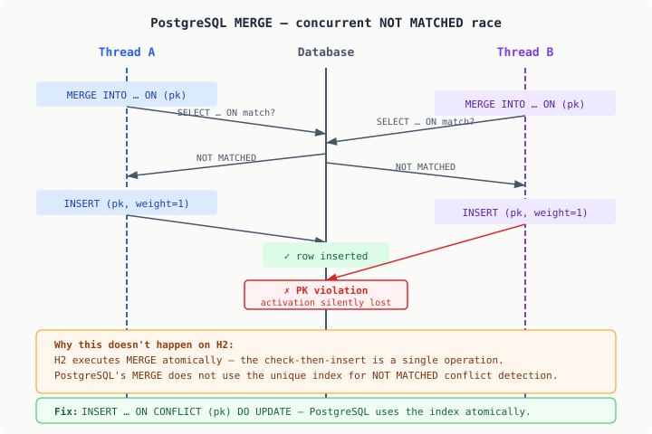
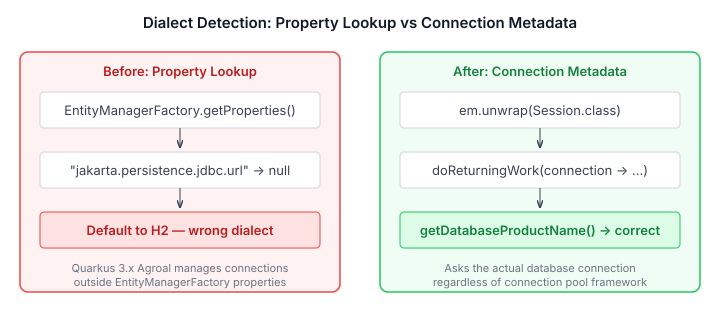

# The SQL That Only Races in Production

SQL `MERGE` looks like a solved problem. One statement, atomic upsert — if the row exists, update it; if not, insert it. That is exactly what it does on H2, the in-memory database that runs every test in the eidos test suite. And it is not quite what it does on PostgreSQL.

The gap is narrow enough that you can ship it, run a full test suite against it, and never see it fail. But put two concurrent requests against the same agent in production, and one of them silently loses data.

## The setup

Eidos has three JPA stores that track per-agent state over time. `JpaDispositionSignalStore` records cognitive function activations — how often an agent exercises a particular thinking style. `JpaBehavioralSignalStore` accumulates behavioral signals — declines, successes, compliance and violation events — with per-signal TTL-based expiry. `JpaAgentStateStore` records degradation state — rate-limited, overloaded, context-exhausted — with TTL-based expiry.

All three need an upsert: if a row exists for this composite key, update it; if not, insert a new one. The previous implementation varied: the disposition store used a two-statement update-then-insert pattern, the behavioral store used JPA's find-then-persist, and the agent state store used delete-then-persist. All three had the same concurrency flaw under different names.

## The race

PostgreSQL's `MERGE` does not use the unique index for conflict detection on the NOT MATCHED path. Two threads that both see no existing row will both attempt the INSERT. One succeeds; the other hits a primary key violation. The activation is silently lost.



The critical thing is that H2's MERGE is genuinely atomic — the check and the insert are one operation. So every test in the suite exercises the MERGE path, sees correct results, and gives you full confidence in SQL that will race under concurrent load on a different database.

The find-then-persist and delete-then-persist patterns have the same window. Two threads call `em.find()`, both get null, both call `em.persist()`, one wins and the other throws `EntityExistsException`. Or worse: two threads delete the same row, one inserts, the other sees stale cache state and throws `ConstraintViolationException`. The delete-then-persist variant added `em.flush(); em.clear()` to work around Hibernate's first-level cache, but that just moved the race window — it did not close it.

## The fix

PostgreSQL has its own atomic upsert idiom: `INSERT ... ON CONFLICT DO UPDATE`. Unlike MERGE, it uses the unique index to detect conflicts atomically:

```sql
INSERT INTO disposition_signal
  (agent_id, tenancy_id, function_term, weight)
VALUES (:agentId, :tenancyId, :functionTerm, 1.0)
ON CONFLICT (agent_id, tenancy_id, function_term)
DO UPDATE SET weight = disposition_signal.weight + 1
```

Both paths — insert and conflict-update — are resolved in a single index operation. No window for a second thread to slip in.

Each store now carries both dialects. H2 gets MERGE (which is genuinely atomic on H2). PostgreSQL gets INSERT ON CONFLICT. The dialect is detected once at `@PostConstruct` and the SQL is selected by a simple `if (postgres)` branch. The H2 path uses explicit CASTs in the USING clause to prevent H2's type inference from promoting values to wrong types — a quirk discovered by the first test run.

## The detection problem

The original dialect detector read the JDBC URL from `EntityManagerFactory.getProperties()`:

```java
var url = (String) props.get("jakarta.persistence.jdbc.url");
return url.startsWith("jdbc:postgresql");
```

Seven lines, clean, obvious. And wrong on Quarkus 3.x.

Quarkus manages database connections through Agroal, its connection pool. Agroal owns the JDBC URL, the credentials, and the connection lifecycle. The EntityManagerFactory never sees them. Those property keys — `jakarta.persistence.jdbc.url`, `javax.persistence.jdbc.url` — are populated only when Hibernate manages connections directly, which Quarkus never lets it do.

The detector returned false. Every store defaulted to H2 dialect. The H2 MERGE SQL happened to work on PostgreSQL — `MERGE` is valid PostgreSQL syntax since version 15 — so the tests passed. But the whole point of the dialect-aware approach was to use PostgreSQL's atomic `ON CONFLICT`, and that path was never reached.



The fix asks the database directly:

```java
return em.unwrap(Session.class).doReturningWork(connection -> {
    var product = connection.getMetaData().getDatabaseProductName();
    return product != null && product.equalsIgnoreCase("PostgreSQL");
});
```

`DatabaseMetaData.getDatabaseProductName()` returns the database's self-reported identity. It works regardless of connection pool framework, configuration mechanism, or Hibernate version. The connection is borrowed from the pool at `@PostConstruct` and returned when `doReturningWork` completes.

## Closing the verification gap

The original entry ended with a hedge: "when eidos goes to production on PostgreSQL, Testcontainers integration tests become the right investment." That gap is now closed.

Three test classes — one per store — run against a real PostgreSQL 17 container via Testcontainers. The setup splits Quarkus's build-time and runtime configuration concerns cleanly:

```java
public class PostgresTestProfile implements QuarkusTestProfile {
    @Override
    public Map<String, String> getConfigOverrides() {
        return Map.of("quarkus.datasource.db-kind", "postgresql",
                "quarkus.datasource.devservices.enabled", "false");
    }
    // ...
}
```

`db-kind` is a Quarkus build-time property — it determines which JDBC driver classes are included during augmentation. Setting it in the test profile triggers a separate augmentation phase with the PostgreSQL driver. The JDBC URL, username, and password come from the `PostgresTestResource` at runtime, after the container starts.

The tests are gated behind a JUnit `@Tag("testcontainers")` and a Maven profile. Default builds exclude the tag; `-Ptestcontainers` includes only the tag. The two populations never mix — H2 tests are unaffected by the PostgreSQL infrastructure.

## What this revealed about test-database fidelity

The dialect detection failure is the instructive part. The PostgreSQL tests passed before the detection fix — because H2's MERGE syntax happens to be valid PostgreSQL. The tests verified that the SQL was syntactically correct. They did not verify that the SQL was the *right* SQL.

H2 with `MODE=PostgreSQL` closes most of the gap between the two databases. It handles type coercions, most SQL syntax, and schema DDL. But MERGE atomicity is one of the places where the two databases diverge at the concurrency level, and the whole point of this work was to use the dialect-specific idiom that is known-safe on each platform.

The fix cost seven lines of code. The gap it closed — confirming that the production SQL path is actually exercised — is not something you can verify by inspection, by code review, or by running a thousand tests against the wrong database.
