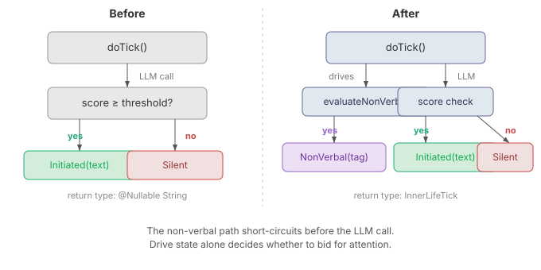

# The Gesture the LLM Never Saw

`ProactiveSpeechSupport.evaluateProactive()` returned `@Nullable String`. Speak or don't. That was the entire decision surface.

The inner life orchestrator did more work than that return type could carry. It evaluated civility constraints, checked content quality gates, ran novelty detection, invoked an LLM for motivation scoring, and tracked initiation history. All of that collapsed into a string or null. The drive state — the affiliation intensity that had been building for minutes of silence — was invisible to the caller.

This matters because an avatar that can speak or stay silent is missing the third option: a non-verbal attention bid. A knock. A lean forward. A glance. The kind of thing a person does when they want to re-engage but don't have anything specific to say. The speech pipeline in agency already supports gesture dispatch, but neocortex had no way to express the decision.

## Three changes, one widened surface



The sealed hierarchy gained a third variant:

```java
public sealed interface InnerLifeTick {
    record Silent(@Nullable String reason) implements InnerLifeTick {}
    record Initiated(String content, @Nullable String channelHint,
                     double motivationScore) implements InnerLifeTick {}
    record NonVerbal(String tag, double motivationScore) implements InnerLifeTick {}
}
```

`NonVerbal` carries a tag — `"knock"` by default — and the drive intensity that triggered it. The tag is an extensible vocabulary, not an enum. Future gestures (wave, nod, point) are just different tag strings. The motivation score lets the caller decide whether the bid is worth acting on.

The interesting design question was where to evaluate NonVerbal. The LLM path is expensive: assemble a prompt, invoke a model, parse JSON. A non-verbal bid doesn't need any of that — it's a pure function of drive state and silence duration. High affiliation drive plus sustained silence means the agent wants social contact. That's computable without a model call.

So `evaluateNonVerbal` runs before the LLM path, as a programmatic short-circuit. If affiliation intensity exceeds the threshold and the silence duration is long enough, it returns `NonVerbal` immediately. The LLM never fires. This is the right layering: drives decide whether to bid; the LLM decides what to say. When the decision is bid-without-words, the LLM has nothing to contribute.

The timing required care. The agent state tracks `lastActivityTimestamp` — when something last happened. If `doTick()` updated that timestamp before checking NonVerbal, the silence duration would always read as zero. The fix: evaluate NonVerbal against the previous timestamp, then update it. The check sees real silence; the update ensures the next tick starts fresh.

## Caller-supplied prompt sections

The second change opens the proactive prompt to external sections. `InnerLifeOrchestrator.tick()` now accepts a `List<CognitionPromptRenderer>` — the same SPI that cognitive prompt sections use everywhere else. These get rendered with a `CognitionRenderContext` (agent, tenant, activated drives) and appended to the system prompt before the LLM call.

The motivation: when the speech pipeline adds gesture instructions — "express emphasis with hand gestures", "nod when acknowledging" — those instructions need to be in the proactive prompt, not just the conversational prompt. Without this, proactive speech was always untagged: the LLM didn't know gestures were available, so it never suggested them.

The `buildSystemPrompt` method reuses the `DriveProfile` already fetched at the top of `doTick()` — a review catch that avoided a redundant lookup.

## Delivery feedback

The third change closes a state leak. When a proactive turn gets dropped at dequeue — the user spoke while the evaluation was in flight — neocortex wasn't told. The inner life state kept counting that initiation as delivered, which inflated `consecutiveInitiationsWithoutResponse` and could suppress future bids.

`reportDropped(agentId, tenantId, userActivityAt)` adjusts the counter downward, removes the most recent initiation timestamp, and — the part the review caught — updates `lastActivityTimestamp` from `userActivityAt`. That last bit prevents an immediate NonVerbal bid: the user was active, so the silence clock resets.

## The return type change

`evaluateProactive` now returns `InnerLifeTick` directly instead of `@Nullable String`. Callers get the full decision — Initiated, NonVerbal, or Silent — and map it to their own types. Agency's `AvatarCognition` will map `Initiated` to `ProactiveAct.Speak`, `NonVerbal` to `ProactiveAct.Gesture`, and `Silent` to null. The neocortex side doesn't know about those types and doesn't need to.

This is what sealed hierarchies are for. The switch expression that handled two cases now handles three, and the compiler enforces exhaustiveness. When a fourth variant arrives — timed silence with an explicit duration, perhaps — every caller that forgot to handle it gets a compile error. The `@Nullable String` path couldn't do that. It could only return text or nothing, and "nothing" swallowed every non-text decision into a single null.
