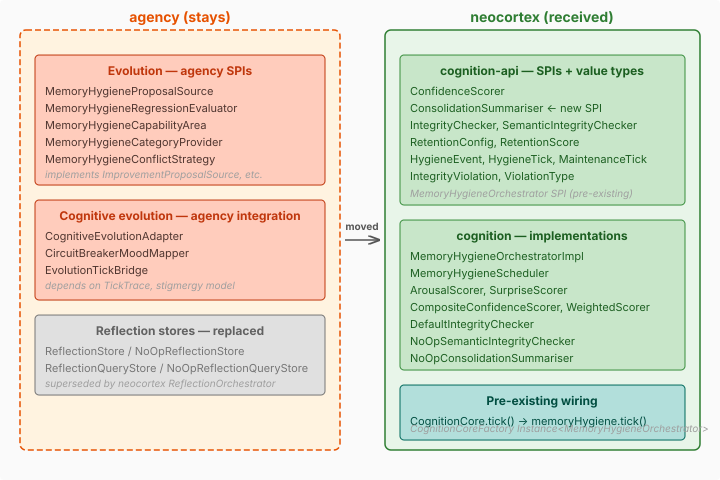

# The Migration That Needed a Scalpel

Agency issue #447 carries a simple-sounding description: "move ~33 source files of cognitive logic from agency to neocortex." The memory hygiene portion — 22 main files, 7 evolution files, 14 tests — was supposed to drop into neocortex's `cognition` module alongside the SPI it implements. Straightforward receiving work.

Except it wasn't. The issue had been scoped with a broad brush: everything under `social/memory/` was labelled "cognitive residue left behind during the extraction." I started reading the files and hit a question that changed the shape of the work: what are the evolution types actually *for*?

## The evolution types aren't cognitive

Seven files in `social/memory/evolution/` implement agency-specific SPIs — `ImprovementProposalSource`, `RegressionEvaluator`, `CapabilityArea`, `ConflictStrategy`, `ImprovementCategoryProvider`. These are the agency stigmergy framework's extension points. They wire memory hygiene quality signals into agency's self-improvement pipeline: observe quality, propose parameter tuning, detect regression, roll back.

Four more files in `social/cognition/evolution/` gate the evolution tick based on curiosity drive intensity and feed circuit breaker outcomes back as mood signals. They read cognitive state, but what they orchestrate is agency's evolution machinery.

The issue lumped "code that talks about memory" with "code that belongs in the cognitive subsystem." Those aren't the same thing. The evolution types serve agency. They implement agency interfaces. They depend on agency infrastructure (`TickTrace`, `HealthScoreSnapshot`, the whole stigmergy model). Moving them to neocortex would drag agency's improvement framework across the boundary — or leave dead stubs implementing SPIs that don't exist in neocortex.

## What standalone cognition actually needs

The question that settled the scope: does neocortex need memory hygiene parameter adaptation for standalone use (without agency)?

Yes. But not through agency's proposal/evaluate/rollback pipeline. Neocortex already has the machinery: consolidation phases that run on a scheduled loop, CBR outcome feedback that adjusts confidence via EMA, CAPS weight updates through Rescorla-Wagner learning. The neocortex-native answer is a `HygieneAdaptationPhase` — a consolidation phase that uses the same CBR infrastructure everything else does. That's a separate design exercise, worth its own issue, done cleanly instead of dragging agency's framework across.

The evolution types stay in agency. They're correctly placed. A future issue will design the adaptation loop using neocortex-native patterns.

## The receiving side

What actually moved was the core: retention scoring, eviction, consolidation, integrity checking. Sixteen main files, five test files. The adaptations tell you where the real boundaries are:

**`KeyedLock`** was an agency utility for per-key serialisation — a `ConcurrentHashMap<String, ReentrantLock>` with a `withLock()` convenience method. Three lines of infrastructure that didn't warrant a dependency. Inlined directly in the orchestrator.

**`ContentSummariser`** was agency's summarisation framework — generic-typed, `CompletableFuture`-based, coupled to agency's `SummaryResult`. The orchestrator used it to merge similar memories during consolidation. I replaced it with a `ConsolidationSummariser` SPI in cognition-api: `String summarise(List<String> texts)`. Pure text in, pure text out. A `NoOpConsolidationSummariser` returns empty string as the default bean — consolidation gracefully degrades to a no-op until someone provides an LLM-backed implementation.

**`ReflectionStore`** and its three companion types were agency's reflection persistence layer. Neocortex already has `ReflectionOrchestrator` backed by `CaseMemoryStore` with domain="reflection". Exact same capability, different interface. The scheduler now calls `ReflectionOrchestrator.reflect()` and the existing CDI event pipeline handles storage. Four files dropped; zero capability lost.

## The SPI that was already waiting

The satisfying part: neocortex's `MemoryHygieneOrchestrator` interface had been sitting in cognition-api since the original cognitive extraction. Two methods — `tick(agentId, tenantId)` and `knowledgeGaps(agentId, tenantId)`. `CognitionCore` already called it during the tick cycle. `CognitionCoreFactory` already had `Instance<MemoryHygieneOrchestrator>` for CDI injection. The wiring was complete. All that was missing was an implementation that actually did something.

`MemoryHygieneOrchestratorImpl` fills that gap. Each tick iterates the configured case types, retrieves memories from the CBR store, scores them through a `ConfidenceScorer` (weighted composite of arousal and surprise by default), applies temporal decay and scope decay, evicts anything below the retention threshold, and consolidates similar survivors. The gap state feeds into prompt rendering for the memory hygiene knowledge-gap section.

The CDI activation is clean. Five new default bean producers in `CognitionDefaultBeans`: `RetentionConfig.DEFAULT`, `CompositeConfidenceScorer` with arousal + surprise weights, `DefaultIntegrityChecker`, `NoOpSemanticIntegrityChecker`, `NoOpConsolidationSummariser`. When the cognition module is on the classpath with a `CbrRecordStore`, memory hygiene activates. When it's not, the `Instance<MemoryHygieneOrchestrator>` in the factory resolves to nothing and `CognitionCore` skips the tick — same as before.

## Finishing the cut

Three things needed attention after the core landed.

The orchestrator used a `ConcurrentHashMap<String, ReentrantLock>` for per-agent tick serialisation — one lock per agent:tenant pair, never evicted. Fine for a small deployment, but the map grows without bound. I replaced it with a fixed 16-stripe `ReentrantLock` array. Same serialisation guarantee, zero growth. The original agency code had the same unbounded map; migrating code is a good time to fix inherited debt.

The `EraseRequest` for evicted memories was using a deprecated 4-arg constructor that wraps the entity ID in `Subject.of("unknown", entityId)`. The `"unknown"` subject type is a lossy placeholder. Since eviction always targets a CBR memory, `Subject.of("memory", entityId)` is the right canonical form.

The consolidation path — where similar surviving memories are merged into one — was dead. `NoOpConsolidationSummariser` returns empty string, so the merge always skipped. I added `LlmConsolidationSummariser`: when `SessionPipeline` is available, the CDI producer swaps in the LLM implementation automatically. The prompt is minimal — merge these fragments, preserve the facts, don't add information. `ClearingPolicy.EVERY_CALL` keeps consolidation calls stateless. When no LLM is available, the NoOp default keeps eviction and integrity checking working; only consolidation degrades.

## The pattern

Cross-repo migrations that move "everything in this directory" tend to drag integration code across boundaries. The fix is tedious but straightforward: read every file and ask what it depends on. If it implements the destination's SPIs or uses only the destination's types, it moves. If it implements the source's SPIs or depends on the source's infrastructure, it stays. The directory structure is not the architecture.

The evolution types will get their neocortex-native replacement. It'll be a consolidation phase, not an improvement proposal. It'll use CBR outcomes, not a staged evaluate/tune/verify pipeline. Same capability, different machinery — because the machinery is part of the system's identity, not a transportable pattern.
