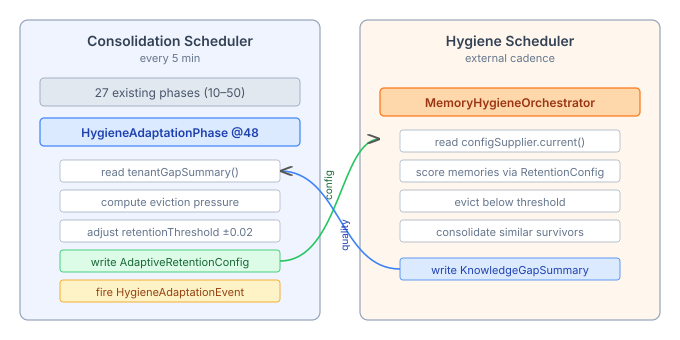

# The Threshold That Tuned Itself

A cognitive memory system has a problem that biological memory solved long ago: deciding what to keep. The neocortex memory hygiene orchestrator scores every memory against a retention threshold, evicts what falls below, and consolidates what survives. Five parameters control this — a threshold and four weights — and until today, every one of them was nailed down at startup.

That meant the system could be miscalibrated and never recover. Set the threshold too high and valuable memories get evicted. Too low and noise accumulates until the memory store is functionally useless for retrieval. The only feedback was a developer noticing degraded behaviour and manually adjusting a config property. For a system that's supposed to model cognition, that's a gap worth closing.

## The Design Problem

The obvious approach is "make the config dynamic." The less obvious part is where the adaptation logic lives. The neocortex has two independent tick loops: a consolidation scheduler that runs MindMap phases every five minutes, and a hygiene scheduler that runs memory scoring and eviction on its own cadence. They share no state and know nothing about each other.

The hygiene orchestrator produces quality signals — a `KnowledgeGapSummary` recording how many memories fell below the retention threshold, how many got consolidated, and the total scored. The adaptation logic needs to read those signals and adjust the parameters. But the adaptation logic is naturally a consolidation phase, because that's the pipeline designed for cross-cutting cognitive maintenance.

The key insight: the two loops don't need to synchronise. The adaptation phase reads quality signals from the *previous* hygiene tick and writes adjusted parameters for the *next* one. One-tick lag. For parameters that move in 0.02 increments, that lag is irrelevant.

## Why One Parameter Is Enough

I started with the intuition that the adaptation phase should identify the "weakest dimension" across all five parameters and nudge it. The decision review tore that apart in about thirty seconds.

The problem is information-theoretic. `KnowledgeGapSummary` gives you two signals: eviction pressure (how many memories are near the threshold) and consolidation activity (how many groups got merged). `RetentionConfig` has five parameters. Two signals cannot uniquely drive five dials — if eviction pressure is high, is the threshold too aggressive, or is the confidence weight undervaluing uncertain-but-valuable memories, or is the recency weight penalising older-but-important ones?

The answer, once Claude's reviewer pointed it out, was obvious: the four weights aren't quality parameters at all. They're personality parameters. How much an agent values confidence versus recency versus scope versus trust is a disposition question, not a hygiene question. The only parameter that directly controls eviction aggressiveness is the threshold itself.

So the adaptation algorithm became trivially simple: compute eviction pressure (lowRetentionCount / totalScored), compare against a target band (5%–30%), and step the threshold by ±0.02 when it's outside. One signal, one parameter, one direction. Testable in a few lines. Explainable in a sentence.

## The Oscillation Problem

Stateless single-parameter adjustment has an obvious failure mode: oscillation. Lower the threshold → fewer evictions → pressure drops below target → raise the threshold → more evictions → pressure rises above target → repeat.

The fix requires exactly one piece of state: was the previous adjustment working? If I lowered the threshold last tick and eviction pressure moved toward the target band, the adjustment is doing its job — hold, don't reverse. Only adjust again if the system is still outside the band and not improving.

This turns the adaptation from a reactive servo into a converging one. The ±0.02 step size bounds the worst case, and the direction tracking prevents the oscillation. The whole thing runs in a `ConcurrentHashMap<String, KnowledgeGapSummary>` per tenant — no persistence, no learning, no complexity.

## What the Reviewer Caught

The decision review was worth its cost. We'd made five quick-pick decisions in brainstorming, and the reviewer found three blocking issues:

**Priority collision.** I'd picked `@Priority(22)` based on a mental model of the phase ordering that was missing 15 of the 28 actual phases. Priority 22 was already occupied by `DriveDescriptionGenerationPhase`. The fix was moving to `@Priority(48)` — late in the pipeline, which is correct since the phase reads cross-system hygiene data and doesn't depend on other consolidation outputs.

**Missing agentId.** `ConsolidationPhase.run()` only gives you a `tenantId`. But the gap state in the hygiene orchestrator is stored per agent-per-tenant. I'd proposed reading gap summaries without noticing there was no way to enumerate agents. The fix was a `tenantGapSummary()` method on the SPI that aggregates across all agents — a default method returning empty, so existing implementations don't break.

**CDI bean in the wrong module.** The `AdaptiveRetentionConfig` holder was going to live in cognition-api alongside `RetentionConfig`. But cognition-api is a pure-Java SPI module. An `@ApplicationScoped` CDI bean has no business there. The fix was putting a `RetentionConfigSupplier` functional interface in cognition-api and the implementation in cognition.

None of these were exotic. They were the kind of error you get from designing against a mental model of the codebase instead of reading the actual code. The reviewer's job is exactly this — go check whether the claims about the codebase are true. In this case, three out of five weren't.

## What This Opens Up

The adaptive retention threshold is a closed loop, but it's a simple one. The CBR persistence layer — storing (parameters, quality outcome) pairs as cases and retrieving the best-performing configuration — is the natural next step. The `AdaptiveRetentionConfig` holder is designed for it: on startup, retrieve the best case from CBR instead of starting at `DEFAULT`.

The per-agent question is also unresolved. Right now the threshold is global — if one agent has terrible retention while another is fine, the aggregate masks it. Per-agent configs require extending `RetentionConfig` with an agent dimension, which is a larger design decision about whether hygiene is an individual or collective property. I think it's individual, but that's a discussion for another issue.
