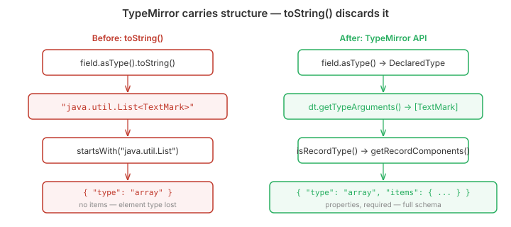
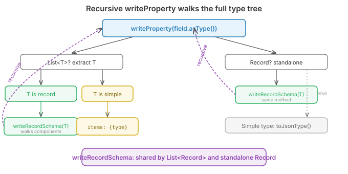

# The Type Your Schema Forgot

Annotation processors work with two representations of a Java type: the `TypeMirror`, which is the compiler's structured model, and the string you get when you call `toString()` on it. The structured model knows that `List<TextMark>` is a declared type with one type argument that is itself a record with two components. The string knows that it's `"java.util.List<test.plugins.ListTestPlugin.TextMark>"` — text you can match against, but not interrogate.

Our `SchemaEmitter` APT was generating JSON Schema from `@Plugin` records. It converted each field's type to a string, then ran it through a switch:

```java
private String toJsonType(String javaType) {
    return switch (javaType) {
        case "java.lang.String" -> "string";
        case "int", "long" -> "integer";
        // ...
        default -> {
            if (javaType.startsWith("java.util.List")) yield "array";
            yield "object";
        }
    };
}
```

For `List<String>`, this produced `{ "type": "array" }`. Correct type. Missing items. A consumer looking at this schema has no way to know what the array contains — strings, records, nested arrays. The JSON Schema spec has the `items` keyword for exactly this purpose, but we'd discarded the information needed to populate it.

## TypeMirror is the compiler's structured model

The fix is to stay in `TypeMirror` space instead of converting to string. When the field's type is a `DeclaredType` whose element is `java.util.List`, the type argument is accessible via `getTypeArguments()`:



For a `List<String>`, this generates `{ "type": "array", "items": { "type": "string" } }`. For a `List<TextMark>` where `TextMark` is a record, we walk its components recursively:

```java
if (isRecordType(elementType)) {
    writeArrayRecordProperty(w, (DeclaredType) elementType, key, indent);
} else {
    String itemType = toJsonType(elementType.toString());
    w.print(indent + "\"" + key + "\": { \"type\": \"array\", "
          + "\"items\": { \"type\": \"" + itemType + "\" } }");
}
```

The `isRecordType` check is a single call: `dt.asElement().getKind() == ElementKind.RECORD`. Java 16's record support in the annotation processing API means the compiler gives you `getRecordComponents()` on the `TypeElement`, returning the same structured component list you'd get from the plugin record itself. The generated items schema includes properties, types, and a `required` array — the full object description a validator or LLM needs.

This is a universal APT pitfall. The moment you call `toString()` on a `TypeMirror`, you've opted out of the compiler's type system. You're pattern-matching strings instead of walking a structure. For simple types — `String`, `int`, `boolean` — the string representation is unambiguous. For generic types, it's a lossy encoding.

## The string path survived inside the fix

The initial fix handled `List<T>` at the top level — the plugin record's own fields. But `writeArrayRecordProperty` still called `toJsonType(comp.asType().toString())` for each component of the nested record. If `TextMark` itself had a `List<String> tags` field, that inner list produced `{ "type": "array" }` without items. The same string-based path, one level deeper.

The fix is to call `writeProperty` recursively instead of `toJsonType`. Every component of a nested record gets the same TypeMirror-aware handling as a top-level plugin field. A `List<Outer>` where `Outer` has `List<String> tags` now generates items all the way down.

The same gap existed for standalone record fields. A plugin with `@Optional Address address` where `Address` is a record produced `{ "type": "object" }` — no properties, no required array. The compiler knows the record's components. We were throwing that away.

Both fixes converge on a shared method:

```java
private void writeRecordSchema(PrintWriter w, DeclaredType type, String indent) {
    TypeElement recordElement = (TypeElement) type.asElement();
    List<? extends RecordComponentElement> components =
        recordElement.getRecordComponents();
    // ... emit properties, recurse via writeProperty, emit required
}
```

`writeArrayRecordProperty` wraps it in an array; `writeRecordProperty` writes it directly. Both delegate component handling back to `writeProperty`, which dispatches on List, Record, or simple type. The recursion terminates because Java records can't form cycles — a record component can't be its own enclosing type.



The progression is worth noticing. The original code had one method (`toJsonType`) that mapped types to JSON Schema strings. The first fix added a second path (`writeProperty`) that handled List specially but left everything else on the string path. The final design makes `writeProperty` the single entry point for all type schema emission — List, Record, and simple types are all handled there, with `writeRecordSchema` as the shared recursive core. Each step was driven by a specific test failure, not by anticipating future requirements.

## The last SnakeYAML import

A related cleanup: the platform's config loaders were the last two files with direct SnakeYAML imports. `YamlPreferenceLoader` and `YamlEndpointLoader` both used `new Yaml().load(is)` to parse simple YAML config files. No position tracking, no dual-parse — just config loading.

The migration to Jackson's `ObjectMapper(new YAMLFactory())` is mechanical, with one behavioral difference worth knowing. SnakeYAML's `Yaml.load()` returns `null` for empty input. Jackson's `ObjectMapper.readValue()` throws `MismatchedInputException`. If your existing code guards with `if (doc == null) return empty`, you need to catch the exception too:

```java
try {
    doc = MAPPER.readValue(is, Map.class);
} catch (MismatchedInputException e) {
    return result;  // empty input → empty result
} catch (IOException e) {
    throw new UncheckedIOException(e);
}
```

With these two files migrated, there are no direct SnakeYAML imports left in the platform. Jackson's `jackson-dataformat-yaml` still uses SnakeYAML internally for the YAML wire format, but the platform code deals exclusively with Jackson's `ObjectMapper` API. One parsing interface, one set of configuration options, one place where YAML behaviour is defined. The SnakeYAML dependency is now purely transitive — invisible to application code.

## Why dependency hygiene matters for platforms

When a platform publishes SPIs consumed by downstream modules, every direct dependency is a surface that leaks. A developer writing a connector who sees `import org.yaml.snakeyaml.Yaml` in the platform source will use SnakeYAML for their own YAML parsing. They'll copy the pattern. When the platform later needs to change its YAML processing — for position tracking, for Jackson feature flags, for YAML version behaviour — those downstream modules are now coupled to the old approach.

Consolidating on a single YAML API isn't about preference. It's about the blast radius of the next change.
