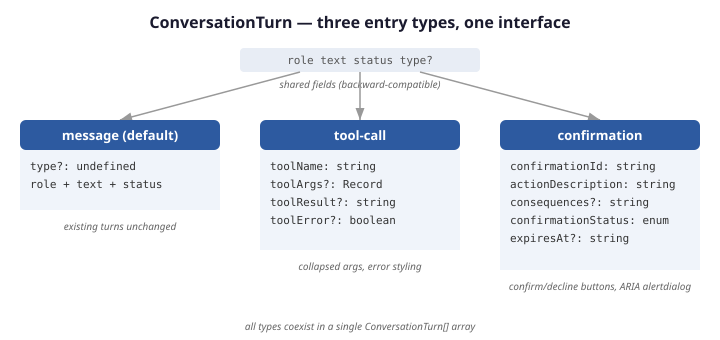
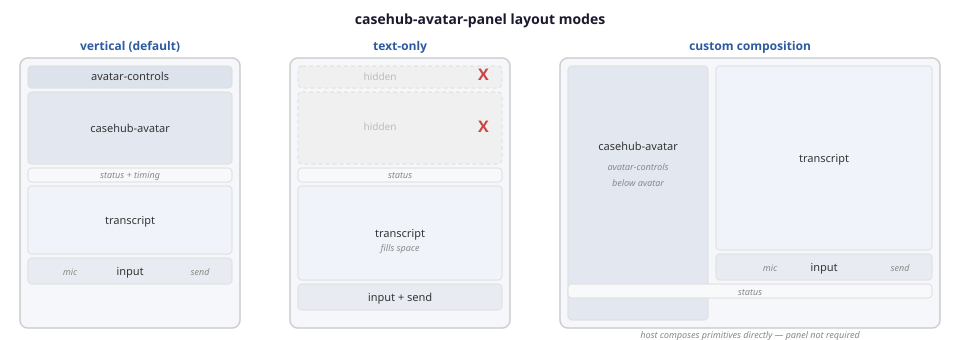

# The Avatar Package Gets Discipline

The avatar package in mosaic had accumulated the kind of drift that happens when features land fast: hardcoded dark-theme hex values scattered across five components, two config types with confusingly similar names, and a dead controller that nothing imported anymore. Each issue was small. Together they made the package feel unfinished.

We started at the naming layer. `AvatarConfig` and `AvatarSessionConfig` both lived in the same export surface, and the names gave no clue which one a consumer should reach for. The component-level config — camera settings, body type, mood — became `AvatarComponentConfig`. The session-level config — voices, LLMs, playback rate — stays as `AvatarSessionConfig`. Now the names tell you where each one belongs.

The dead `AvatarWsController` was the kind of orphan that rots quietly. It was a Lit `ReactiveController` from before `AvatarSession` replaced it — still exported, still tested, used by nothing. I'd normally leave orphaned code for a deprecation cycle, but there are no external consumers in pre-release. We deleted the controller, its tests, and its exports. 350 lines gone.

The theme work was mechanical but consequential. Every component had `var(--pages-background, #1a1a2e)` — dark-biased fallbacks baked into the CSS. In a light theme, the fallbacks never fire if tokens are provided, but they're a lie about what happens without them. We stripped every hardcoded fallback, leaving bare `var(--pages-background)`. The components now rely entirely on the pages token layer. If a host doesn't provide tokens, they get `unset` — which is honest about the dependency rather than silently rendering dark.

## The transcript grew up

The transcript was the interesting part. `ConversationTurn` was a flat interface — role, text, status. We extended it with optional fields for two new turn types: tool calls and confirmations.

A tool-call turn renders the tool name, collapsed arguments, and result inline in the conversation. An error result gets distinct styling. A confirmation turn renders an action card with confirm/decline buttons that dispatch events back through the DOM. The confirmation card uses `role="alertdialog"` so screen readers announce the action before the user reaches the buttons.

The design choice worth noting: we kept `ConversationTurn` as a single interface with optional fields rather than splitting into a discriminated union. The flat interface is backward-compatible — existing producers that only set `role`, `text`, and `status` still work without changes. The cost is non-null assertions when accessing tool or confirmation fields inside type guards. That's a known trade-off, and it's filed for revisiting once the turn types stabilise.

## Text-only mode

The text-only mode came from a real consumer need. Clinical triage and life dashboard panels want the conversation UI without the 3D avatar, voice controls, and TalkingHead dependency.

A `showAvatar` boolean on the panel conditionally renders the heavyweight parts. TalkingHead is already lazy-loaded via dynamic `import()`, so when the avatar element isn't in the DOM, the WebGL dependency never loads. The text-only panel is transcript and input bar — nothing else.

The panel itself is a vertical stack — avatar above transcript — but nothing forces that layout. Each piece is an independent custom element: `<casehub-avatar>`, `<casehub-transcript>`, `<casehub-speech>`, `<casehub-avatar-controls>`. A host that wants the avatar on the left and the conversation on the right just composes them in a side-by-side grid. The panel is a convenience; the primitives are the real API.

## What's left unbuilt

The confirmation flow leaves one thing open: auto-expiry. The `expiresAt` field exists on `ConversationTurn` but nothing reads it yet. A stale confirmation just sits there with its buttons enabled. The timer logic belongs in the session layer, not the transcript renderer — getting the event plumbing right matters more than the timeout.

The transcript went from a flat text renderer to something that can show the agent's work — tools, confirmations, errors — inline where the user is already reading. That's the foundation for the cognitive agent pipeline to surface its reasoning without forcing a context switch.
