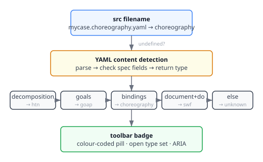

# The Type Is in the Name

The case diagram showed you the case — bindings, workers, capabilities, edges — but never said what kind of execution model it was. `detectDiagramType()` already existed in mosaic-core, parsing YAML content to figure out whether something was a case definition, an HTN decomposition, or a Serverless Workflow. It returned `'case'`, `'htn'`, `'swf'`, or `'unknown'`. The issue asked for a badge. The interesting part was what happened to the type set along the way.

The original issue listed choreography, sequential, HTN, GOAP, LLM, and portfolio as the execution models to detect. That list didn't survive contact with the actual domain. Sequential is just a choreography with a linear topology — bindings still dispatch to workers via capabilities, the graph just happens to be a chain. Portfolio is a choreography that dispatches to sub-cases instead of workers. Neither has different runtime semantics. They describe graph shape, not execution model.

What survived: **choreography** (the general case model, replacing the vague `'case'`), **HTN**, **GOAP** (goal-oriented cases), **SWF**, **LLM**, and **playbook**. Plus `agent-conf`, `avatar-conf`, `agency`, and whatever comes next — because the type set isn't a closed enum.

## The naming convention changes everything

The platform uses a `name.type.yaml` filename convention — `mycase.choreography.yaml`, `plan.htn.yaml`, `bot.agent-conf.yaml`. When the convention is followed, detection is trivial: split the filename on `.`, take the second-to-last segment. No YAML parsing, no heuristics, no maintenance when new types appear.

```typescript
export function detectDiagramTypeFromSrc(src: string): string | undefined {
  if (!src) return undefined;
  const filename = src.split('/').pop()!.split('?')[0]!.split('#')[0]!;
  const segments = filename.split('.');
  if (segments.length < 3) return undefined;
  const ext = segments[segments.length - 1];
  if (ext !== 'yaml' && ext !== 'yml') return undefined;
  return segments[segments.length - 2];
}
```

The convention isn't consistently adopted everywhere yet — that's a separate org-wide concern. So YAML content detection stays as the fallback. We extended `detectDiagramType()` to return `'goap'` for definitions with `spec.goals` and `'choreography'` instead of the old `'case'`. Detection order matters: HTN is checked before GOAP because a decomposition with goals is fundamentally HTN — the goals are part of the task network, not a separate planning model.



## The badge

The toolbar renders a colour-coded pill — `choreography` in blue, `htn` in purple, `goap` in amber, and so on. The colour map is a `Record<string, string>` with a neutral grey default. Adding a new type means adding one line. Unknown types aren't hidden — they get the default colour and show whatever the filename said. The type set grows without code changes.

The `'case'` → `'choreography'` rename touched three downstream consumers: `DIAGRAM_TAGS` (the routing map that picks which `<*-diagram>` component to render), `diagram-workbench` (which hardcoded `'case'` as the root level type), and the export example page. We kept `case` as a backward-compatible alias in `DIAGRAM_TAGS` alongside the new `choreography` and `goap` entries — both resolve to `casehub-diagram`.

The convention-first approach means the detection system works for types that have no YAML structure to analyse at all. An `avatar-conf.yaml` file has no `spec.bindings` or `document.do` — it's a configuration file, not an execution model. The filename tells you what it is. The content fallback handles legacy files and inline YAML where there's no filename to parse.
