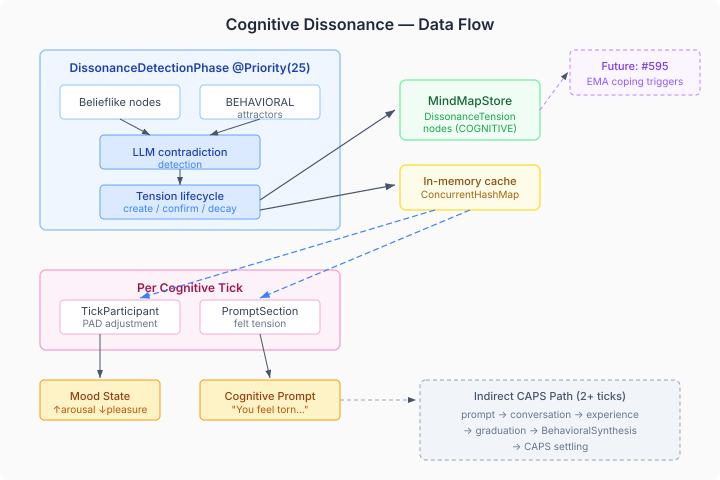

# The Villain Who Can't Feel the Contradiction

A character holds two beliefs: "I am charming and lovable" and "I am plotting to murder my business partner." Both sit in the knowledge graph as Belieflike nodes, both with high confidence, neither interfering with the other. The character experiences no tension, no internal conflict, no cost. As far as the cognitive engine is concerned, these beliefs coexist peacefully.

That's the gap. Festinger (1957) called it cognitive dissonance — the psychological discomfort from holding inconsistent cognitions. Aronson (1969) refined it further: the strongest dissonance occurs when behaviour violates the self-concept. "I am kind" contradicted by "I just hurt someone" produces more tension than any abstract belief-belief conflict. Cooper and Fazio (1984) added the physiological dimension — dissonance produces measurable arousal, not just intellectual unease.

The neocortex engine has the infrastructure to represent all of this. It has beliefs (Belieflike nodes in MindMap), behavioural patterns (CapsGenerated attractors in the BEHAVIORAL subgraph), self-concept (the CAPS mediating layer — `self_worth`, `self_efficacy`, `other_reliability`), and mood (PAD values). What it lacked was the bridge between them — the mechanism that detects when beliefs contradict each other or contradict established behaviour, and produces the felt tension that makes characters psychologically real.

## The constraint satisfaction insight

Shultz and Lepper (1996) formalized dissonance as constraint satisfaction. Cognitive elements are nodes in a connectionist network. Consonance relations are excitatory connections. Dissonance relations are inhibitory connections. The network settles to minimize total constraint violation — some beliefs strengthen, others weaken.

This maps directly to the existing CAPS engine. CapsSettler already does iterative spreading activation across a network of ~30 input nodes, ~20 mediating nodes, and ~24 output nodes, with weighted connections, convergence detection, oscillation detection, and attractor extraction. When I looked at this, the first question was obvious: can we just feed contradictory beliefs into CAPS and let the existing settling mechanism produce the dissonance signal?

The answer is yes, but indirectly. The CAPS mediating nodes — `self_worth`, `self_efficacy`, `other_reliability`, `other_safety`, `world_predictability`, `future_outlook` — are the self-concept. They're bipolar [-1, 1] nodes that represent how the character values themselves, trusts others, and sees the world. When contradictory beliefs activate competing CAPS pathways, those mediating nodes are where the tension manifests. Self-concept dissonance doesn't need separate modelling because it's already baked into the network topology.

## Why not direct CAPS settling

The tempting approach was to settle CAPS directly with the contradicting belief activations — feed "I am kind" and "I enjoy cruelty" as competing input activations and observe the oscillation. The decision review caught why this doesn't work mechanically: `BehavioralSynthesisPhase` already settles CAPS for each agent and caches the result in `lastSettlingResults`. A second settling pass would create a double write-cycle, invalidate the cached state, and produce undefined interactions between experience-derived and dissonance-derived attractors.

The indirect path is cleaner and more faithful to Festinger. Dissonance reduction is gradual — it happens through ongoing conversation and behaviour, not through an instant reconfiguration of the constraint network. The dissonance produces felt tension (PAD arousal up, pleasure down). The character articulates the tension during conversation. That conversation generates new experiences, which graduate through ExperienceConsolidationPhase, which eventually feed into BehavioralSynthesisPhase and settle CAPS on a subsequent tick. The behavioural effects of dissonance arrive 2+ consolidation ticks later, carried by the character's own responses to the tension. This is exactly how Festinger describes the process: the dissonance motivates change, and the change happens through behaviour.

## The architecture

A new consolidation phase — `DissonanceDetectionPhase` at `@Priority(25)` — runs periodically. For each agent, it collects all Belieflike nodes and established behavioural attractors, sends them to an LLM in a single call, and gets back structured JSON: which pairs contradict, how strong the contradiction is, and what CAPS input nodes each element would activate.

Detected contradictions become persistent `DissonanceTension` nodes in the COGNITIVE subgraph. Each tension node carries the two contradicting elements, the strength, the CAPS activation maps, and a timestamp for lifecycle tracking. The LLM re-assesses existing tensions on each tick — confirming, decaying, or resolving them as beliefs and behaviours evolve.

Two per-tick consumers read from the phase's in-memory cache. `DissonanceTickParticipant` adjusts PAD: arousal increases proportional to aggregate tension strength (capped at +0.3), pleasure decreases (capped at -0.2), dominance drops from the strongest single tension (capped at -0.1). `DissonancePromptSection` renders the tension as natural language — "You feel an uncomfortable tension between parts of yourself that don't fit together" — sorted by strength, capped at three items to avoid overwhelming the prompt.

## The LLM question

One decision I want to highlight: detection is LLM-based, not structural or NLI. The neocortex codebase has a consistent design principle — semantic judgment uses LLMs; mechanical pipelines consume the structured values LLMs produce. "Do these two beliefs contradict?" is fundamentally a semantic question. An NLI classifier might catch "I am kind" vs "I am cruel" but would miss "I value loyalty" vs "I would betray anyone for power." The existing pattern — LlmSituationClassifier for experience classification, LlmAppraisalStrategy for SEC dimensions, BeliefRevisionPhase for evidence-belief contradictions — all use LLMs for this class of judgment. Dissonance detection follows the same path.

The LLM also maps each contradicting element to CAPS input node activations — the same semantic mapping that LlmSituationClassifier performs for experiences. This is what makes beliefs into "cognitive elements in the constraint network" per Shultz and Lepper. The activation maps are stored on the tension nodes for observability and future integration with the EMA coping system (#595).

## Resolution — and why it's deferred

Festinger's dissonance reduction strategies map directly to EMA coping strategies from Marsella and Gratch (2009): "change a cognition" is positive reinterpretation, "deny contradicting information" is denial, "reduce importance" is suppression. Building a parallel resolution system would create two independent strategy selectors for overlapping territory. The right integration point is the coping system (#595), where dissonance tension becomes a coping trigger and resolution flows through EMA's existing strategy selection.

For now, mechanical decay provides an interim pathway — if the LLM stops detecting the contradiction (because BeliefRevisionPhase revised a belief, or because behavioural attractors shifted through natural experience), the tension strength decays additively at 0.1 per tick and resolves when it drops below 0.15. It's simple and it works. But the real resolution — where the character rationalizes, compartmentalizes, or genuinely changes their mind — will come from coping.

## What this opens up

The villain who believes they're charming while plotting murder will now experience that contradiction as psychological cost. Their arousal will rise. Their pleasure will drop. The prompt will tell them they feel torn. And their conversation behaviour — influenced by that tension — will generate experiences that eventually reshape their CAPS attractors. The constraint network that Shultz and Lepper described is already there in the engine. This work connects beliefs to it, so contradictions produce consequences rather than coexisting in silence.
