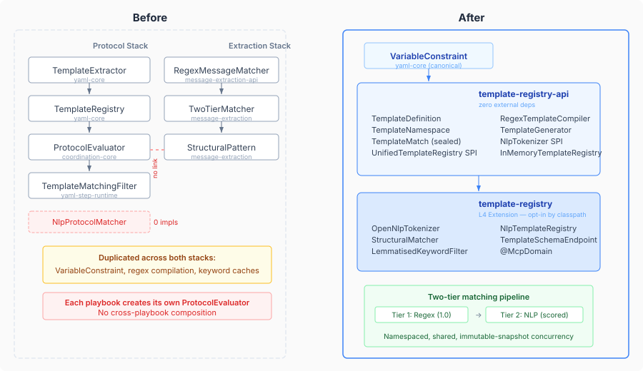

# Two Stacks, One Registry

The template matching infrastructure in casehub-platform had a problem I should have spotted earlier. We had two parallel implementations of the same concept — one in the protocol stack (yaml-core → coordination-core → yaml-step-runtime) and one in the extraction stack (message-extraction-api → message-extraction) — with no code dependency between them.

Both compile `${var}` templates to regex. Both extract variable bindings from input text. Both have constraint validation. Both have a `VariableConstraint` sealed interface with identical `StringConstraint` and `EnumConstraint` records. The extraction stack added NLP structural matching via OpenNLP (tense, plurals, lemmatisation). The protocol stack had an NLP SPI (`NlpProtocolMatcher`) with zero implementations — the bridge to the extraction stack was never built.

Worse: each playbook creates its own isolated `ProtocolEvaluator`. Templates compile per-playbook. Keyword caches duplicate. There is no cross-playbook composition. The lifecycle is the problem, not the matching algorithm.



## What "unified" means here

The unified template registry replaces both stacks with two new modules: `template-registry-api` (zero external deps, depends on yaml-core for the canonical `VariableConstraint`) and `template-registry` (OpenNLP, structural matching, CDI wiring).

Templates are registered under namespaces — `protocol:review`, `protocol:governance`, `runtime:alerts` — so different sources don't collide. The registry does two-tier matching: regex first (always available, in the API module), NLP structural fallback (when the impl module is on the classpath). NLP activates by classpath presence, not by configuration — the platform's opt-in extension pattern.

The design had some interesting tensions between ideal and premature. I wanted a discrimination tree indexed by lemmatised literals — O(template depth) lookup instead of O(n) linear scan. Claude pushed back during the decision review: the existing keyword affinity filtering already provides discrimination, and upgrading it to operate on lemmatised tokens (so "approved" and "approve" reduce to the same lemma) gives morphological discrimination with no new data structures. The positional trie is deferred until template counts exceed ~100 per registry. For 10–50 templates per protocol, lemmatised keyword filtering is sufficient.

Similarly, I wanted NLP-driven generation — verb conjugation, determiner agreement, the works. The review caught this as premature: English morphological rules are irregular, the effort is substantial, and no concrete consumer requires subject-dependent generation yet. Template slot-filling is sufficient for governed communications where the template IS the grammatically correct surface form.

## Where the NLP earns its keep

The regex tier handles exact matches — "I approve this design" matches the template `"I ${decision} this ${subject}"` and extracts `{decision: "approve", subject: "design"}` with score 1.0. Fast, reliable, and the common case when LLMs follow templates closely.

But LLMs don't always follow templates closely. An agent writes "I approved this design" (past tense) or "I approve these designs" (plural). The regex tier rejects both: "approved" doesn't string-match the enum value "approve", and "these" doesn't match the literal "this" in the compiled pattern.

The NLP tier catches them. OpenNLP tokenises the input, POS-tags each word, and lemmatises: "approved" → "approve", "these" → "this", "designs" → "design". The structural matcher walks the lemmatised tokens against the template's structural elements. "approve" matches the enum. The match succeeds.

```java
// Regex rejects — "approved" ≠ "approve" as a string
var regexResult = regexRegistry.match("protocol:review", "I approved this design");
// → Unmatched

// NLP matches — lemmatisation normalises "approved" → "approve"
var nlpResult = nlpRegistry.match("protocol:review", "I approved this design");
// → Matched(decision="approve", subject="design")
```

The distinction between enum and string extraction matters. Enum variables extract the **lemma** — "approved" becomes "approve", which is one of the declared enum values. String variables extract the **surface text** — "the chief information security officer" is preserved verbatim, commas and all. This means a protocol engine always sees clean enum values regardless of verb tense, while keeping the full richness of free-text captures.

## Multi-word capture and comma-separated lists

String variables use clause capture — they grab everything between structural anchors (literal words in the template). This handles multi-word phrases naturally:

- "Escalating to **the chief information security officer**" → `target` captures the entire title
- "I approve this **proposed migration strategy for the legacy database**" → `subject` captures the whole phrase
- "I reject this proposal because **it breaks the API, the security model, and the backwards compatibility guarantee**" → `rationale` captures the enumerated list verbatim

Comma-separated lists fall out of clause capture without any special code. An LLM that writes "because 1) no error handling, 2) no tests, 3) no documentation" — the rationale clause captures it all, numbered items and punctuation intact.

## From prose to protocol action

The extracted fields aren't just data — they drive protocol logic. The `templateName` tells the protocol engine which action type matched (vote vs escalate), and the fields are the action's parameters:

```java
var match = registry.match("protocol:review", "I rejected this proposal");
// templateName = "vote", decision = "reject", subject = "proposal"

switch (match.templateName()) {
    case "vote" -> recordVote(match.fields().get("decision"),
                              match.fields().get("subject"));
    case "escalate" -> routeEscalation(match.fields().get("target"),
                                        match.fields().get("reason"));
}
```

The key insight: "I rejected this proposal", "I reject this proposal", and "I rejects this proposal" all produce `decision=reject`. The protocol engine sees the same normalised action regardless of the verb form in the input. NLP normalisation means the dispatch logic doesn't need to handle grammar variation — it's already resolved.

## Named agents — pronouns and delegation

A protocol might need to track who voted, not just what they voted. The template `"On behalf of ${agent} I ${decision} this ${subject}"` captures the agent as a string variable — it can be a name, a title, or a multi-word entity:

| Input | agent | decision |
|---|---|---|
| "On behalf of Sarah I approve this design" | Sarah | approve |
| "On behalf of Mark I reject this proposal" | Mark | reject |
| "On behalf of the committee I approve this budget" | the committee | approve |
| "On behalf of the security review board I reject this deployment plan" | the security review board | reject |
| "On behalf of Sarah I approved this architecture" | Sarah | approve (tense normalised) |

The template doesn't need to know about gender or person — the `${agent}` variable captures whatever noun phrase appears, and the NLP handles verb inflection transparently.

## Singular and plural — matching works, generation doesn't yet

The template `"I ${decision} this ${subject}"` matches both "I approve this design" and "I approve these designs". The NLP tier normalises "these" via lemma equivalence with "this". The extracted subject preserves the surface form — the caller sees "designs" (plural), not "design" (singular) — so downstream code knows whether the input referred to one thing or several.

There's an asymmetry here worth calling out. **Matching** handles plurals — "these designs" matches a template that says "this". But **generation** doesn't adapt — `generate("vote", {subject: "designs"})` produces "I approve this designs" (grammatically wrong) because slot-filling keeps the template's literal "this" without adjusting to "these". Matching is grammar-tolerant; generation is grammar-literal. The morphological generation work (#962) addresses this — POS metadata from the NLP compilation is already preserved, it just isn't used for inflection yet.

## The full range — what the integration tests prove

The best way to understand what the NLP handles is to see the inputs it was tested against. All of these match the same two templates — `"I ${decision} this ${subject}[ because ${rationale}]"` and `"Escalating to ${target}[ due to ${reason}]"`:

**Verb tense normalisation** — all normalise to the same enum lemma:

| Input | Extracted `decision` |
|---|---|
| "I approve this design" | approve (regex, score 1.0) |
| "I approved this design" | approve (NLP, lemmatised) |
| "I approves this design" | approve (NLP, lemmatised) |
| "I approving this design" | approve (NLP, lemmatised) |
| "I rejected this proposal" | reject (NLP, lemmatised) |
| "I rejects this proposal" | reject (NLP, lemmatised) |
| "I rejecting this proposal" | reject (NLP, lemmatised) |

**Wrong enum values rejected** — the NLP matches structure but enforces constraints:

| Input | Result |
|---|---|
| "I celebrated this achievement" | Unmatched — "celebrate" not in {approve, reject, abstain} |

**Singular and plural** — determiners and nouns normalise:

| Input | Extracted `subject` |
|---|---|
| "I approve this design" | "design" |
| "I approve these designs" | "designs" (surface preserved) |
| "I approve this proposal" | "proposal" |
| "I approve these proposals" | "proposals" (surface preserved) |
| "I approve these architectural proposals" | "architectural proposals" |

**Multi-word capture** — clause variables grab entire phrases:

| Input | Extracted field |
|---|---|
| "I approve this proposed migration strategy for the legacy database" | subject = "proposed migration strategy for the legacy database" |
| "Escalating to the chief information security officer" | target = "the chief information security officer" |
| "Escalating to management due to repeated failures in the deployment pipeline that are blocking three downstream teams" | reason = "repeated failures in the deployment pipeline..." |

**Comma-separated lists** — captured verbatim including punctuation:

| Input | Extracted field |
|---|---|
| "I approve this API, database, and deployment pipeline" | subject = "API, database, and deployment pipeline" |
| "I reject this proposal because it breaks the API, the security model, and the backwards compatibility guarantee" | rationale = "it breaks the API, the security model, and the backwards compatibility guarantee" |
| "I reject this proposal because 1) no error handling, 2) no tests, 3) no documentation" | rationale = "1) no error handling, 2) no tests, 3) no documentation" |

**Named agents** — with a template `"On behalf of ${agent} I ${decision} this ${subject}"`:

| Input | Extracted fields |
|---|---|
| "On behalf of Sarah I approve this design" | agent = "Sarah", decision = "approve" |
| "On behalf of Mark I reject this proposal" | agent = "Mark", decision = "reject" |
| "On behalf of the committee I approve this budget" | agent = "the committee", decision = "approve" |
| "On behalf of the security review board I reject this deployment plan" | agent = "the security review board", decision = "reject" |
| "On behalf of Sarah I approved this architecture" | agent = "Sarah", decision = "approve" (tense normalised) |

**Rich protocol** — four variables with `"Requesting ${action} on ${resource} from ${authority}[ because ${justification}]"`:

| Input | Extracted fields |
|---|---|
| "Requesting approval on the production deployment from the release manager because the deadline is tomorrow" | action = "approval", resource contains "production", authority contains "release", justification contains "deadline" |
| "Requesting review on the API changes from the architect" | action = "review", justification absent (optional omitted) |
| "Requesting deletion on the database from the admin" | Unmatched — "deletion" not in {approval, review, access, exception} |

**False positive rejection** — conversational input correctly stays unmatched:

| Input | Result |
|---|---|
| "Let me think about this for a while" | Unmatched |
| "Great work on the implementation" | Unmatched |
| "Can we schedule a meeting to discuss?" | Unmatched |
| "The deployment pipeline is running smoothly" | Unmatched |

**End-to-end function call** — prose drives a typed event:

```java
// LLM writes past tense — NLP normalises, protocol dispatches
var match = registry.match("protocol:review", "I approved this architecture because it handles failover");
// templateName = "vote"

var event = new VoteRecordedEvent(
    match.fields().get("decision"),    // "approve" — the lemma, not "approved"
    match.fields().get("subject"),     // "architecture"
    match.fields().get("rationale")); // "it handles failover"

// Three different surface forms — all produce the same event:
// "I approve this design"   → VoteRecordedEvent(approve, design, null)
// "I approved this design"  → VoteRecordedEvent(approve, design, null)
// "I approves this design"  → VoteRecordedEvent(approve, design, null)
```

## Bidirectional: extract and generate

Templates work in both directions. Extract turns prose into fields; generate turns fields back into prose:

```java
// Extract
var matched = registry.match("protocol:review", "I approve this design");
// → {decision: "approve", subject: "design"}

// Generate
var surface = registry.generate("protocol:review", "vote",
    Map.of("decision", "approve", "subject", "design"));
// → "I approve this design"
```

Generation uses template slot-filling — the template pattern is the grammatically correct form, variables are substituted into their positions. Optional segments (`[ because ${rationale}]`) are included when all their variables have values, omitted otherwise. The roundtrip property holds: extract from prose, generate from the extracted fields, get the original prose back.

## Schema publication

Each registered template publishes a sentence schema — available via the registry API and exposed via `@McpDomain` for REST/GraphQL/MCP access. The schema includes the template patterns, variable definitions with constraints, and (when NLP is on the classpath) POS-annotated structural summaries showing the lemma and part-of-speech tag for each template element.

The schema is the contract between LLMs and the protocol engine. It tells the LLM: "this protocol expects sentences that look like this, with these variable positions and these allowed values." The LLM conforms; the platform extracts mechanically.

## What's next: YAML corpus and playbook integration

Templates are infrastructure — defined in their own corpus files, not embedded in playbooks:

```yaml
# templates/protocol-review.yaml
namespace: protocol:review
templates:
  vote:
    patterns:
      - "I ${decision} this ${subject}[ because ${rationale}]"
    variables:
      decision:
        type: enum
        values: [approve, reject, abstain]
      subject:
        type: string
      rationale:
        type: string
        required: false
```

Playbooks consume templates via a `match` step that connects the registry to the execution pipeline:

```yaml
- match:
    input: ${response.text}
    namespace: protocol:review
    on:
      vote:
        - invoke: recordVote
          args: { decision: ${vote.decision}, subject: ${vote.subject} }
        - signal: vote-recorded
      escalate:
        - invoke: routeEscalation
          args: { target: ${escalate.target} }
```

Variable types from the template corpus flow through to the playbook — the compiler knows `${vote.decision}` is an enum with known values, `${vote.rationale}` is optional. Type safety from template definition through to function call, with NLP normalisation handling the grammar in between.
