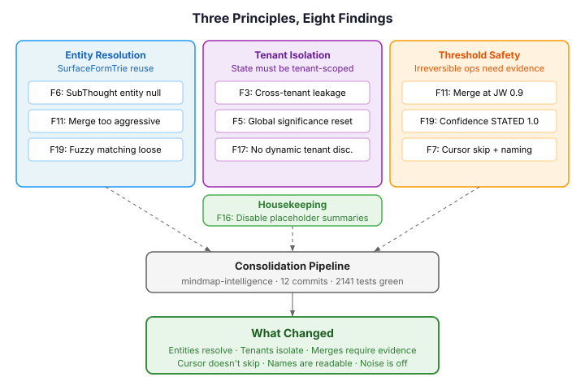

# Three Principles, Eight Bugs

The cognitive review surfaced 107 findings across the neocortex pipeline. The consolidation phases in `mindmap-intelligence` owned eight of them — a mix of tenant isolation failures, entity resolution gaps, merge false positives, and a cursor that silently skipped memories.

I expected these to be eight independent patches. They weren't.

## The pattern

Three findings involved the same thing: entity recognition in text. `SubThoughtExtractor` hardcoded entity to null, making the entire sub-thought consolidation phase inert — it groups by entity, every entity was null, nothing grouped. `MergeDetectionPhase` auto-merged "John Smith" and "Joan Smith" sharing one neighbor because Jaro-Winkler character similarity can't distinguish them. `MindMapExtractor` fuzzy-matched "Mark" to "Marcus" across unrelated subgraphs at a threshold of 0.85.

The codebase already had `SurfaceFormTrie` — an Aho-Corasick scanner in the `entity-token` module that recognizes entity mentions by their canonical names, aliases, and surface forms. It was already a dependency of `mindmap-intelligence`. Nobody was using it in these paths.

Three more findings were tenant isolation failures. `CognitiveAttentionAccumulator` keyed signals by principal ID alone — if the same agent operated across two tenants, signals pooled. `SignificanceAccumulator.swapAndReset()` replaced the entire per-tenant map atomically, discarding accumulated significance for tenants that weren't being processed. New tenants created after startup were invisible to consolidation because discovery happened once at `@PostConstruct`.

Same flaw, three manifestations: consolidation state wasn't tenant-scoped.

## The fixes that needed design

The watermark cursor was the most interesting fix. `ExperienceConsolidationPhase` scans memories and graduates them to MindMap nodes when corroboration reaches a threshold. When a memory is corroboration-blocked (its subject hasn't been mentioned enough), the cursor is supposed to stay behind it so it gets re-evaluated next tick. But if a later memory in the same batch passed, the cursor jumped ahead and the blocked memory was never revisited.

The fix is TCP acknowledgement semantics: the cursor represents "everything up to here is fully resolved." When a blocked memory sits at position N and a later one at N+5 graduates, the cursor stays at N-1. We added a TTL escape hatch — after 10 ticks without corroboration, the memory is abandoned and the cursor advances. Without this, a single hallucinated entity would permanently anchor the watermark.

The merge thresholds needed different guards for different failure modes. For general entities, we cap the blended score below auto-merge when name similarity is under 0.95 and shared neighbors are fewer than 2 — single-neighbor Jaccard inflates unreliably. For goals, we added word-token Jaccard: "Write chapter 1" vs "Write chapter 2" score 0.95 on Jaro-Winkler but 0.5 on word Jaccard. The domain compatibility check switched from treating null as a wildcard to strict equality.

Claude caught two edge cases in code review that I'd missed. The sentinel node that stores cursor state doesn't exist on fresh systems — if every memory in the first batch is corroboration-blocked, `saveBlockedTickCounts` silently returned without persisting, and the TTL escape hatch never fired. And abandoned memories weren't cleaned from the tick-count map, so dead properties accumulated on the sentinel node indefinitely.

## The easy ones

ConversationBridge defaulted every paragraph to STATED confidence (1.0). Conversation text is the system's interpretation, not stated fact — INFERRED (0.7) is accurate. One line change, existing callers with genuinely stated facts (biographical import) already pass STATED explicitly.

CommunitySummaryPhase generated placeholder text ("Summary: Alice, Bob, Charlie") that nothing read. Gated behind a runtime config check, default disabled. The k-core detection infrastructure stays live for future use.

The signals drain in `SubThoughtConsolidationPhase` was a copy-paste omission — every other phase calls `pendingSignals.clear()` after copying in `signals()`. Without it, signals accumulated unboundedly across ticks.

## What's next

The eight findings are one sub-epic of seven in the cognitive pipeline coherence effort. SE1 (pipeline spine) and SE2 (CAPS rework) are running in parallel on other slots. Once SE1 lands, SE6 (affect and emotion) and SE7 (orchestrators) can start — they depend on the unified composition path that SE1 establishes. The full pipeline runs against 300-tick scenarios, but that's the capstone, not the starting point. Each sub-epic proves its changes through micro tests and short runs first.
