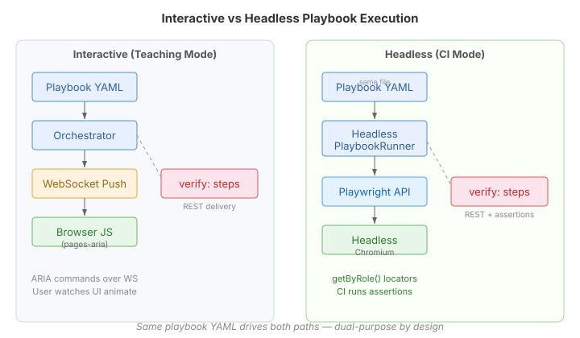

# When Playbooks Learn to Test Themselves

The helpdesk demo playbook already walks a user through the full case lifecycle — submit a ticket, watch it classify, see the work item appear, resolve it, verify notification. It does this by sending ARIA commands over WebSocket to a browser page that animates each step. Teaching mode.

The question I wanted to answer: can the same YAML file that teaches also test?

## The dual-purpose bet

The playbook YAML has two kinds of steps. UI steps (`fill:`, `click:`) interact with form elements using ARIA selectors — `role: textbox, name: Subject`. Verification steps (`verify:`) hit REST endpoints and assert field values. In interactive mode, the orchestrator dispatches UI steps to browser-side JavaScript via WebSocket and runs verify steps through the REST delivery handler.

For headless mode, the UI steps need a different executor. Instead of broadcasting ARIA commands and waiting for the browser's JS to report back, Playwright drives a headless Chromium directly. The ARIA selectors map naturally — `fill: { role: textbox, name: Subject }` becomes `page.getByRole(TEXTBOX, new GetByRoleOptions().setName("Subject")).fill(value)`. Same semantic, different transport.

The verify steps don't change at all. They're already server-side REST calls with expected values. In headless mode they become assertions with retry polling — the same eventual-consistency pattern, just with a test harness verdict at the end instead of a UI checkmark.

## What the scaffold looks like

I brought Claude in for the implementation. We built `HeadlessPlaybookRunner` in the pages playbook-runtime module — it takes a playbook YAML string, parses it through the existing `PlaybookContentParser`, launches headless Chromium, and walks the step list. Each step dispatches to a type-specific handler: `executeFill`, `executeClick`, `executeSelect`, `executeNavigate`, `executeVerify`. Teaching-only steps like `spotlight` and `show-markdown` are skipped — they have no headless equivalent.

The locator resolution handles both flat and nested param formats. The demo playbook uses nested targets (`target: { role: textbox, name: Subject }`) while some simpler playbooks use flat params. Both paths resolve to the same `page.getByRole()` call.

On the examples side, `PlaybookIntegrationTest` loads `helpdesk-demo.yaml` from the classpath — it's already there via the `helpdesk-shared` dependency — and runs it headlessly. Currently disabled until the Quarkus test profile wiring connects the test port to the Playwright base URL.

A code review caught two things worth fixing before merge. The `checkExpectations()` stub was returning a failure list, which meant every verify step would silently poll for 30 seconds before timing out — the kind of thing that wastes an afternoon of debugging when someone first enables it. Changed to throw `UnsupportedOperationException` so it fails fast with a clear message. The reviewer also flagged that a null `baseUrl` would produce URLs like `"null/api/health"` — a valid string that generates a confusing network error. Added a null guard in the config constructor.

## The queue picture

This session also sorted out the work queue for the YAML helpdesk plan. Batches 1–6 are done — auto-discovery, persistence, eidos dispatch, push publish, the helpdesk module itself, page YAML and demo playbook all landed. Four batches remain:

| # | Issue | What |
|---|-------|------|
| 7 | #216 | TS event decorators — `@Observes`/`@Publish` wired to push topics |
| 8 | #217 | Three-way viewer — YAML/visual/split mode |
| 9 | #214 | Headless playbook testing (this session's scaffold) |
| 10 | #215 | Polish — side-by-side docs + visualiser bindings |

All four are now queued with issues. Batch 7 (TS decorators) is next — a topic change from Java/Playwright into TypeScript in a new `casehub-pages` package.

The five implementation items remaining on #214 are tracked as checkboxes in the issue: JSON response matching for verify expectations, bootstrap rule seeding, trigger ordering, test profile wiring, and enabling the integration test. Each one is a session-sized piece of work, not a quick fix.

## What this opens up

If the dual-purpose bet pays off, every playbook becomes a CI test for free. The demo playbook that onboards a new developer also validates the full case lifecycle on every build. No separate test maintenance, no test scripts that drift from the actual UI. The YAML is the single source of truth for both paths.

The interesting constraint is trigger ordering. The demo playbook uses `trigger: { after: step-name }` to sequence steps — fill the form, then click submit, then wait for classification. In interactive mode the orchestrator dispatches triggered steps when their predecessor completes. The headless runner currently ignores triggers and runs sequentially, which works for the linear demo but won't generalise to playbooks with parallel branches. That's the hardest remaining piece.
