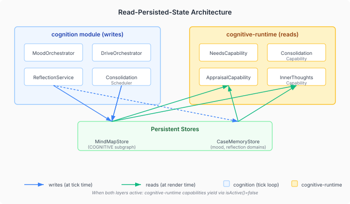

# The Layer That Only Reads

The cognitive-runtime module sits below the full cognition pipeline. It provides lightweight avatar capabilities — personality briefings, goal awareness, temporal context — without requiring the emergent tick loop, the CARMA appraisal system, or the drive orchestrator. Six capabilities shipped in the initial batch. This session added four more: needs awareness, emotional state, inner reflections, and consolidation learning.

The interesting constraint: cognitive-runtime must not depend on the `cognition` module. It depends on `cognition-api` (the SPIs and value types) and on `mindmap-api` and `memory-api` (the store interfaces). But the implementations that compute live cognitive state — the mood orchestrator, the drive evaluator, the appraisal tick participant — all live in `cognition`. So what does a "needs capability" look like when you can't ask the drive system what the agent needs right now?

## The obvious answer was wrong

My first instinct was static derivation. `CognitiveDerivationEngine` already maps disposition axes to personality weights, mood baselines, curiosity config, and a dozen other derived values. Surely it could also derive a needs hierarchy from personality — a stoic mentor values understanding and self-expression; a bold strategist values tasks and social connection.

The decision review caught the problem: CognitiveDerivationEngine has no `deriveNeeds()` method, and nothing in its existing derivation pathways produces anything resembling a five-tier needs hierarchy. I'd been reasoning from what the engine *could* do in principle, not from what it actually does. The spec would have committed us to building a new derivation pathway for a result that never changes — the same agent always gets the same needs hierarchy, making "My sense of safety feels neglected" meaningless if it's constant for the lifetime of a character descriptor.

The reviewer's alternative was better: the cognition module's `NeedsPyramidPromptSection` already reads need-satisfaction nodes from the MindMap COGNITIVE subgraph. Those nodes persist after being written by the drive system. cognitive-runtime can read them without the tick loop running. Same pattern as `GoalCapability` — query persisted graph state, render what you find, return null if there's nothing.

## Read persisted state, don't compute

That pivot crystallised the design principle for all four capabilities. cognitive-runtime is a *read* layer, not a *compute* layer. It surfaces state that other components have written to persistent stores.

| Capability | Reads from | What it finds |
|---|---|---|
| **NeedsCapability** | MindMap COGNITIVE subgraph | `need-satisfaction` nodes with tier and satisfaction level |
| **AppraisalCapability** | CaseMemoryStore domain="mood" | Most recent PAD values (pleasure, arousal, dominance) |
| **InnerThoughtsCapability** | CaseMemoryStore domain="reflection" | Reflection memories written by `ReflectionService` |
| **ConsolidationCapability** | MindMap COGNITIVE subgraph | Graduated, summary, and curiosity nodes by trait |

Each capability follows the identical pattern: constructor takes a store, `initialize()` captures the tenant ID, the prompt section queries the store and formats the results, returns null when the store is empty. The same shape as the existing `MemoryCapability` and `GoalCapability`. Nothing novel in the implementation — the design work was choosing the right data source.

The trade-off is acknowledged: in a pure standalone deployment where no cognition tick has ever run, all four capabilities render nothing. That's correct behaviour, not a gap. If nobody has written mood state to the store, there is no mood state to read.

## The dual-layer collision

The more subtle design problem was what happens when both layers are active. `CognitiveAvatar` (cognitive-runtime) and `CognitionCore` (cognition) both implement `CognitivePromptSource`. Both produce prompt blocks via `contributeBlocks()`. When both are on the classpath — which is a supported deployment — a consumer that collects blocks from all sources gets two blocks with the same `BlockTag` for each overlapping capability: the lightweight version and the full runtime version.

The fix is straightforward: each new capability takes a `cognitionActive` boolean at construction time. When the full cognition module is present, `isActive()` returns false and the capability's prompt section is excluded from the avatar's output. `CognitiveAvatarProducer` already uses `Instance<T>.isResolvable()` to detect what's on the classpath — the same mechanism can detect whether cognition's prompt sections are available.

The boolean is currently hardcoded to `false` — the marker bean detection is a one-line change when it's wired. The constructor parameter and the `isActive()` override are in place. The existing six capabilities are unaffected — they provide complementary static data (briefing, goals, temporal awareness) that doesn't duplicate cognition sections.

## Consolidation traits as a query surface

`ConsolidationCapability` queries the COGNITIVE subgraph and groups nodes by trait. Three trait strings serve as the query surface:

- `"graduated-sub-thought"` — from `SubThoughtConsolidationPhase`
- `"Summary"` — from `CommunitySummaryPhase`
- `"CuriosityDescriptionGenerated"` — from `CuriosityDescriptionGenerationPhase`

This couples cognitive-runtime to string literals defined in `mindmap-intelligence`. If a consolidation phase renames a trait, the renderer breaks silently. The spec acknowledges this — extracting these constants to a shared location would eliminate the coupling, but that's a follow-up, not a blocker.

One query retrieves all COGNITIVE subgraph nodes. The renderer classifies them by trait and groups them into subsections. Nodes without any consolidation trait are ignored. The result reads like a brief summary of what the graph has learned recently — graduated insights, community summaries, and curiosity descriptions, each limited to a few entries.

What made this work is that the capabilities need context, not live answers. A stoic mentor who reads about its recent consolidation results is reading a summary, not watching consolidation happen. The read-persisted-state pattern fits because the prompt section is consumed at a different cadence than the data is produced.
