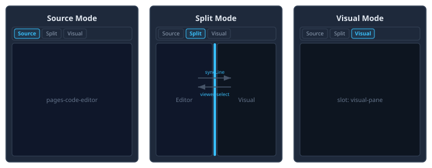

# One Viewer to Rule Them All

The pages platform has had a split view for playbooks since `playbook-split-view` landed — YAML on the left, visual step cards on the right, cursor linked between them. It works. But it's hardcoded to playbook step sequences, lives in `pages-step-viewer`, and can't be reused for page layouts, case definitions, or agent descriptors.

Meanwhile the playbook controller manages its YAML viewer through raw `document.createElement` calls, manual position tracking, dock/undock state, and snap-to-controller logic spread across 60 lines of imperative DOM manipulation. Every new artifact type that wanted the same split-view experience would need to build its own version from scratch.

The three-way viewer extracts the pattern into a generic component.

## What It Is

A new package — `@casehubio/pages-three-way-viewer` — with three pieces:

**ViewerController** is a pure state machine. Three states: Source, Split, Visual. It tracks mode and split ratio, remembers the ratio across mode transitions, fires a callback on change. No DOM dependency — it's independently testable and reusable. The playbook controller could adopt it to replace its ad-hoc `_yamlOpen` / `_docked` state management.

**The sync protocol** defines how the two panes talk to each other. Visual renderers implement `syncLine(line: number)` to highlight the element at a given YAML line. They dispatch `viewer-select` events with `{line, endLine}` when clicked. The three-way-viewer listens for cursor movement in the editor and calls `syncLine`; it listens for `viewer-select` and scrolls the editor. Any renderer that implements the interface gets linked navigation for free. Renderers that don't implement it still work — they just don't get sync.

**The `<pages-three-way-viewer>` component** ties it together. It embeds `pages-code-editor` for the editor pane, accepts any visual renderer via a `visual-pane` slot, and manages mode switching through a compact toolbar.

## The Slot Problem

We ran into an interesting naming collision during design. "Slot" means three different things in this ecosystem: web component `<slot>` elements, work-slots for parallel development, and agent slots in eidos metadata. Using `slot="visual"` in the docs would have been ambiguous in every conversation about the component.

I settled on "pane" — editor pane, visual pane. The HTML attribute is `slot="visual-pane"`, which reads naturally and doesn't collide with anything. Small decision, but naming collisions in a multi-domain platform compound fast.

## What Comes Next

The component exists but nothing consumes it yet. The immediate follow-up is migrating `playbook-split-view` to become a thin wrapper — it would drop from 175 lines of layout and splitter code to a consumer that just wires `parseAndResolve` to the visual pane. The playbook controller's floating YAML viewer could adopt `ViewerController` for its mode state.

The more interesting direction is case definitions. The `casehub-diagram` component already renders case YAML as a visual graph with ELK auto-layout. Pairing it with the three-way viewer would give case authors the same edit-and-see experience that playbook authors have — YAML on the left, live graph on the right, click a node to jump to its definition.
