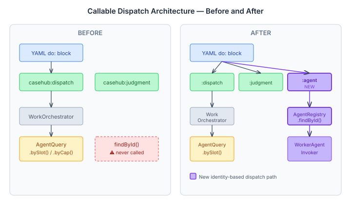

# The Dispatch Path Nobody Called

The engine had three ways to invoke an eidos agent from YAML: by slot, by capability, and eagerly from Java. All three went through `AgentQuery` — slot-based lookup, capability-and-domain matching, or a pre-built invoker. `AgentRegistry.findById()` sat there in the API, taking an `agentId` and a `tenancyId`, returning an `Optional<AgentDescriptor>`. Nothing called it.

The original issue described the fix as a new `WorkerFunctionProvider` — same kind of class as `AgentWorkerFunctionProvider` and `FlowWorkerFunctionProvider`. First-principles analysis said otherwise. The gap wasn't at the provider level (top-level worker definitions). It was at the callable dispatch level — inside `do:` blocks, where flow steps call out to other systems via `call: casehub:dispatch` and `call: casehub:judgment`.



A flow `do:` block already had two dispatchers: `casehub:dispatch` for capability-based orchestration and `casehub:judgment` for inline judgment execution. What it couldn't do was call a specific named agent. If you wanted agent X, you had to define a top-level worker with `agent: { slot: X }`, bind it to a unique capability, then `call: casehub:dispatch` with that capability. Indirection upon indirection, when you already knew the agent's name.

## casehub:agent

The new dispatcher registers as `casehub:agent` in the `CallableDispatchRegistry` and takes an `agentId` directly:

```yaml
do:
  - classify:
      call: casehub:agent
      with:
        agentId: classifier-agent
        inputProjection: "{ subject: .subject }"
        outputProjection: "{ category: .category }"
```

Under the hood: `AgentRegistry.findById(agentId, tenancyId)` → render system prompt → build `WorkerAgentInvoker` with optional JQ projections → execute on a virtual thread. The tenancy comes from the case instance, resolved via the `FlowExecutionRegistry` — the same path `casehub:dispatch` uses.

## The Module Boundary Problem

The dispatcher needed types from two module families that never overlapped at compile scope. Flow infrastructure types (`CallableDispatchRegistry`, `FlowExecutionRegistry`, `FlowExecution`) live in `engine-support-core`. Eidos types (`AgentRegistry`, `SystemPromptRenderer`) come from `casehub-eidos-api`. The `runtime` module has eidos but `engine-support-core` is test-scoped there. The `flow` module has flow types but no eidos.

The fix was to put `CasehubAgentDispatch` in `engine-support-core` (alongside the other dispatchers — `engine-support-core` already had `casehub-eidos-api` as an optional dependency) and add `casehub-eidos-api` and `casehub-platform-agent-api` as compile dependencies to the `flow` module. The `FlowBeans` CDI producer in `flow` now injects `AgentRegistry`, `SystemPromptRenderer`, and `AgentProvider`, wiring the dispatcher at startup. The flow module's description was already outdated — it claimed to depend only on `casehub-engine-common` but already pulled in `engine-support-core`. Agent dispatch from flows is a natural evolution of that boundary.

## Startup Validation

The second piece was `AgentTaskBindingResolver` — a startup observer at `@Priority(2700)` that iterates all case definitions, finds `AgentTaskTarget` bindings, and queries `AgentRegistry` for matching agents by capability and domain. Unresolved bindings get a warning, not a failure — agents may register dynamically after startup. Advisory validation, not a gate.

The two features close different gaps. The dispatcher gives flows a direct, identity-based way to call agents. The resolver tells you at startup whether your capability-based bindings have agents behind them. One is for the author writing `do:` blocks; the other is for the operator deploying a case definition.
