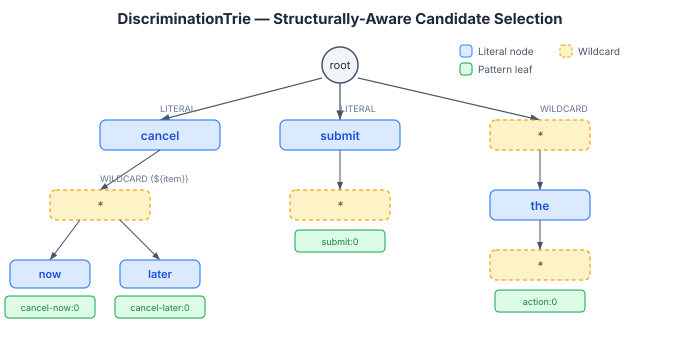

# Teaching the Template Matcher to Guess Better and Search Faster

CaseHub's template matching pipeline has had three tiers since the adaptive variation work: regex, keyword affinity with structural matching, and LLM classification. The gap between tiers 1 and 3 was both a coverage gap and a performance cliff. If keyword affinity filtered a pattern — because the input used "escalate" instead of "raise" — the system jumped straight to an LLM call. No middle ground.

Two changes landed today that fill that gap from opposite directions.

## The embedding rescue tier

The first problem: vocabulary gaps. A user says "escalate the manager" but the template says "Raising ${target} to ${level}". Keyword affinity scores this at zero — different lemmas, no overlap — and the pattern gets filtered before the structural matcher ever runs.

The new tier 2 sits between keyword affinity and LLM classification. When affinity filtering rejects a pattern, we compute cosine similarity between the template's keyword embeddings and the input's keyword embeddings via LangChain4j's `EmbeddingModel`. If the similarity exceeds a threshold, the structural matcher gets a second chance.

The interesting part isn't the rescue itself — it's the feedback loop. When an embedding-rescued pattern produces a structural match, the system batch-embeds the unmatched keyword pairs and stores any above-threshold pairs as learned synonyms. Those synonyms feed directly into the keyword affinity calculation on the next match attempt, via a new three-argument overload on `LemmatisedKeywordFilter.affinity()`. The system teaches itself to avoid the embedding tier for the same vocabulary gap in the future.

Thread safety matters here. The synonym map is `ConcurrentMap<String, ConcurrentMap<String, Set<String>>>` with `ConcurrentHashMap.newKeySet()` for the innermost sets — three layers of concurrent structures because synonym learning can happen on any match call from any virtual thread.

The implementation lives entirely in `template-registry-llm`, preserving the module boundary. `NlpTemplateRegistry` in the base `template-registry` module gained only protected accessors (`tokenizer()`, `affinityThreshold()`, `scoreThreshold()`, `nlpCompiled()`) so the subclass can replicate its matching loop with the rescue insertion. No LangChain4j imports leak into the base module.

One thing Claude caught during review: the initial embedding cache design used `(namespace, input)` as the cache key — shared across all templates in a namespace. The first template's negative result would block every subsequent template from being checked. We removed the per-pattern cache entirely. The input embedding is already computed once per match invocation via a local variable; the per-template similarity check is just a dot product.

## The discrimination trie

The second problem: scale. The keyword affinity check iterates every template, every pattern, computing bag-of-words overlap. At 10–50 templates this is fine. At 100+ it becomes the dominant cost per match.

The discrimination trie replaces that linear scan with a positional lookup. It's not a standard string trie — it encodes the template's structural element sequence, interleaving literal nodes (keyed by lemma) with wildcard nodes (representing variable/clause slots).

For template `"Cancel ${item} now"`, the trie path is `LITERAL(cancel) → WILDCARD → LITERAL(now) → leaf`. For `"${action} the ${target}"`, it's `WILDCARD → LITERAL(the) → WILDCARD → leaf`. Templates sharing a prefix share trie nodes.

The walk mirrors `StructuralMatcher.captureClause()` semantics. At a wildcard node, the walker scans ahead in the input tokens for any child literal's lemma, branching depth-first on shortest skip. The branching factor is bounded by distinct next-literals across patterns sharing a prefix — typically 2–5.

The key design question was whether the trie should encode structural position or just keyword presence. I was initially drawn to keyword-only indexing, but that loses the relationship between keywords and variable slots. Two templates with the same keywords in different positions (`"Cancel ${item} now"` vs `"Cancel now ${item}"`) would be indistinguishable. The structurally-aware approach discriminates on where the literals appear relative to the variables — which is exactly what the structural matcher checks.

Activation is threshold-based: below 100 patterns per namespace, the existing bag-of-words loop runs unchanged. Above the threshold, `NlpTemplateRegistry.matchInNamespace()` delegates to the trie. The trie is per-namespace, immutable after construction (mutable builder → frozen via `Map.copyOf`), and rebuilt on register/deregister/replace. At the target scale, construction is microseconds.

One subtlety: optional template elements. The trie build skips optional literals entirely — they don't constrain candidate selection. This means the trie is slightly more permissive than keyword affinity (it may return candidates whose optional literals don't match), but the structural matcher validates those precisely. The alternative was branching on optionality during the trie walk, which added complexity for marginal discrimination value.

## How they fit together

The two features are independent by design. The trie operates at the `NlpTemplateRegistry` level; embedding rescue operates at the `AdaptiveTemplateRegistry` level (a subclass). When the trie is active for a namespace, it replaces keyword affinity filtering as the candidate selector. Embedding rescue remains available for the patterns the trie doesn't match, but the interaction isn't pre-engineered — the LLM fallback tier still catches what both miss.

This was a deliberate scoping choice. I was tempted to design the trie-embedding interaction upfront, but the two features serve different purposes (performance vs vocabulary coverage), and there's no evidence yet that large registries also have significant synonym gap problems. If that turns out to be the case, the integration point is clean — the trie's candidate set could feed embedding rescue for non-candidates — but speculating about it now would be designing for a scenario I can't verify.

The branch carries 1,679 lines across 18 files, with 106 new tests. The heaviest single change is `AdaptiveTemplateRegistry` — it went from 236 lines to nearly 500 to accommodate the embedding rescue override of `matchInNamespace()`, the synonym learning logic, the per-template embedding lifecycle, and the trace diagnostics override.
