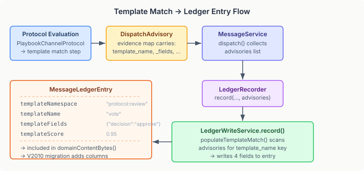

# From Prose to Structured Evidence: Template Match Fields in the Ledger

The normative ledger has always recorded speech acts — "agent sent DONE on this channel with this content." That tells you something happened. It does not tell you what was decided. When an agent writes "I approve the architecture because it handles failover gracefully," the governance act is buried in prose. A human can read it. A database query cannot.

We closed that gap. The ledger now carries structured governance evidence extracted by protocol template matching: the namespace, the template name, the extracted fields as JSON, and the match confidence score. "Show me all approve votes on this channel" becomes a column filter, not a text search.

## The design question was about plumbing

The interesting part was not the four columns — those are straightforward nullable fields on `MessageLedgerEntry`. The interesting part was how to get the match result from where it's computed (protocol evaluation, deep in the dispatch pipeline) to where it's recorded (ledger write, in a separate `REQUIRES_NEW` transaction).

Three options were on the table:

1. **Extend `DispatchAdvisory.evidence()` map** — the advisory pipeline already flows through dispatch; just carry the match metadata in the evidence map that advisories already have.
2. **Add a `TemplateMatch` type to `DispatchResult`** — cleaner typing, but requires new types and touches the API module.
3. **New field on `MessageDispatch`** — populated by the enforcement pipeline mid-dispatch.

I went with option 1. The advisory system is designed for exactly this kind of metadata — it flows naturally through the pipeline, the evidence map is already `Map<String, Object>`, and no new types are needed. The extraction logic in `LedgerWriteService` scans advisories for the first one whose evidence map contains a `template_name` key, then pulls out the four fields.

## What the extraction looks like

The `populateTemplateMatch()` method does defensive extraction: null-safe, instanceof checks on every evidence value, String passthrough for pre-serialised JSON (avoids double-encoding), and first-match-wins with early return. A playbook that produces an advisory with `template_name` in its evidence map automatically gets its match recorded in the ledger — no registration, no configuration.

The evidence key convention:

- `template_namespace` — e.g. `"protocol:review"`
- `template_name` — e.g. `"vote"`
- `template_fields` — a Map (serialised to JSON) or a pre-serialised JSON string
- `template_score` — a Number, typically 1.0 for regex matches, lower for NLP

## Hash chain integrity

Template fields participate in `domainContentBytes()` — the canonical byte representation used for the Merkle hash chain. They use a conditional `|T:` prefix, same pattern as the judgment fields (`|J:`). When no template match exists, the hash is identical to before. Backward compatible by construction.

## What this opens up

Content-level governance queries against the ledger. Compliance reports can enumerate every structured decision on a channel without parsing prose. Watchdog conditions could fire on specific template field values — not just message types. The gap between "we know agents communicated" and "we know what was decided" gets smaller with each field the ledger captures.
