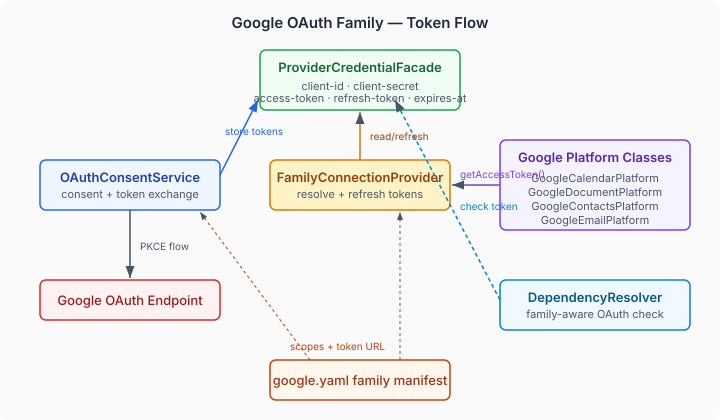

# One Consent to Rule Them All

Four Google connectors — Calendar, Drive, Contacts, Gmail — each needing the same OAuth2 credentials. Each independently asking for client-id, client-secret, refresh-token. The family manifest concept had been in place for a while: `google.yaml` declared the shared scopes and OAuth endpoints, and `enrichWithFamily()` wired the family config into individual connector manifests at load time. But the end-to-end flow — authenticate once, all four connectors light up — wasn't connected.

The gap was between two credential systems. The connector lifecycle stored tokens in `ProviderCredentialFacade` (a file-backed YAML store). The Google platform classes read tokens via `ServiceConnectionProvider` from platform-api, backed by `OAuthTokenStore` in the platform's authn module. Two stores, no bridge.

## The Design That Didn't Survive Review

The first instinct was straightforward: make `OAuthConsentService` write to both stores. Consent flow exchanges the authorization code, stores tokens in `ProviderCredentialFacade` as it already does, and additionally writes an `OAuthTokenRecord` into the platform's `OAuthTokenStore`. The platform's `OAuthTokenManagerCore` handles refresh from there.

Claude ran a decision review against this. The reviewer found a data model mismatch I hadn't considered: `OAuthTokenStore` is per-actor — every record is keyed by `actorId`, `provider`, `tenancyId`. The consent flow stores under `actorId="system"`. But `GoogleCalendarPlatform` calls `getAccessToken(userId, "google", "default")` with the actual user's ID. Tokens stored under "system" would never be found by a user-scoped lookup.

The reviewer also pointed out a dependency direction problem. The planned refresh fallback required platform code to read from `ProviderCredentialFacade`, which lives in `connectors-api`. Platform can't depend on connectors — the arrow goes the other way.

## FamilyConnectionProvider

The solution was to keep everything connector-side. `FamilyConnectionProvider` implements `ServiceConnectionProvider` (the platform interface) but reads tokens from `ProviderCredentialFacade` and handles refresh internally. No platform-side changes needed.

Token refresh reuses the same HTTP call pattern as `OAuthConsentService` — POST to the family manifest's token URL with the stored refresh-token and client credentials. A per-provider lock prevents concurrent refresh attempts from racing on token rotation, which matters because Google may rotate the refresh token on each use.

The class is annotated `@ApplicationScoped @DefaultBean`. In standalone deployments, it's the `ServiceConnectionProvider`. In full-platform deployments where `ServiceConnectionProviderCore` exists, the platform bean takes priority. CDI handles the override automatically.

## Incremental Consent with an Upfront Default

Google supports incremental consent — you can request additional scopes on top of an existing grant by passing `include_granted_scopes=true`. The family manifest declares `consent: incremental`, and `OAuthConsentService` now reads this and appends the parameter.

The default path requests all eight family scopes in a single consent screen. One click, all four connectors activated. But `buildAuthorizationUrl` now accepts an optional scope override for per-connector consent — if someone only wants Calendar, they get only Calendar's two scopes, and can add Drive later without re-authenticating from scratch.

The consent flow also now stores `expires-at` and `granted-scopes` in the credential facade, which `FamilyConnectionProvider` uses for expiry-based refresh and scope tracking.

## Family-Aware Dependency Resolution

`DependencyResolver` already handled `requires` / `provides` matching — Signal needs SMS, TrueLayer needs email. But OAuth family dependencies were invisible to it. A connector with `auth.family: google` and no access token had no way to surface "you need to run the Google consent flow" through `unmetRequirements()`.

Rather than adding explicit `requires: [{capability: oauth2, sub: [google]}]` to each manifest (which would need a virtual provider for resolution), `DependencyResolver` now auto-infers the requirement. During construction it scans manifests for `auth.type: oauth2` + `auth.family`. In `unmetRequirements()`, it checks the credential facade for an access token under the family's credential key. If missing, it returns a `FamilyOAuthOption` — a new `ResolutionOption` variant that names the family and all its member connectors.

This keeps the unified dependency view without redundant declarations. An agent calling `unmetRequirements("calendar-google")` gets back "needs oauth2 consent for google family (calendar-google, document-google, contacts-google, email-google)" with a resolution path through `credentialInput`.

The three new connector manifests are minimal — `auth.type: oauth2`, `auth.family: google`, plus `provides` declarations. `enrichWithFamily()` fills in the OAuth config and shared fields from the family manifest. The email-google manifest was simplified to match — its redundant field declarations were dead code after family enrichment anyway.
