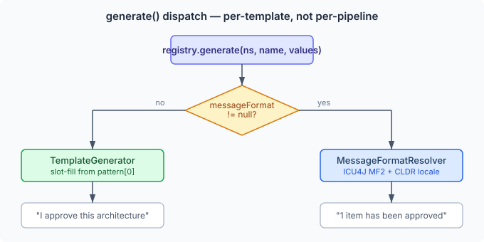

# Slot-Filling Meets CLDR — Why MF2 Is Per-Template, Not a Pipeline Stage

The template registry has two generation modes that look similar from the outside but solve fundamentally different problems. I spent most of this session figuring out where the boundary actually is.

The registry's existing `generate()` method does slot-filling: take a template pattern like `"I ${decision} this ${subject}"`, substitute the variables, return the surface form. The template IS the grammar — every variable position accepts any string value and produces correct English. This works for governed protocol vocabulary where agents must produce structurally predictable prose.

It falls apart the moment a template involves quantity. `"${count} items have been ${action}"` produces "1 items have been approved" — grammatically wrong in English and catastrophically wrong in languages with complex plural rules. Russian has four plural categories. Arabic has six. Welsh distinguishes zero, one, two, few, many, and other. Simple substitution can't handle this because the correct surface form depends on the *value* of the variable, not just its *position*.



This is exactly what ICU MessageFormat 2.0 solves. MF2 is a Unicode standard (stable since CLDR 47) for data-driven message selection — given variable values and a locale, it chooses the right variant from a pre-defined set. The MF2 pattern for that item-count template:

```
.input {$count :integer}
.match $count
1 {{{$count} item has been {$action}}}
* {{{$count} items have been {$action}}}
```

`.input` declares the variable and its function (`:integer` for plural selection via CLDR rules). `.match` selects on the declared variable. No explicit plural logic — the locale data handles everything. French works identically:

```
.input {$count :integer}
.match $count
1 {{{$count} élément a été {$action}}}
* {{{$count} éléments ont été {$action}}}
```

## The key design insight

The first instinct was to treat MF2 as a pipeline stage — slot-fill first, then run MF2 formatting on the result. This doesn't work because MF2 needs the raw variable values to select the right variant. If slot-filling has already substituted `${count}` with `"5"`, MF2 receives a plain string with no variable to select on.

The right model is per-template dispatch. Each `TemplateDefinition` optionally carries an MF2 message pattern alongside its matching patterns. `generate()` checks: does this template have a `messageFormat`? If yes, delegate to MF2. If no, slot-fill as before.

```java
// Protocol template — slot-fill, no MF2 needed
TemplateDefinition.builder("vote")
    .pattern("I ${decision} this ${subject}")
    .build();

// Quantity template — MF2 for locale-aware generation
TemplateDefinition.builder("item-count")
    .pattern("${count} items have been ${action}")
    .messageFormat(".input {$count :integer}\n.match $count\n1 ...")
    .build();
```

Matching is unchanged — both templates use regex and NLP structural patterns for input extraction. The divergence is only on the generation path. MF2 syntax isn't designed for extraction (its `.input`/`.match` structure selects *output* forms, not *input* patterns), so the two concerns stay cleanly separated.

## Where the reviews bit

Two adversarial reviews caught real problems. The decision review identified that putting a nullable `MessageFormatResolver` on `InMemoryTemplateRegistry`'s constructor contradicted a pattern the same codebase had explicitly rejected three issues earlier. The fix: MF2 lives in `NlpTemplateRegistry` (the extension subclass), not the base class. The base class just gets a fail-fast guard — if someone registers an MF2 template on bare `InMemoryTemplateRegistry`, it throws instead of silently producing broken output.

The spec review caught that my YAML examples used MF1 function names (`:plural`, `:select`) and the `when` keyword — both removed from the final MF2 specification. MF2 uses `:integer` for plurals and `:string` for gender selection, with variant keys directly preceding the pattern. And it turned out the syntax had a further wrinkle: ICU4J 79.1 requires `.input` declarations for variable annotations, with `.match` referencing the bare variable name — not `.match {$var :function}` as the earlier spec drafts showed. The implementation tests caught this immediately.

## The SPI design

`MessageFormatResolver` follows the `MatchingStrategy` pattern — multi-method interface with separate compilation and formatting phases. `compile()` runs at registration time (parsing, validation, locale binding), returning an opaque `CompiledMessage` handle. `format()` runs at generation time with the pre-compiled handle and string values. Type coercion (strings to numbers for `:integer` selectors) happens inside the resolver, keeping the public API at `Map<String, String>` for consistency with the matching side.

ICU4J 79.1 provides the implementation. The MF2 spec is stable; the Java API is at Draft status (promoted from tech preview). The `MessageFormatResolver` SPI insulates the platform — if ICU4J's API changes, only the adapter internals change.

The implementation sits in a new `template-registry-mf2` module, classpath-activated like `template-registry-nlp-svo`. Add the module, MF2 generation activates. Remove it, templates with `messageFormat` fail at registration with a clear error. No silent degradation.
