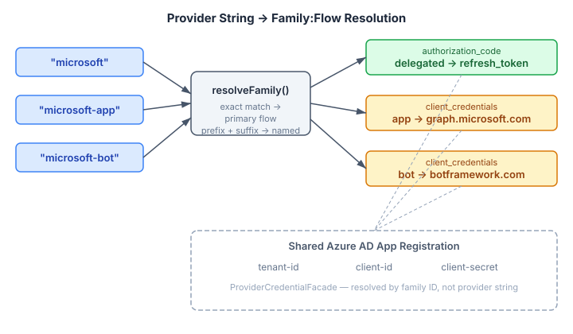
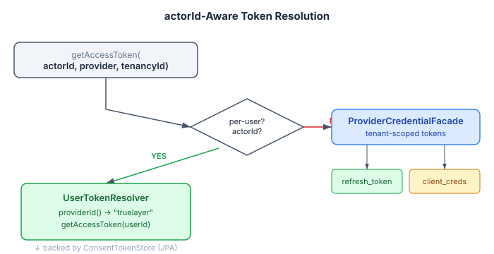

# Three Flows, One Family

The Google family manifest worked because Google's OAuth model is simple: one app registration, one authorization_code flow, one token per family. Every Google module — Calendar, Drive, Contacts, Gmail — authenticates the same way. The family manifest declares the shared OAuth endpoints and scopes, `FamilyConnectionProvider` resolves the token, done.

Microsoft broke that simplicity. Same single Azure AD app registration, same client-id and client-secret — but three distinct OAuth flows through it.

Teams reads channels and presence via a delegated token (user-consented, authorization_code grant). It sends messages and manages reactions via an application token (client_credentials, no user involved — tenant admin grants the permissions). And its Bot Framework client authenticates against a completely different token endpoint (`botframework.com` instead of the tenant-specific `login.microsoftonline.com/{tenant-id}`). Calendar, Mail, and OneDrive only need the delegated flow.

One app registration. Three grant types. Three different scopes. Two different token endpoints.

## Named Flows

The solution was to extend `FamilyManifest` with named flows. Instead of a single `OAuthDeclaration` per family, the manifest now carries a `Map<String, FlowDeclaration>` where each flow declares its grant type, scopes, and an optional token-url override:

```yaml
family:
  id: microsoft
  flows:
    delegated:
      grant: authorization_code
      scopes: [Calendars.ReadWrite, Mail.Read, ...]
    app:
      grant: client_credentials
      scopes: ["https://graph.microsoft.com/.default"]
    bot:
      grant: client_credentials
      scopes: ["https://api.botframework.com/.default"]
      token-url: "https://login.microsoftonline.com/botframework.com/oauth2/v2.0/token"
```

The top-level `oauth` block carries the shared defaults (auth-url, token-url, redirect-uri). Flows inherit from it unless they override — the bot flow overrides `token-url` because Bot Framework uses a different tenant path.

Each connector manifest declares which flows it needs: `flows: [delegated]` for Calendar, `flows: [delegated, app, bot]` for Teams. Google modules don't declare flows at all — backward compatible, single implicit flow.

## Convention Over Configuration

The existing code in `TeamsChatPlatform` already used distinct provider strings: `"microsoft"` for the delegated token, `"microsoft-app"` for application, `"microsoft-bot"` for the bot. These followed a natural convention — `{familyId}-{flowSuffix}`.

`FamilyConnectionProvider.resolveFamily()` now parses provider strings against that convention. Exact match (`"microsoft"`) returns the primary flow. Prefix match with suffix lookup (`"microsoft-app"` → family `"microsoft"`, flow `"app"`) returns the named flow. No code changes in Teams — the provider strings it already uses just work.



The `client_credentials` path was the other half. `FamilyConnectionProvider` had only handled `refresh_token` grants (for expired delegated tokens). Now it detects the flow's grant type and routes accordingly — `client_credentials` POSTs directly to the token endpoint with the shared client-id and client-secret, no user consent involved.

## The Bug That Almost Shipped

Claude caught a real problem during the wrap review. The token URL for the `app` flow inherits from the family's top-level `oauth.token-url`, which contains `{tenant-id}` — a template variable that needs resolving from the credential facade. The `acquireApplicationToken` method was using the URL raw, which would have produced a DNS lookup for the literal string `{tenant-id}`.

The fix was a `resolveTokenUrl()` helper that walks the URL looking for `{variable}` patterns and resolves each from the credential facade. The same bug existed pre-#376 in `doRefresh()` — it had been harmless because Google's token URL contains no templates, but Microsoft's does. Both paths use the helper now.

## Per-User Consent — the TrueLayer Design

The Microsoft work exposed a bigger question. TrueLayer's PSD2 consent is per-user: each user grants access to their own bank account, and the consent token is stored by user ID. But `FamilyConnectionProvider` stored everything per-provider — one token per family, shared across all callers.

I looked at the `ServiceConnectionProvider` interface. Its signature: `getAccessToken(actorId, provider, tenancyId)`. Every caller — Google, Microsoft, TrueLayer — already passes `userId` as `actorId`. Every implementation ignores it.

The interface was designed for per-user resolution. The implementation gap was in `FamilyConnectionProvider`, which treats all tokens as tenant-scoped. The fix was a `UserTokenResolver` CDI SPI — a single interface with `providerId()` and `getAccessToken(userId)`. Provider modules implement it. `FamilyConnectionProvider` discovers beans at startup and routes per-user requests through them when the flow declares `per-user: true`.



`TrueLayerConsentService` already had a `getUserToken(userId)` method that checks expiry, refreshes if needed, and returns the access token. Making it implement `UserTokenResolver` was ten lines — exposing the existing method through the SPI. No changes to its internals, no changes to `ConsentTokenStore`, no forcing per-user tokens into the tenant credential facade.

The routing itself is a guard clause at the top of `getAccessToken`: if `actorId` is non-null and the resolved flow is per-user, delegate to the resolver. If `actorId` is null, fall through to the tenant path. Every caller already passes `userId` as `actorId` — the interface was designed for this from day one, the implementation just never used it.

`DependencyResolver` needed the same awareness. For per-user flows, it checks whether a `UserTokenResolver` bean exists for that provider rather than looking for a stored access-token in the credential facade. The credential facade still handles client-id and client-secret — the shared app registration — but per-user consent tokens live in their own lifecycle.

The per-user model matters beyond TrueLayer. Google's `GoogleCredentialResolver` CDI SPI does per-user credential resolution too. Flipping Google's flows to `per-user: true` is a future option — same mechanism, different provider.

## What Landed

The Microsoft branch: `FlowDeclaration` and `GrantType` in `FamilyManifest`. The updated `microsoft.yaml`. Connector manifests for Calendar, Document, and Teams. `resolveFamily()` for convention-based routing. `acquireApplicationToken()` for client_credentials. `DependencyResolver` checking per-flow requirements. `OAuthConsentService` reading scopes from the named delegated flow.

The TrueLayer branch: `UserTokenResolver` SPI in `connectors-api`. `per-user: true` on `FlowDeclaration` with Jackson deserialization and a boolean accessor that defaults to false. `FamilyConnectionProvider` with a three-arg constructor, CDI discovery of resolver beans, and the actorId-aware guard clause. `TrueLayerConsentService` implementing the SPI. `DependencyResolver` with per-user flow awareness. A `truelayer.yaml` family manifest declaring the per-user delegated flow.

The code review caught one real bug — `Instance.isResolvable()` returns true only for exactly one CDI bean. With multiple `UserTokenResolver` implementations the resolver map would silently stay empty. The fix: `!instances.isUnsatisfied()`.
